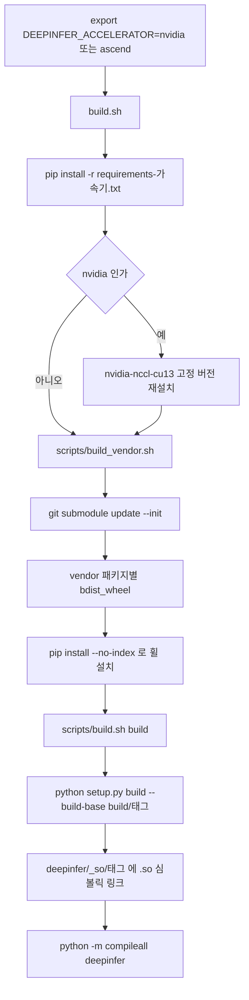

소스에서 C++ 확장과 커널을 빌드하는 순서를 정리한다.

## 빌드 전체 흐름

`./build.sh` 한 번이 아래 순서를 모두 실행한다. 각 단계는 Makefile 타깃으로도 따로 돌릴 수 있다.



### 코드 분석: build.sh

최상위 [build.sh#L5-L25](https://github.com/deepseek-ai/DeepInfer/blob/a679bb86ce36e883a98a97733492b686e5b9a08e/build.sh#L5-L25)에서 가속기 변수 검사와 세 단계 호출을 본다.

```bash
case "${DEEPINFER_ACCELERATOR:-}" in
    nvidia|ascend) ;;
    *)
        echo "Usage: DEEPINFER_ACCELERATOR=nvidia|ascend $0" >&2
        exit 1
        ;;
esac

# Install other Python dependencies
pip install -r "requirements-${DEEPINFER_ACCELERATOR}.txt"

if [ "${DEEPINFER_ACCELERATOR}" = nvidia ]; then
    # Patch NCCL to 2.32.3
    pip install --no-deps --force-reinstall nvidia-nccl-cu13==2.32.3
fi

# Build and install vendored dependencies
bash ./scripts/build_vendor.sh

# Build DeepInfer
bash ./scripts/build.sh build
```

최상위 스크립트는 `DEEPINFER_ACCELERATOR`가 비어 있으면 바로 실패한다. 반면 하위 스크립트(`scripts/build.sh`, `scripts/build_vendor.sh`)는 `${DEEPINFER_ACCELERATOR:-nvidia}`로 기본값을 nvidia로 잡는다. Makefile로 하위 단계만 돌릴 때는 타깃 이름이 이 변수를 대신 넣어 준다. NVIDIA 쪽은 torch 휠이 끌고 오는 NCCL을 `--no-deps --force-reinstall`로 2.32.3에 덮어쓴다는 점이 눈에 띈다. 왜 이 버전이어야 하는지는 코드 주석에 없다.

### requirements 계층

의존성 파일은 `-r`로 이어지는 3단 구조다.

| 파일 | 상위 | 내용 |
| --- | --- | --- |
| [requirements.txt](https://github.com/deepseek-ai/DeepInfer/blob/a679bb86ce36e883a98a97733492b686e5b9a08e/requirements.txt#L1-L21) | 없음 | 런타임 의존성 21개. `transformers==4.50.0`, `tokenizers==0.21.4`, `xgrammar==0.2.2`, `tilelang==0.1.15`, `tile-kernels==2.1.0`, `pyzmq`, `posix_ipc` 등. `setup.py`의 `install_requires`가 이 파일을 읽는다 |
| [requirements-dev.txt](https://github.com/deepseek-ai/DeepInfer/blob/a679bb86ce36e883a98a97733492b686e5b9a08e/requirements-dev.txt#L1-L19) | requirements.txt | `pytest`, `ruff`, `pybind11-stubgen`, vendor stub 생성용 `tree-sitter`, sweep 그림용 `matplotlib`, 런타임 프로파일 HTTP 서버용 `fastapi`, `uvicorn` |
| [requirements-nvidia.txt](https://github.com/deepseek-ai/DeepInfer/blob/a679bb86ce36e883a98a97733492b686e5b9a08e/requirements-nvidia.txt#L1-L5) | requirements-dev.txt | `torch==2.13.0+cu132`, `flash-attn-4==4.0.0b34` |
| [requirements-ascend.txt](https://github.com/deepseek-ai/DeepInfer/blob/a679bb86ce36e883a98a97733492b686e5b9a08e/requirements-ascend.txt#L1-L4) | requirements-dev.txt | `torch==2.13.0+cpu`, `torch-npu==2.13.0rc1` |

가속기별 파일이 dev 파일을 포함하므로 `build.sh`로 설치하면 개발 도구까지 함께 깔린다. 모든 버전이 `==`로 고정돼 있어 다른 프로젝트와 같은 환경에 섞기 어렵다. README가 "빈 Python 3.12 환경"을 요구하는 이유로 읽힌다(추정).

### vendor 서브모듈 빌드

DeepInfer가 직접 쓰는 커널 라이브러리는 `vendor/` 아래 git 서브모듈로 들어 있다([.gitmodules](https://github.com/deepseek-ai/DeepInfer/blob/a679bb86ce36e883a98a97733492b686e5b9a08e/.gitmodules)). `scripts/build_vendor.sh`가 가속기에 따라 빌드할 묶음을 고른다([scripts/build_vendor.sh#L7-L22](https://github.com/deepseek-ai/DeepInfer/blob/a679bb86ce36e883a98a97733492b686e5b9a08e/scripts/build_vendor.sh#L7-L22)).

| 가속기 | `BUILD_TARGET` | 빌드하는 서브모듈 | 설치되는 파이썬 패키지 |
| --- | --- | --- | --- |
| nvidia | `CUDA` | DeepSelect, FlashMLA, DeepEP, DeepGEMM | `deep_select`, `flash_mla`, `deep_ep`, `deep_gemm` |
| ascend | `ASCEND` | DeepSelect, FlashMLA, DeepEP-Ascend, DeepGEMM-Ascend | `deep_select`, `flash_mla`, `deep_ep`, `deep_gemm` |

설치되는 패키지 이름이 두 가속기에서 같다는 점이 중요하다. 엔진 코드는 `import deep_gemm`, `import deep_ep`만 하고, 어느 구현이 깔렸는지는 빌드 시점에 정해진다. 하드웨어 이원화는 11장에서 다룬다.

아래는 패키지별 휠을 만드는 루프다([scripts/build_vendor.sh#L38-L53](https://github.com/deepseek-ai/DeepInfer/blob/a679bb86ce36e883a98a97733492b686e5b9a08e/scripts/build_vendor.sh#L38-L53)).

```bash
mkdir -p "${WHEEL_DIR}"
for pkg in "${PACKAGES[@]}"; do
  echo "🔧 Building ${pkg} (${BUILD_TARGET}) ..."
  envs=()
  var="$(target_var "${pkg}")"
  [ -n "${var}" ] && envs+=("${var}=${BUILD_TARGET}")
  [ "${pkg}" = DeepGEMM ] && envs+=(DG_FORCE_BUILD=1)
  (
    cd "${VENDOR_DIR}/${pkg}"
    git submodule update --init --recursive
    env "${envs[@]}" python setup.py bdist_wheel --dist-dir "${WHEEL_DIR}"
  )
done

echo "📦 Installing wheels from ${WHEEL_DIR} ..."
python -m pip install --no-deps --no-index --find-links "${WHEEL_DIR}" "${INSTALL[@]}"
```

DeepSelect와 FlashMLA는 한 저장소가 두 가속기를 모두 지원하므로 `DEEP_SELECT_BUILD_TARGET_PLATFORM`, `FLASH_MLA_BUILD_TARGET_PLATFORM`으로 대상을 넘긴다. DeepEP와 DeepGEMM은 Ascend용 저장소가 따로 있어 변수 대신 서브모듈 자체를 바꾼다. 휠은 `build/<가속기>-<arch>/vendor-wheels`에 모이고 `--no-index`로 그 폴더에서만 설치하므로, 이 단계는 네트워크 없이 재현된다. 서브모듈 초기화(`git submodule update --init`)도 이 스크립트가 직접 하므로 클론할 때 `--recursive`를 빠뜨려도 빌드는 진행된다([scripts/build_vendor.sh#L27-L28](https://github.com/deepseek-ai/DeepInfer/blob/a679bb86ce36e883a98a97733492b686e5b9a08e/scripts/build_vendor.sh#L27-L28)).

### 확장 모듈 deepinfer._C

마지막 단계는 C++ 확장 `deepinfer._C`다. 3장의 스케줄러, 4장의 입력 메타데이터 준비, CUDA graph 타이머가 모두 여기에 들어 있다. [setup.py#L16-L36](https://github.com/deepseek-ai/DeepInfer/blob/a679bb86ce36e883a98a97733492b686e5b9a08e/setup.py#L16-L36)에서 공통 소스 목록을 본다.

```python
# Extension configuration shared by the CUDA and NPU backends.
COMMON_COMPILE_FLAGS = ["-O2", "-std=c++20", "-Wno-deprecated-declarations"]
ABI_FLAG = "-D_GLIBCXX_USE_CXX11_ABI=1"
assert torch._C._GLIBCXX_USE_CXX11_ABI, "must use CXX11 ABI"

CXX_FLAGS = ["-g1", *COMMON_COMPILE_FLAGS, ABI_FLAG]
COMMON_SOURCES = [
    "csrc/pybind.cpp",
    "csrc/engine/pybind.cpp",
    "csrc/engine/pybind_sequence.cpp",
    "csrc/engine/pybind_scheduler.cpp",
    "csrc/engine/pybind_output.cpp",
    "csrc/engine/zos.cpp",
    "csrc/engine/input_metadata/block_load_plan.cpp",
    "csrc/engine/input_metadata/prepare_tensor_input_base.cpp",
    "csrc/engine/input_metadata/prepare_tensor_input_v4.cpp",
    "csrc/engine/prepare_sample.cpp",
    "csrc/graph_timer/pybind.cpp",
]
```

소스가 모두 `.cpp`라는 점에 주목한다. `.cu` 파일이 없으므로 이 확장은 GPU 커널을 담지 않는다. 스케줄링, 시퀀스 상태, 입력 텐서를 CPU에서 채우는 일을 C++로 옮긴 것이고, GPU 연산은 vendor 라이브러리와 TileLang 커널이 맡는다. 가속기별로 덧붙는 파일은 둘뿐이다. NVIDIA는 `csrc/cuda_utils.cpp`와 `csrc/graph_timer/graph_timer_cuda.cpp`, Ascend는 `csrc/asc_utils.cpp`와 `csrc/graph_timer/graph_timer_asc.cpp`를 쓴다([setup.py#L38-L72](https://github.com/deepseek-ai/DeepInfer/blob/a679bb86ce36e883a98a97733492b686e5b9a08e/setup.py#L38-L72)). NVIDIA 쪽은 `libcuda.so`를 직접 링크하려고 `CUDA_HOME/lib64/stubs`를 라이브러리 경로에 넣는다.

빌드 산출물의 배치는 [scripts/build.sh#L11-L30](https://github.com/deepseek-ai/DeepInfer/blob/a679bb86ce36e883a98a97733492b686e5b9a08e/scripts/build.sh#L11-L30)이 정한다.

```bash
PY_BUILDTAG=$(python -c "import sys, sysconfig; print(f'{sysconfig.get_platform()}-{sys.implementation.cache_tag}')")
PLATFORM_TAG="${DEEPINFER_ACCELERATOR:-nvidia}-$(uname -m)"
BUILD_BASE="build/$PLATFORM_TAG"
SO_DST="deepinfer/_so/$PLATFORM_TAG"

_build() {
  set_max_jobs
  python setup.py build --build-base "$BUILD_BASE"
  (
    set +e
    set -x
    shopt -s failglob
    mkdir -p "$SO_DST"
    for so in "${BUILD_BASE}/lib.${PY_BUILDTAG}/deepinfer/"*.so; do
      ln -fs "$(realpath --relative-to="$SO_DST" "$so")" "$SO_DST/"
    done
  )
  [ -n "$(ls -A "$SO_DST")" ] || { echo "No .so was linked into $SO_DST" >&2; exit 1; }
  python -m compileall deepinfer -j "$MAX_JOBS" -q
}
```

`pip install`이 아니라 `setup.py build`만 하고, 결과 `.so`를 소스 트리 안 `deepinfer/_so/<가속기>-<arch>/`에 심볼릭 링크로 건다. 병렬 컴파일 수는 `MAX_JOBS`로 조절하고 기본값은 16이다([scripts/build.sh#L6-L9](https://github.com/deepseek-ai/DeepInfer/blob/a679bb86ce36e883a98a97733492b686e5b9a08e/scripts/build.sh#L6-L9)). 런타임은 [deepinfer/__init__.py#L9-L32](https://github.com/deepseek-ai/DeepInfer/blob/a679bb86ce36e883a98a97733492b686e5b9a08e/deepinfer/__init__.py#L9-L32)에서 이 폴더를 패키지 검색 경로에 붙인다.

```python
def _so_platform_tag() -> str:
    accelerator = envs.DEEPINFER_ACCELERATOR
    if not accelerator:
        try:
            from deep_cluster.hardware import accelerator_kind

            accelerator = accelerator_kind()
        except Exception:
            accelerator = ""
    if accelerator not in ("nvidia", "ascend"):
        accelerator = "nvidia"  # 无加速卡 / 探测失败：缺省按 nvidia
    return f"{accelerator}-{os.uname().machine}"


_so_dir = os.path.join(os.path.dirname(__file__), "_so", _so_platform_tag())
if os.path.isdir(_so_dir):
    __path__.append(_so_dir)
```

`__path__.append`로 하위 디렉터리를 패키지 경로에 더하면 `import deepinfer._C`가 그 폴더의 `.so`를 찾는다. 주석은 같은 아키텍처의 nvidia 빌드와 ascend 빌드가 한 소스 트리에 공존할 수 있게 하려는 배치라고 설명한다. 같은 이유로 `examples/_config.py`가 저장소 루트를 `sys.path`에 넣어서, 예제는 `pip install -e .` 없이 소스 트리에서 바로 돈다([examples/_config.py#L17-L24](https://github.com/deepseek-ai/DeepInfer/blob/a679bb86ce36e883a98a97733492b686e5b9a08e/examples/_config.py#L17-L24)).

> **주의**: `envs.DEEPINFER_ACCELERATOR`의 기본값은 `"nvidia"`다([deepinfer/environ.py#L108](https://github.com/deepseek-ai/DeepInfer/blob/a679bb86ce36e883a98a97733492b686e5b9a08e/deepinfer/environ.py#L108)). 그래서 위 코드의 `if not accelerator:` 분기는 변수가 빈 문자열로 명시된 경우에만 하드웨어 탐지로 넘어간다. Ascend 머신에서 변수를 export하지 않으면 `nvidia-<arch>` 폴더를 찾게 된다. README가 "DeepInfer를 실행하는 환경에서도 export를 유지하라"고 적은 이유다.

### setup.py와 빌드 스크립트의 가속기 판정 차이

빌드 스크립트는 환경 변수를 보지만 `setup.py`는 하드웨어를 직접 본다([setup.py#L10-L12](https://github.com/deepseek-ai/DeepInfer/blob/a679bb86ce36e883a98a97733492b686e5b9a08e/setup.py#L10-L12)).

```python
from deep_cluster.hardware import accelerator_kind

IS_NPU = accelerator_kind() == "ascend"
```

`accelerator_kind()`는 `/dev/davinci_manager` 같은 장치 노드로 Ascend를 먼저 확인하고, 다음으로 NVIDIA를 확인하며, 둘 다 없으면 `"cpu"`를 돌려준다([deep_cluster/hardware/device.py#L18-L23](https://github.com/deepseek-ai/DeepInfer/blob/a679bb86ce36e883a98a97733492b686e5b9a08e/deep_cluster/hardware/device.py#L18-L23)). 따라서 확장의 종류(NpuExtension 또는 CUDAExtension)는 빌드하는 머신의 장치가 결정하고, 산출물이 놓일 폴더 이름은 환경 변수가 결정한다.

> **주의**: 장치가 없는 빌드 머신에서 `DEEPINFER_ACCELERATOR=ascend`로 빌드하면 `IS_NPU`가 거짓이 되어 CUDA 확장이 `ascend-<arch>` 폴더에 링크될 수 있다(추정). 코드상 두 판단을 맞추는 검사는 없다. 빌드는 대상 장치가 있는 머신에서 하는 것이 안전하다.

### Makefile 타깃

[Makefile#L1-L32](https://github.com/deepseek-ai/DeepInfer/blob/a679bb86ce36e883a98a97733492b686e5b9a08e/Makefile#L1-L32)은 위 단계를 개별로 다시 돌릴 때 쓴다.

| 타깃 | 실행 내용 | 쓰는 때 |
| --- | --- | --- |
| `build-nvidia`, `build-ascend` | `DEEPINFER_ACCELERATOR=<가속기> scripts/build.sh build` | `csrc/` C++ 코드만 고쳤을 때 확장 재빌드 |
| `vendor-nvidia`, `vendor-ascend` | `scripts/build_vendor.sh` | 서브모듈 커밋을 올렸을 때 vendor 휠 재빌드 |
| `clean` | `scripts/build.sh clean` 후 `deepinfer/*.so` 삭제 | 빌드 폴더, `_so` 링크, `__pycache__` 제거 |
| `stubgen` | `scripts/gen_stub.sh` | `deepinfer/_C/*.pyi` 타입 스텁 재생성 |
| `format` | `ruff check --fix && ruff format`, `scripts/format_csrc.sh` | 파이썬과 C++ 포맷 정리 |

`deepinfer/_C/` 폴더에는 `__init__.pyi`, `engine.pyi`, `graph_timer.pyi`, `cuda_utils.pyi` 스텁만 들어 있다. 실제 구현은 `_so/` 아래 `.so`에 있고, 스텁은 IDE와 pyright가 C++ 바인딩의 시그니처를 읽게 하려는 용도다.
