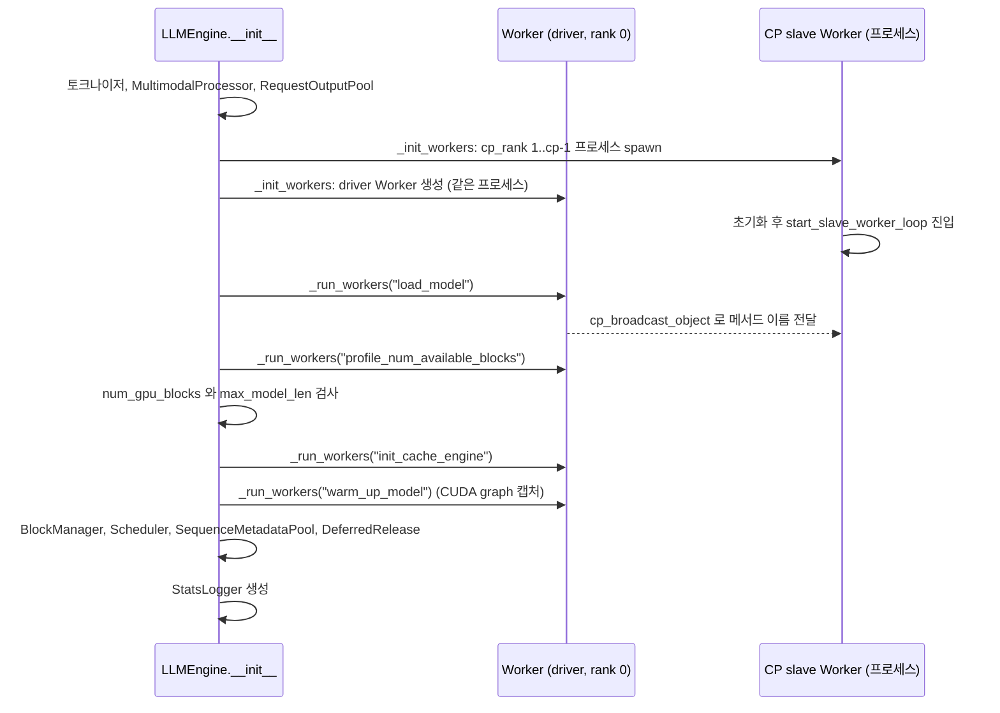

EngineArgs 가 엔진 객체로 바뀌는 과정을 따라간다.

## EngineArgs의 네 가지 설정 분해

`LLMEngine.from_engine_args()`는 `EngineArgs.create_engine_configs()`가 만든 네 설정 객체로 엔진을 만든다([engine/arg_utils.py#L62-L114](https://github.com/deepseek-ai/DeepInfer/blob/a679bb86ce36e883a98a97733492b686e5b9a08e/deepinfer/engine/arg_utils.py#L62-L114)).

| 설정 | 정의 | 엔진 루프에서 쓰는 값 |
| --- | --- | --- |
| `ModelConfig` | [config.py#L19](https://github.com/deepseek-ai/DeepInfer/blob/a679bb86ce36e883a98a97733492b686e5b9a08e/deepinfer/config.py#L19) | `max_model_len`, `runtime_max_model_len`, 토크나이저, 압축 토크나이저 사용 여부 |
| `CacheConfig` | [config.py#L125-L147](https://github.com/deepseek-ai/DeepInfer/blob/a679bb86ce36e883a98a97733492b686e5b9a08e/deepinfer/config.py#L125-L147) | `block_size`(모델 메타데이터가 128로 고정), `gpu_memory_utilization`, 프로파일 후 채워지는 `num_gpu_blocks` |
| `ParallelConfig` | [config.py#L150-L182](https://github.com/deepseek-ai/DeepInfer/blob/a679bb86ce36e883a98a97733492b686e5b9a08e/deepinfer/config.py#L150-L182) | DP, CP, EP 크기, `engine_rank`, `world_size` |
| `SchedulerConfig` | [config.py#L185-L216](https://github.com/deepseek-ai/DeepInfer/blob/a679bb86ce36e883a98a97733492b686e5b9a08e/deepinfer/config.py#L185-L216) | `max_num_batched_tokens`, `max_num_seqs`, `chunked_prefill`, prefill 시도 간격 2종 |

`block_size`는 사용자가 정하지 않는다. `ModelMetadata.resolved_tokens_per_block`이 128을 돌려주고, `tokens_per_block` 인자를 따로 주면 그 값과 같은지 단언만 한다([model_executor/model_metadata_utils.py#L133-L135](https://github.com/deepseek-ai/DeepInfer/blob/a679bb86ce36e883a98a97733492b686e5b9a08e/deepinfer/model_executor/model_metadata_utils.py#L133-L135)).

위치 인덱스 상한인 `runtime_max_model_len`은 `max_model_len`에 MTP와 비동기 스케줄링 여유를 더한 값이다([config.py#L11-L16](https://github.com/deepseek-ai/DeepInfer/blob/a679bb86ce36e883a98a97733492b686e5b9a08e/deepinfer/config.py#L11-L16)).

```python
def _get_runtime_max_model_len(max_model_len: int) -> int:
    """Return the exclusive upper bound of every runtime position."""
    nextn = envs.DEEPINFER_USE_NEXTN_DECODE
    scheduler_overhead = nextn + (nextn + 1 if envs.DEEPINFER_ZERO_OVERHEAD_SCHEDULING else 0)
    draft_overhead = nextn
    return max_model_len + scheduler_overhead + draft_overhead
```

nextn이 5이고 ZOS가 켜져 있으면 여유는 $5 + 6 + 5 = 16$이다. ZOS가 켜지면 스케줄러가 앞 스텝 결과를 모르는 채로 다음 스텝 위치를 잡으므로 `nextn + 1`만큼 더 내다봐야 한다. RoPE cache처럼 위치로 인덱싱하는 버퍼가 모두 이 크기로 잡힌다.

## 엔진 생성 순서

`LLMEngine.__init__`은 아래 순서로 자원을 준비한다. 순서가 곧 의존 관계다.



### 코드 분석: 워커 생성

[engine/llm_engine.py#L377-L413](https://github.com/deepseek-ai/DeepInfer/blob/a679bb86ce36e883a98a97733492b686e5b9a08e/deepinfer/engine/llm_engine.py#L377-L413)에서 CP 워커와 driver 워커를 만드는 방식을 본다.

```python
        for cp_rank in range(1, cp_size):
            args = (
                self.engine_type,
                self.model_config,
                self.parallel_config,
                self.scheduler_config,
                self.cache_config,
                cp_rank % ngpus,  # local_rank
                cp_rank,
                distributed_init_method,
                False,
            )
            worker = SpawnProcessWithCrashHeader(
                target=_spawn_worker,
                name=f"worker-cp{cp_rank}",
                args=args,
                daemon=True,
            )
            worker.start()
        logger.info("_init_workers: non-driver workers started")

        driver_kwargs = {
            "engine_callbacks": EngineCallbacks(post_process_fn=self.post_process, pre_sampler_sync_fn=self.pre_sampler_sync),
        }
```

엔진 하나는 CP 그룹 하나다. CP rank 0의 워커는 엔진과 같은 프로세스에서 실행되는 driver이고, 나머지는 데몬 프로세스로 뜬다. DP 차원은 엔진을 여러 개 띄워 해결하고(2장의 `launch_dp`), EP는 모델 안의 통신 그룹으로 처리된다(7장). driver에게만 엔진 콜백 두 개(`post_process`, `pre_sampler_sync`)를 넘긴다. 워커가 스텝 중간에 엔진 쪽 처리를 호출하는 지점이다.

slave 워커는 생성자 끝에서 무한 루프에 들어가 driver가 방송하는 `(메서드 이름, 인자)`를 받아 실행한다([worker/base.py#L129-L133](https://github.com/deepseek-ai/DeepInfer/blob/a679bb86ce36e883a98a97733492b686e5b9a08e/deepinfer/worker/base.py#L129-L133)). 엔진의 `_run_workers(method)`는 driver의 `run_workers`를 부르고, driver는 CP 그룹이 2 이상일 때 메서드 이름을 방송한 뒤 자기 메서드를 실행한다([worker/base.py#L290-L302](https://github.com/deepseek-ai/DeepInfer/blob/a679bb86ce36e883a98a97733492b686e5b9a08e/deepinfer/worker/base.py#L290-L302)). 엔진이 부르는 모든 워커 작업이 이 한 통로를 지난다.

### 코드 분석: 캐시 초기화

[engine/llm_engine.py#L437-L458](https://github.com/deepseek-ai/DeepInfer/blob/a679bb86ce36e883a98a97733492b686e5b9a08e/deepinfer/engine/llm_engine.py#L437-L458)에서 블록 수 확정과 검사를 본다.

```python
        self._run_workers("profile_num_available_blocks")
        num_gpu_blocks = self.cache_config.num_gpu_blocks
        logger.info(f"RANK {dist.get_rank()}, # GPU blocks: {num_gpu_blocks}")

        if num_gpu_blocks <= 0:
            raise ValueError(
                "No available memory for the cache blocks. Try increasing `gpu_memory_utilization` when initializing the engine."
            )
        max_seq_len = int(self.cache_config.block_size * num_gpu_blocks * 0.8)
        if self.model_config.runtime_max_model_len > max_seq_len:
            raise ValueError(
                f"The model's runtime max seq len ({self.model_config.runtime_max_model_len}, "
                f"derived from max_model_len={self.model_config.max_model_len}) is larger than the maximum number of tokens that can be stored in KV cache ({max_seq_len}). "
                f"Try increasing `gpu_memory_utilization` or decreasing `max_model_len` when initializing the engine."
            )

        self._run_workers("init_cache_engine")
        if self.engine_type != EngineType.NORMAL:
            self.init_pd_split()
        logger.info("init_cache_engine done.")
        self._run_workers("warm_up_model")
        logger.info("warm_up_model done.")
```

블록 수는 워커가 계산해 `cache_config`에 써 넣는다. 엔진은 결과를 읽어 "최대 길이 시퀀스 하나가 전체 블록의 80% 안에 들어가는가"만 확인한다. PROMPT, COMPLETION 엔진이면 이 자리에서 `init_pd_split()` 가상 함수를 부른다. 기반 클래스에서는 빈 함수이고, PD 분리 구현이 공개판에 없다는 README 설명과 맞는다(10장).

> **주의**: `_init_cache` docstring은 "여러 워커의 블록 수 중 최솟값을 쓴다"고 적지만, 실제 계산은 `all_reduce(SUM)`을 world 크기로 나누고 짝수로 내린 평균값이다([worker/base.py#L264-L267](https://github.com/deepseek-ai/DeepInfer/blob/a679bb86ce36e883a98a97733492b686e5b9a08e/deepinfer/worker/base.py#L264-L267)). rank 사이 여유 메모리가 크게 다르면 일부 rank가 자기 몫보다 많은 블록을 받게 된다. 이 차이가 실제 문제를 일으키는지는 확인하지 못했다(미검증).
