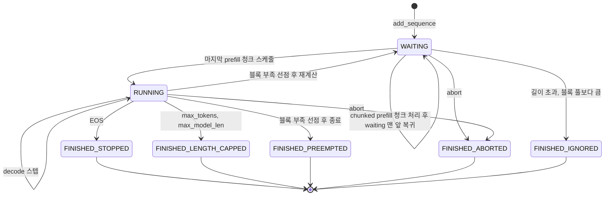
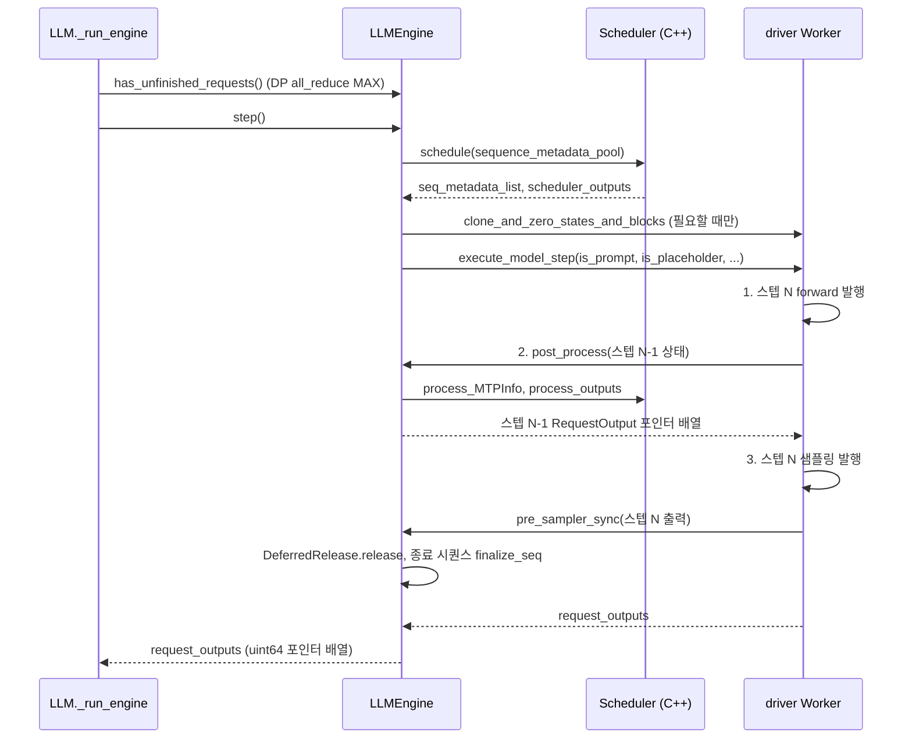

요청 하나가 들어와 끝날 때까지 엔진 루프에서 거치는 단계를 본다.

## 요청 수명주기

### 코드 분석: add_request

`LLM._add_request`는 토큰화를 마친 `np.int32` 배열로 `LLMEngine.add_request`를 부른다. 엔진 쪽은 검증하고 `Sequence`를 만든 뒤 스케줄러 대기열에 넣는다. 끝부분 [engine/llm_engine.py#L606-L631](https://github.com/deepseek-ai/DeepInfer/blob/a679bb86ce36e883a98a97733492b686e5b9a08e/deepinfer/engine/llm_engine.py#L606-L631)을 본다.

```python
        so_pending = False
        if sampling_params.so_args is not None:
            so_args = sampling_params.so_args
            if not enqueue:
                # 调用方自行管理调度，无法靠 pump 重入，保持同步构建
                seq.so_matcher = self.so_matcher_builder.build(so_args).result()
            else:
                so_pending = True

        if chunk_checkpoints is not None:
            seq.chunk_checkpoints = chunk_checkpoints
        # Add the sequence group to the scheduler.
        if enqueue:

            def _enqueue(s: Sequence) -> None:
                if s.so_matcher is not None and s.so_matcher.is_aborted():
                    s.status = SequenceStatus.FINISHED_SO_FAILED
                self.scheduler.add_sequence(s)
                if self.multi_modal_processor is not None:
                    self.multi_modal_processor.add(request_id, multi_modal_data)

            if so_pending:
                self.so_matcher_builder.submit(seq, sampling_params.so_args, _enqueue)
            else:
                _enqueue(seq)
```

구조화 출력이 있는 요청은 바로 대기열에 들어가지 않는다. 문법 컴파일러(`SOMatcherBuilder`)가 별도 CPU 스레드에서 matcher를 만들고, 완성되면 콜백 `_enqueue`가 대기열에 넣는다. 그래서 `has_unfinished_requests()`는 스케줄러의 미완료 수에 빌더 대기 건수까지 더해서 본다. 그 앞부분은 토큰 id가 `[0, vocab + 이미지 특수 토큰 수)` 범위를 벗어나면 예외 대신 `None`을 돌려주고 요청을 버린다([engine/llm_engine.py#L580-L589](https://github.com/deepseek-ai/DeepInfer/blob/a679bb86ce36e883a98a97733492b686e5b9a08e/deepinfer/engine/llm_engine.py#L580-L589)). YoCo 절단 모드에서는 `prompt_logprobs`를 강제로 끈다.

### 상태와 대기열

시퀀스 상태는 C++ enum 하나로 관리하고, `FINISHED_STOPPED` 이후 값이면 모두 종료로 본다([csrc/engine/sequence.hpp#L30-L43](https://github.com/deepseek-ai/DeepInfer/blob/a679bb86ce36e883a98a97733492b686e5b9a08e/csrc/engine/sequence.hpp#L30-L43)).

| 상태 | 들어가는 지점 | 뜻 |
| --- | --- | --- |
| `WAITING` | `add_sequence`, 선점 후 재계산, chunked prefill 이어 하기 | prefill 대기 |
| `RUNNING` | prefill 마지막 청크 스케줄 시, prompted에서 admit 시 | decode 대상 |
| `SWAPPED` | 정의만 있음 | 이 판의 스케줄러 코드에서 쓰는 곳을 찾지 못했다 |
| `FINISHED_STOPPED` | `_check_stop`에서 EOS | 정상 종료 |
| `FINISHED_LENGTH_CAPPED` | `max_tokens` 도달, `max_model_len` 초과 | 길이 제한 |
| `FINISHED_ABORTED` | `abort_sequence` | 사용자 취소 |
| `FINISHED_IGNORED` | prompt가 `prompt_limit` 초과, 블록 풀 전체보다 큼 | 처리 불가 |
| `FINISHED_PREEMPTED` | `_preempt`에서 `stop_preempted_request=True`이거나 구조화 출력 요청 | 선점으로 종료 |
| `FINISHED_SO_FAILED` | matcher 생성 실패, SO 상태 -1 | 구조화 출력 실패 |
| `FINISHED_VE_FAILED` | 이미지 바이트가 `None` | 비전 인코더 입력 실패 |

스케줄러는 세 대기열을 가진다([csrc/engine/scheduler.hpp#L1124-L1126](https://github.com/deepseek-ai/DeepInfer/blob/a679bb86ce36e883a98a97733492b686e5b9a08e/csrc/engine/scheduler.hpp#L1124-L1126)). `waiting`은 prefill 대기 `deque`, `prompted`는 prefill이 끝났거나 fork된 시퀀스가 decode 진입을 기다리는 `deque<(seq, forked)>`, `running`은 decode 중인 `vector`다. NORMAL 엔진에서 prefill을 끝낸 시퀀스는 `process_outputs`에서 바로 `running`에 들어가고, `prompted`는 주로 PD 분리 시 COMPLETION 엔진과 prefix fork에서 쓰인다.



종료 판정은 토큰을 붙일 때마다 [csrc/engine/scheduler.hpp#L1035-L1052](https://github.com/deepseek-ai/DeepInfer/blob/a679bb86ce36e883a98a97733492b686e5b9a08e/csrc/engine/scheduler.hpp#L1035-L1052)에서 한다.

```cpp
    void _check_stop(Sequence &seq) {
        int token_id = seq.get_last_token_id();

        if (!seq.generation.stopping.ignore_eos && token_id == eos_token_id) {
            seq.schedule.status = SequenceStatus::FINISHED_STOPPED;
            return;
        }

        if (seq.input.tokens.get_len() > max_model_len) {
            seq.schedule.status = SequenceStatus::FINISHED_LENGTH_CAPPED;
            return;
        }

        if (seq.get_output_len() == seq.generation.stopping.max_tokens) {
            seq.schedule.status = SequenceStatus::FINISHED_LENGTH_CAPPED;
            return;
        }
    }
```

stop 문자열 검사는 여기에 없다. 토큰 id 수준의 EOS와 길이만 본다. MTP로 한 스텝에 토큰이 여러 개 붙는 경우 `process_outputs`가 토큰 하나 붙일 때마다 이 함수를 부르고 종료되면 나머지를 버린다.

## step 루프

### 코드 분석: LLMEngine.step

[engine/llm_engine.py#L881-L908](https://github.com/deepseek-ai/DeepInfer/blob/a679bb86ce36e883a98a97733492b686e5b9a08e/deepinfer/engine/llm_engine.py#L881-L908)에서 스케줄 부분을 본다.

```python
        with cpu_timer.record("schedule"):
            seq_metadata_list: list[SequenceMetadata]
            scheduler_outputs: SchedulerOutputs
            with cpu_timer.record("schedule:cpp"):
                seq_metadata_list, scheduler_outputs = self.scheduler.schedule(
                    self.sequence_metadata_pool
                )  # Will also free the finished sequence groups.
            # NOTE 开启 yoco 截断时，允许抢占导致的结果变化
            with cpu_timer.record("schedule:clone"):
                clone_states, clone_blocks, zero_states = (
                    scheduler_outputs.clone_states,
                    scheduler_outputs.clone_blocks,
                    scheduler_outputs.zero_states,
                )
                if clone_states.size > 0 or clone_blocks.size > 0 or zero_states.size > 0:
                    to_release: np.ndarray[np.int32]
                    to_release2: np.ndarray[np.int32]
                    to_release, to_release2 = self._run_workers(
                        "clone_and_zero_states_and_blocks_on_default_stream",
                        clone_states=clone_states,
                        clone_blocks=clone_blocks,
                        zero_states=zero_states,
                    )
                    # Unpinned in this step's pre_sampler_sync.
                    self.deferred_release.collect_clone_unpins(to_release, to_release2)
```

`schedule()`은 시퀀스 메타데이터 목록과 `SchedulerOutputs`를 함께 돌려준다. 메타데이터는 `SequenceMetadataPool`에서 꺼낸 재사용 객체다. 스케줄러가 fork된 시퀀스를 위해 state나 일부 KV 블록을 복사해야 한다고 결정하면 그 목록이 `clone_states`, `clone_blocks`로 나오고, 엔진은 forward 전에 워커에게 기본 스트림에서 복사를 시킨다. 복사 원본은 다른 시퀀스와 공유되는 pin된 블록이므로, pin 해제는 복사 완료 이벤트를 확인한 뒤 같은 스텝의 `pre_sampler_sync`에서 한다.

이어서 엔진은 prefill 마지막 청크인 구조화 출력 요청의 `so_status`를 1로 올리고, KV 상태 저장이 필요한 시퀀스의 state를 복사하고, 멀티모달 처리 결과를 가져온 뒤 `_execute_model_async_step`으로 워커를 부른다([engine/llm_engine.py#L910-L959](https://github.com/deepseek-ai/DeepInfer/blob/a679bb86ce36e883a98a97733492b686e5b9a08e/deepinfer/engine/llm_engine.py#L910-L959)). 워커 호출은 `execute_model_step` 하나다.



`step()`의 반환형은 `np.ndarray[np.uint64]`다. 파이썬 객체 목록이 아니라 C++ `RequestOutput`의 포인터 배열이고, `DeferredRelease`가 다음 스텝 `pre_sampler_sync`에서 풀에 돌려준다. `LLM._run_engine`이 `RequestOutput.clone`으로 복사하는 이유가 이것이다.

### placeholder 스텝

스케줄 결과가 비어도 `step()`은 워커를 부른다. `is_placeholder=True`면 워커가 길이 1짜리 가짜 시퀀스로 forward를 한 번 돈다([worker/worker.py#L125-L127](https://github.com/deepseek-ai/DeepInfer/blob/a679bb86ce36e883a98a97733492b686e5b9a08e/deepinfer/worker/worker.py#L125-L127)). DP rank마다 엔진이 따로 돌지만 MoE의 expert parallel 통신은 모든 rank가 같은 스텝에 참여해야 하므로, 할 일이 없는 rank도 집단 통신에 맞춰 빈 스텝을 돈다(추정, 통신 쪽 코드는 7장 범위). 같은 이유로 `has_unfinished_requests()`는 DP 그룹 전체에서 `MAX`로 all-reduce한다. 한 rank라도 일이 남아 있으면 모두 루프를 계속 돈다([engine/llm_engine.py#L665-L679](https://github.com/deepseek-ai/DeepInfer/blob/a679bb86ce36e883a98a97733492b686e5b9a08e/deepinfer/engine/llm_engine.py#L665-L679)).
