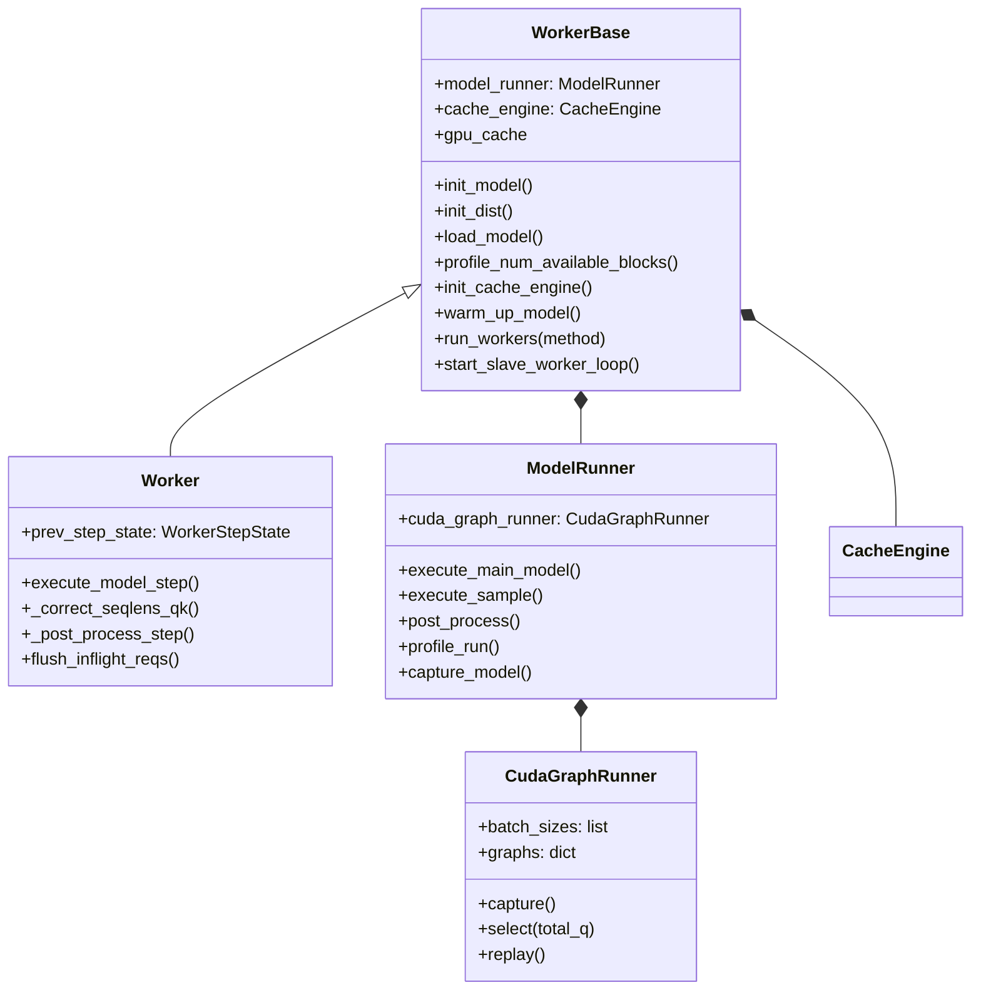

엔진이 넘긴 한 스텝은 워커의 `execute_model_step` 안에서 "이번 스텝 forward 발행, 앞 스텝 후처리, 이번 스텝 샘플링 발행" 순서로 돌고, 그 사이 CPU는 GPU를 기다리지 않도록 동기점을 이벤트 몇 개로 묶어 둔다. 이 장은 워커가 장치와 분산 환경을 준비하는 과정, `ModelRunner`가 C++로 입력 메타데이터를 채워 forward를 발행하는 경로, decode를 CUDA graph로 캡처해 재생하는 방식, 그리고 graph 안의 시간을 재는 `graph_timer`를 코드로 따라간다. KV cache의 배치와 할당은 5장, 샘플러 내부는 9장에서 다룬다.

## 워커 계층

| 클래스 | 위치 | 역할 |
| --- | --- | --- |
| `WorkerBase` | [worker/base.py#L49-L312](https://github.com/deepseek-ai/DeepInfer/blob/a679bb86ce36e883a98a97733492b686e5b9a08e/deepinfer/worker/base.py#L49-L312) | 장치 선택, NUMA와 CPU 고정, 분산 초기화, 모델 로드, 메모리 프로파일, KV cache 생성, CUDA graph 캡처 호출, slave RPC 루프 |
| `Worker` | [worker/worker.py#L51-L283](https://github.com/deepseek-ai/DeepInfer/blob/a679bb86ce36e883a98a97733492b686e5b9a08e/deepinfer/worker/worker.py#L51-L283) | 스텝 실행(`execute_model_step`), ZOS 보정, 후처리, 진행 중 스텝 비우기 |
| `ModelRunner` | [worker/model_runner.py#L53-L644](https://github.com/deepseek-ai/DeepInfer/blob/a679bb86ce36e883a98a97733492b686e5b9a08e/deepinfer/worker/model_runner.py#L53-L644) | 입력 준비, forward와 샘플링 발행, 프로파일 실행, graph 캡처, decode 성능 곡선 |
| `CudaGraphRunner` | [worker/cuda_graph_runner.py#L69-L168](https://github.com/deepseek-ai/DeepInfer/blob/a679bb86ce36e883a98a97733492b686e5b9a08e/deepinfer/worker/cuda_graph_runner.py#L69-L168) | 배치 크기별 graph 캡처, 선택, 재생, 파기 |
| `DFlashCudaGraphRunner` | [worker/dflash_cuda_graph_runner.py](https://github.com/deepseek-ai/DeepInfer/blob/a679bb86ce36e883a98a97733492b686e5b9a08e/deepinfer/worker/dflash_cuda_graph_runner.py) | MTP draft 모듈 전용 graph. 8장 |
| `CacheEngine` | [worker/cache_engine.py#L851](https://github.com/deepseek-ai/DeepInfer/blob/a679bb86ce36e883a98a97733492b686e5b9a08e/deepinfer/worker/cache_engine.py#L851) | KV 블록과 state 텐서 소유. 5장 |
| `InputMetadata` 계열 | [model_executor/input_metadata/input_metadata.py](https://github.com/deepseek-ai/DeepInfer/blob/a679bb86ce36e883a98a97733492b686e5b9a08e/deepinfer/model_executor/input_metadata/input_metadata.py) | forward 한 번에 필요한 위치, 블록 표, 어텐션 인덱스 묶음 |

`WorkerBase`와 `Worker`의 분리는 자원과 수명 주기(base)를 스텝 실행(worker)과 나눈 것이다. 두 파일 docstring이 각각 그렇게 밝힌다.

## 정리

- 워커는 `WorkerBase`(장치, 분산, 메모리, 캐시, RPC 루프)와 `Worker`(스텝 실행)로 나뉜다. 기본 프로세스 그룹은 gloo이고, CP slave는 driver가 방송하는 메서드 이름을 받아 같은 일을 한다.
- KV 블록 수는 MoE 불균형 1.8을 강제한 최대 부하 프로파일 뒤 남은 메모리에서 state 두 벌을 빼고 블록 크기로 나눠 정한다. CUDA graph 메모리는 이 계산 뒤에 잡히므로 `gpu_memory_utilization` 여유에 들어가야 한다.
- `execute_model_step`은 forward 발행, 앞 스텝 후처리, 샘플링 발행, 이번 스텝 후처리 순서로 돈다. ZOS decode는 4단계를 다음 스텝으로 미뤄 CPU 일을 GPU forward 뒤에 숨기고, 동기점은 앞 스텝 `sample_end_evt` 하나다.
- ZOS에서 CPU가 아는 길이는 낙관값이므로 `_correct_seqlens_qk`와 `prepare_decode_v4_zos`가 앞 스텝 수용 결과로 GPU에서 메타데이터를 고친다. 발행 구간은 `forbid_cuda_sync`로 의도치 않은 동기화를 막는다.
- 입력 메타데이터는 C++이 varlen 형태와 `[시작, 길이]` 압축 형태로 채우고, 큰 인덱스 행렬은 forward 안에서 펼친다. graph 캡처 전에 펼친 필드를 지워 펼침 커널까지 graph에 담는다.
- decode graph는 토큰 수 기준으로 2의 거듭제곱과 8 간격 크기를 캡처해 메모리 풀을 공유하고, `graph_timer`는 event-record 노드의 이벤트를 두 벌로 번갈아 바꿔 겹쳐 도는 graph의 시간을 따로 잰다.
