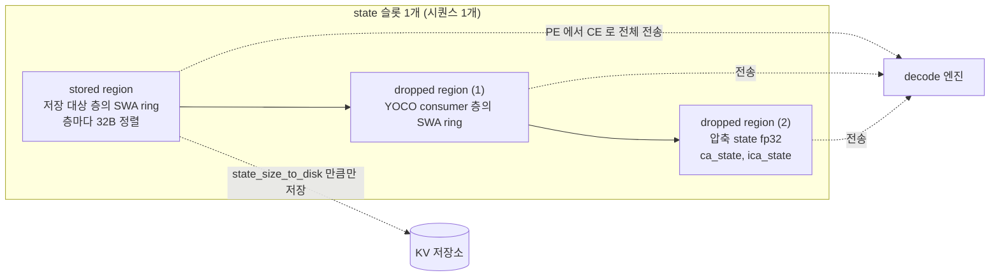

KV 블록과 state 슬롯이 GPU 메모리에 놓이는 방식을 본다.

## 블록 레이아웃: KVCacheManager

블록 하나는 "모든 층의 KV를 한 줄로 이어 붙인 바이트 열"이다. 텐서 모양은 `[num_gpu_blocks, 블록 바이트]`인 `uint8` 2차원이고, 층별 뷰는 그 안에서 오프셋을 잘라 만든다. 이 계산이 [`KVCacheManager.process`](https://github.com/deepseek-ai/DeepInfer/blob/a679bb86ce36e883a98a97733492b686e5b9a08e/deepinfer/worker/cache_engine.py#L376-L477)다.

### 코드 분석: KVCacheManager.process (main KV 부분)

압축 비율 `ratio`인 층이 블록 안에서 차지하는 구간을 잘라내는 부분을 본다.

```python
if ratio > 0:
    if kv_mapped_layer_id != layer_id:
        ca_cache = cache_list[kv_mapped_layer_id].ca_cache
    else:
        # 所有压缩率（c1/c2）统一处理
        token_per_block = block_size // ratio
        delta = token_per_block * self._bytes_per_token
        if gpu_blocks is not None:
            ca_cache = gpu_blocks[:, self._kv_offset : self._kv_offset + delta].as_strided(
                (gpu_blocks.shape[0], token_per_block, 1, self._bytes_per_token),
                (gpu_blocks.stride(0), self._bytes_per_token, self._bytes_per_token, 1),
            )
        padded_delta = _align_to_multiple(delta, 1, 32)
        self._kv_offset += padded_delta
        kv_length += padded_delta

        if _needs_compress_state(ratio):
            num_state_token = self._state_block.all_compress_block_size[ratio]
            ca_state = self._alloc_state(num_state_token, self._compress_dim)
```

- 블록 하나는 압축 전 128토큰을 뜻한다. 압축 비율 2인 층은 그 안에 64개 압축 토큰만 담으므로 `token_per_block = block_size // ratio`가 된다. 같은 블록 번호가 층마다 다른 개수의 압축 토큰을 담는 구조다
- `as_strided`의 첫 stride가 `gpu_blocks.stride(0)`, 곧 블록 전체 바이트다. 그래서 층별 뷰 `ca_cache[b, t]`는 "블록 b 안에서 이 층 구간의 t번째 토큰"을 가리키고, 커널은 `[num_blocks, token_per_block, 1, bytes_per_token]` 모양 하나만 알면 된다
- 층마다 32바이트 경계로 맞춘다. 마지막에 [`finalize`](https://github.com/deepseek-ai/DeepInfer/blob/a679bb86ce36e883a98a97733492b686e5b9a08e/deepinfer/worker/cache_engine.py#L479-L492)가 블록 전체를 `lcm(128, bytes_per_token)`으로 한 번 더 맞춘다. 주석은 DeepGEMM index 커널이 128바이트 배수 stride를, main 어텐션이 `bytes_per_token` 배수 stride를 요구한다고 적는다
- `kv_mapped_layer_id != layer_id`면 다른 층의 `ca_cache`를 그대로 빌려 쓰고 오프셋을 늘리지 않는다. share-kv 설정(6장)에서 앞 층의 캐시를 재사용하는 경로다

indexer K도 같은 방식으로 [바로 앞에서 잘라낸다](https://github.com/deepseek-ai/DeepInfer/blob/a679bb86ce36e883a98a97733492b686e5b9a08e/deepinfer/worker/cache_engine.py#L428-L443). 그래서 블록 한 줄은 `[0층 ica | 0층 ca | 1층 ica | 1층 ca | ...]` 순서로 채워진다. SWA만 쓰는 층은 블록 바이트를 차지하지 않는다(`kv_length == 0`).

| 층 종류 판정 | 함수 | 조건 |
|---|---|---|
| SWA 슬롯이 있는가 | [`_has_SWA`](https://github.com/deepseek-ai/DeepInfer/blob/a679bb86ce36e883a98a97733492b686e5b9a08e/deepinfer/worker/cache_engine.py#L682-L687) | `sink_mode == "swa"` |
| indexer K를 갖는가 | [`_is_sparse`](https://github.com/deepseek-ai/DeepInfer/blob/a679bb86ce36e883a98a97733492b686e5b9a08e/deepinfer/worker/cache_engine.py#L689-L693) | `index_topk > 0` |
| 압축 없는 full 어텐션 | [`_is_full`](https://github.com/deepseek-ai/DeepInfer/blob/a679bb86ce36e883a98a97733492b686e5b9a08e/deepinfer/worker/cache_engine.py#L695-L699) | `kv_compress_ratio == 0` 이고 SWA 아님 |
| 압축 state 가 필요한가 | `_needs_compress_state` | `kv_compress_ratio > 1` |

> **주의**: `_is_full`에 해당하는 층이 들어오면 `process`는 [`AssertionError`를 던진다](https://github.com/deepseek-ai/DeepInfer/blob/a679bb86ce36e883a98a97733492b686e5b9a08e/deepinfer/worker/cache_engine.py#L466-L468). 압축 없는 일반 MLA 층은 이 캐시 엔진이 지원하지 않는다. 클래스 docstring도 `compress_ratio in {1, 2}`만 지원한다고 적는다.

## state 슬롯 레이아웃: StateBlock

state 캐시의 한 행은 시퀀스 하나의 고정 크기 슬롯이다. 슬롯 안의 배치를 [`StateBlock`](https://github.com/deepseek-ai/DeepInfer/blob/a679bb86ce36e883a98a97733492b686e5b9a08e/deepinfer/worker/cache_engine.py#L221-L306)이 계산한다. 원칙은 docstring 첫 줄에 있다. 디스크로 저장할 것은 앞쪽 stored region에, 저장하지 않지만 실행 중 필요한 것은 뒤쪽 dropped region에 둔다.



### 코드 분석: SWA ring 크기

SWA ring이 창보다 몇 토큰 더 큰지 정하는 두 함수를 본다.

```python
def get_inference_swa_block_size(window_size: int) -> int:
    return (window_size + envs.DEEPINFER_MAX_BACKTRACKING_TOKENS) if window_size > 0 else 0

def get_kvstore_swa_block_size(window_size: int) -> int:
    return get_inference_swa_block_size(window_size) + (
        (envs.DEEPINFER_PREFILL_STORE_EXTRA_SIZE + get_yoco_store_extra_tokens()) if envs.DEEPINFER_PREFILL_STORE_EXTRA_STATE else 0
    )
```

[원본 88~110행](https://github.com/deepseek-ai/DeepInfer/blob/a679bb86ce36e883a98a97733492b686e5b9a08e/deepinfer/worker/cache_engine.py#L88-L110)에서 docstring을 빼고 옮겼다.

- `DEEPINFER_MAX_BACKTRACKING_TOKENS`는 추측 디코딩이 거절된 draft만큼 되돌아갈 여유다. [`environ.py`](https://github.com/deepseek-ai/DeepInfer/blob/a679bb86ce36e883a98a97733492b686e5b9a08e/deepinfer/environ.py#L136-L139)에서 이 값은 `max(설정값, DEEPINFER_USE_NEXTN_DECODE + 1)`로 강제되고, `DEEPINFER_USE_NEXTN_DECODE` 기본값이 5라 최소 6이다(8장)
- 저장 쪽(kvstore)은 128토큰 배수에서만 저장하므로([`KVSTORE_GRAIN = 128`](https://github.com/deepseek-ai/DeepInfer/blob/a679bb86ce36e883a98a97733492b686e5b9a08e/deepinfer/worker/cache_engine.py#L32-L33)), `DEEPINFER_PREFILL_STORE_EXTRA_STATE`를 켜면 [기본 128토큰](https://github.com/deepseek-ai/DeepInfer/blob/a679bb86ce36e883a98a97733492b686e5b9a08e/deepinfer/environ.py#L168-L171)을 더 들고 있다가 경계 위치의 창을 꺼낸다
- 창이 없는 모델(`window_size <= 0`)은 0이 되어 SWA 공간 자체가 없다

같은 이유로 압축 state ring도 [`get_inference_compress_block_size`](https://github.com/deepseek-ai/DeepInfer/blob/a679bb86ce36e883a98a97733492b686e5b9a08e/deepinfer/worker/cache_engine.py#L130-L133)에서 `compress_ratio + max(0, BACKTRACKING - 1)` 토큰을 잡는다. 압축 비율 2, backtracking 6이면 7토큰이다. 6장의 decode 압축 커널이 `state_cache_size >= ratio + max_seqlen_q - 1`을 assert하므로 이 크기와 맞물린다.

배포 문서는 V4.1 기준 숫자를 직접 적는다. [`doc/inference_deployment_qa.md`](https://github.com/deepseek-ai/DeepInfer/blob/a679bb86ce36e883a98a97733492b686e5b9a08e/doc/inference_deployment_qa.md#L223)에 따르면 디스크로 가는 `state_size_to_disk`는 "20 layers × 134 tokens × 528 B = 1,415,040 B"이고, 134는 128토큰 창에 6토큰 backtracking을 더한 값이다.

### 코드 분석: 슬롯 개수

```python
def get_num_state_slots(max_num_seqs: int) -> int:
    return int(max_num_seqs * envs.DEEPINFER_NUM_STATE_SLOTS_RATIO) + 1
```

[`get_num_state_slots`](https://github.com/deepseek-ai/DeepInfer/blob/a679bb86ce36e883a98a97733492b686e5b9a08e/deepinfer/worker/cache_engine.py#L201-L202)는 동시 시퀀스 수에 `1.2`(기본값)를 곱하고 1을 더한다. 더한 1은 0번 슬롯이다. C++ 할당자는 [0번을 "비어 있음"으로 쓰고 나눠 주지 않으며](https://github.com/deepseek-ai/DeepInfer/blob/a679bb86ce36e883a98a97733492b686e5b9a08e/csrc/engine/block_manager.hpp#L27-L35), 모델 코드는 CUDA graph padding 행을 이 0번 state에 쓴다([`deepseek.py` 주석](https://github.com/deepseek-ai/DeepInfer/blob/a679bb86ce36e883a98a97733492b686e5b9a08e/deepinfer/model_executor/models/deepseek.py#L220-L223)). 1.2배 여유는 fork처럼 슬롯을 하나 더 잡는 경로를 위한 것으로 보인다(추정).

SWA ring 뷰를 만드는 방식은 블록 쪽과 같다. [`process`의 SWA 분기](https://github.com/deepseek-ai/DeepInfer/blob/a679bb86ce36e883a98a97733492b686e5b9a08e/deepinfer/worker/cache_engine.py#L406-L422)는 `as_strided((num_slots, swa_block_size, 1, 528), (slot_stride, 528, 528, 1))`로 뷰를 잡는다. 슬롯 stride가 슬롯 전체 바이트라서, 커널 입장에서 SWA는 "블록 크기가 `swa_block_size`이고 블록 번호가 state id인 페이징 캐시"로 보인다. 6장의 slot mapping이 `state_id * swa_block_size + pos % swa_block_size`인 이유다.

## GPUCacheInterface와 CacheEngine

[`GPUCacheInterface._kvcache_layout`](https://github.com/deepseek-ai/DeepInfer/blob/a679bb86ce36e883a98a97733492b686e5b9a08e/deepinfer/worker/cache_engine.py#L580-L652)은 위 두 계산을 묶는 입구다. 버퍼를 넘기지 않으면 모양만 계산하고, 넘기면 층별 `KVCache` 목록까지 만든다. `block_size=-1`을 넘기면 state 모양만 돌려준다는 관례가 있어서, 프로파일링 단계에서 블록 크기를 모르는 상태로도 state 크기를 얻는다.

### 코드 분석: 층 순회

```python
kvcache_manager = KVCacheManager(cfg, gpu_blocks, state_blocks)
kvcache_manager.update_gpu_cache_interface_class_fields()
if not need_state_shape_only:
    for layer_id, _, attn_module in iter_runtime_attn_modules(attn_module_list, cfg.num_hidden_layers):
        ...
        kvcache, layout_item = kvcache_manager.process(layer_id, attn_module, block_size, cache_list)
        cache_list.append(kvcache)
        if layout_item[2] > 0:
            layout.append(layout_item)
    kvcache_manager.finalize()
```

[원본 626~644행](https://github.com/deepseek-ai/DeepInfer/blob/a679bb86ce36e883a98a97733492b686e5b9a08e/deepinfer/worker/cache_engine.py#L626-L644)에서 로그 출력만 생략했다. [`iter_runtime_attn_modules`](https://github.com/deepseek-ai/DeepInfer/blob/a679bb86ce36e883a98a97733492b686e5b9a08e/deepinfer/model_executor/layer_utils.py#L6-L16)는 config의 어텐션 목록에서 lm head 자리만 건너뛰고 번호를 다시 매긴다. 그래서 main 층 뒤에 붙은 MTP(DFlash) 층도 같은 `cache_list`에 이어서 들어가고, 8장의 DFlash 층은 `nextn_kv_caches[num_main_layers + i]`로 자기 캐시를 찾는다.

`update_gpu_cache_interface_class_fields`는 SWA 영역 크기들을 **클래스 변수**에 적는다. 저장 · 전송 함수(`select_state_slice_to_store` 등)가 인스턴스 없이 classmethod로 불리기 때문이다. 프로세스 하나에 모델 하나라는 전제가 깔린 설계다.

[`CacheEngine.allocate_gpu_cache`](https://github.com/deepseek-ai/DeepInfer/blob/a679bb86ce36e883a98a97733492b686e5b9a08e/deepinfer/worker/cache_engine.py#L918-L966)는 실제 메모리를 잡는다. 블록과 state 모두 `torch.empty`가 아니라 [`cuda_utils.alloc_tensor`](https://github.com/deepseek-ai/DeepInfer/blob/a679bb86ce36e883a98a97733492b686e5b9a08e/deepinfer/worker/cache_engine.py#L910-L916)로 원시 바이트를 받아 `uint8` 뷰로 바꾼다. PyTorch 캐싱 할당자 밖에서 메모리를 잡는 셈이라 `empty_cache` 영향을 받지 않는다(추정. `alloc_tensor` 구현은 `csrc/cuda_utils.cpp`에 있고 이 장에서 읽지 않았다). 할당 뒤에는 `cache_config`에 `num_state_seqs`, `bytes_of_state_per_seqs`, `bytes_per_block`을 적어 엔진이 할당자 두 개를 만들 때 쓰게 한다.

| 메서드 | 반환 | 호출 위치 |
|---|---|---|
| `get_cache_block_size(block_size, cfg)` | 블록 1개 바이트 | 워커 프로파일링 |
| `get_state_shape(cfg, max_num_seqs)` | `(슬롯 수, 슬롯 바이트)` | 워커 프로파일링, 할당 |
| `get_kvcache_layout(cfg, block_size)` | 층별 `(layer_id, offset, length)`, 저장 state 크기 | 할당 시 로그, 저장소 연동 |
| `allocate_gpu_cache()` | `GPUCacheInterface`, `gpu_blocks`, `gpu_states` | `CacheEngine.__init__` |
