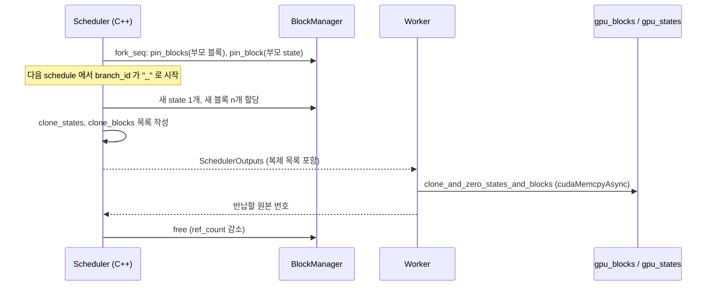

블록 번호 할당, prefix 재사용, 저장소 연동 함수를 본다.

## 블록 번호 할당: C++ BlockManager

어느 블록 번호를 어느 시퀀스에 줄지는 Python이 아니라 [`csrc/engine/block_manager.hpp`](https://github.com/deepseek-ai/DeepInfer/blob/a679bb86ce36e883a98a97733492b686e5b9a08e/csrc/engine/block_manager.hpp)가 정한다. 구현은 참조 카운트가 붙은 이중 연결 free list 하나다.

### 코드 분석: Blocks::allocate / free

```cpp
int allocate() {
    int block_id = _pop_front(); // _erase 已校验 ref_count == 0
    _blocks[block_id].ref_count += 1;
    return block_id;
}

void pin_block(int block_id) {
    ...
    TORCH_CHECK(block.ref_count > 0, "try to pin free block");
    block.ref_count += 1;
}

void free(int block_id) {
    ...
    block.ref_count -= 1;
    TORCH_CHECK(block.ref_count >= 0, "ref_count corrupted: ref_count < 0");
    if (block.ref_count == 0) {
        _push_back(block_id);
    }
}
```

[원본 82~103행](https://github.com/deepseek-ai/DeepInfer/blob/a679bb86ce36e883a98a97733492b686e5b9a08e/csrc/engine/block_manager.hpp#L82-L103)에서 범위 검사를 생략했다. 앞에서 꺼내고 뒤에 돌려놓으므로 가장 오래전에 반납된 블록부터 다시 쓴다. vLLM의 prefix caching처럼 해시로 블록을 찾아 재사용하는 기능은 이 클래스에 없다. 재사용은 `pin_block`으로 참조 카운트를 올리는 방식 하나뿐이다.

시퀀스에 필요한 블록 수는 [`Sequence::get_num_blocks`](https://github.com/deepseek-ai/DeepInfer/blob/a679bb86ce36e883a98a97733492b686e5b9a08e/csrc/engine/sequence.hpp#L291-L293)가 계산한다.

$$
\text{num\_blocks} = \left\lceil \frac{\text{len} + \text{inflight} + \text{nextn\_len}}{\text{block\_size}} \right\rceil
$$

draft 토큰 수(`nextn_len`)까지 미리 블록을 잡는다. 검증 단계에서 draft 위치에도 KV를 쓰기 때문이다(8장). [`try_allocate_seq`](https://github.com/deepseek-ai/DeepInfer/blob/a679bb86ce36e883a98a97733492b686e5b9a08e/csrc/engine/block_manager.hpp#L216-L239)는 블록과 state를 둘 다 잡을 수 있을 때만 성공한다. 블록이 총량보다 많이 필요하면 `NEVER`, 지금만 부족하면 `LATER`를 돌려주고, 스케줄러는 `LATER`면 대기열 처리를 멈춘다(3장).

## prefix 재사용: fork와 블록 복제

공개된 코드에서 같은 prefix를 여러 시퀀스가 함께 쓰는 경로는 [`Scheduler::fork_seq`](https://github.com/deepseek-ai/DeepInfer/blob/a679bb86ce36e883a98a97733492b686e5b9a08e/csrc/engine/scheduler.hpp#L1061-L1121)다. 이미 prefill된 시퀀스의 블록 테이블과 state id를 그대로 복사하고 `pin_blocks` · `pin_block`으로 참조 카운트만 올린다. 저장소 안에서 이 함수를 부르는 곳은 [`examples/benchmark.py`](https://github.com/deepseek-ai/DeepInfer/blob/a679bb86ce36e883a98a97733492b686e5b9a08e/examples/benchmark.py#L331-L349) 하나로, 한 시퀀스의 캐시를 배치 크기만큼 복제해 decode 벤치마크를 돌리는 데 쓴다.

fork된 시퀀스가 처음 스케줄될 때는 마지막 블록을 복제해야 한다. 공유 블록에 새 토큰을 쓰면 원본이 오염되기 때문이다.

### 코드 분석: fork 시퀀스의 copy-on-write

```cpp
int num_reserve_blocks = seq->cache.num_tokens / seq->cache.block_size;
int to_allocate_blocks = seq->get_num_blocks() - num_reserve_blocks;
...
_clone_state(*seq);
auto new_blocks = block_manager->allocate_nolock(to_allocate_blocks);
if (seq->cache.num_tokens % seq->cache.block_size) { // 有尾巴，需要 copy
    clone_blocks.emplace_back(seq->cache.block_table[num_reserve_blocks]);
    clone_blocks.emplace_back(new_blocks.front());
}
for (size_t i = num_reserve_blocks + (seq->cache.num_tokens % seq->cache.block_size ? 1 : 0);
    i < seq->cache.block_table.size(); ++i) {
    clone_blocks.emplace_back(seq->cache.block_table[i]);
    clone_blocks.emplace_back(0);
}
```

[원본 413~437행](https://github.com/deepseek-ai/DeepInfer/blob/a679bb86ce36e883a98a97733492b686e5b9a08e/csrc/engine/scheduler.hpp#L413-L437)에서 할당 가능 검사를 생략했다. 이 경로는 prompt가 덜 계산된 채 fork되어 대기열로 간 시퀀스용이다. prompt가 끝난 뒤 fork된 시퀀스는 decode 쪽 [582~614행](https://github.com/deepseek-ai/DeepInfer/blob/a679bb86ce36e883a98a97733492b686e5b9a08e/csrc/engine/scheduler.hpp#L582-L614)에서 같은 방식으로 state와 마지막 블록을 복제한다.

- 꽉 찬 블록(`num_reserve_blocks`개)은 계속 공유한다. 덜 찬 마지막 블록만 `(src, dst)` 쌍으로 복제 목록에 올린다
- 그 뒤에 공유하던 블록은 `(src, 0)`으로 올린다. `dst = 0`은 "복사하지 말고 참조만 반납하라"는 뜻이다([`clone_blocks` 설명](https://github.com/deepseek-ai/DeepInfer/blob/a679bb86ce36e883a98a97733492b686e5b9a08e/deepinfer/_C/engine.pyi#L379-L383))
- state는 SWA ring 전체가 바뀌므로 [`_clone_state`](https://github.com/deepseek-ai/DeepInfer/blob/a679bb86ce36e883a98a97733492b686e5b9a08e/csrc/engine/scheduler.hpp#L203-L212)가 새 슬롯을 할당해 전체를 복제한다

복제 목록은 스케줄 결과에 실려 워커로 간다. 워커는 [`clone_and_zero_states_and_blocks_on_default_stream`](https://github.com/deepseek-ai/DeepInfer/blob/a679bb86ce36e883a98a97733492b686e5b9a08e/deepinfer/worker/base.py#L159-L168)에서 C++ 함수 [`clone_and_zero_states_and_blocks`](https://github.com/deepseek-ai/DeepInfer/blob/a679bb86ce36e883a98a97733492b686e5b9a08e/csrc/engine/scheduler.hpp#L1264-L1313)를 부른다. 이 함수는 블록 · 슬롯 단위로 `cuda_copy_async`를 걸고, `zero_states`에 오른 슬롯은 0으로 지운 뒤, 반납할 원본 번호 목록을 돌려준다. 블록 한 행 전체(모든 층)를 한 번에 복사하므로 층 수만큼 커널을 띄우지 않는다.



> **주의**: README는 공개본에 "A KV cache system"이 빠져 있다고 밝히고([README.md](https://github.com/deepseek-ai/DeepInfer/blob/a679bb86ce36e883a98a97733492b686e5b9a08e/README.md#L40)), 배포 문서도 KV 캐시 관리 구성요소는 아직 전부 공개하지 않았다고 적는다([doc 21행](https://github.com/deepseek-ai/DeepInfer/blob/a679bb86ce36e883a98a97733492b686e5b9a08e/doc/inference_deployment_qa.md#L21)). 해시 체인 prefix 매칭, 3FS 저장소에서 블록을 가져오는 경로는 이 저장소에 코드가 없다. 엔진의 저장 훅 [`pe_do_save_kvcache`](https://github.com/deepseek-ai/DeepInfer/blob/a679bb86ce36e883a98a97733492b686e5b9a08e/deepinfer/engine/llm_engine.py#L821-L822)도 빈 함수다.

## 저장소 연동용 state 함수

prefix 매칭은 공개되지 않았지만, state를 저장 형식과 실행 형식 사이에서 바꾸는 함수는 `GPUCacheInterface`에 남아 있다. 저장 쪽 SWA ring은 `swa_block_size_kvstore`, 실행 쪽은 `swa_block_size_inference` 크기라서 그대로 복사할 수 없다.

### 코드 분석: select_state_slice

```python
def select_state_slice_ref(
    state_tensor: torch.Tensor,
    state_cache: torch.Tensor,
    last_hit_position: int,
) -> None:
    _, block_size_kvstore, _ = state_cache.shape
    _, block_size_inference, _ = state_tensor.shape
    index = torch.arange(last_hit_position - block_size_inference, last_hit_position).cuda()
    state_tensor[:, index % block_size_inference] = state_cache[:, index % block_size_kvstore]
```

[`tilelang_ops/state_cache.py`의 PyTorch 참조 구현](https://github.com/deepseek-ai/DeepInfer/blob/a679bb86ce36e883a98a97733492b686e5b9a08e/deepinfer/model_executor/layers/tilelang_ops/state_cache.py#L37-L45)이다. 실제로는 같은 의미의 TileLang 커널 [`select_state_slice`](https://github.com/deepseek-ai/DeepInfer/blob/a679bb86ce36e883a98a97733492b686e5b9a08e/deepinfer/model_executor/layers/tilelang_ops/state_cache.py#L12-L34)를 쓴다. 논리 위치 `last_hit_position` 직전 `block_size_inference`개 토큰을, 큰 ring에서 꺼내 작은 ring의 같은 나머지 자리에 넣는다. 반대 방향은 `load_state_to_cache`다.

| classmethod | 하는 일 | 정렬 요구 |
|---|---|---|
| [`select_state_slice_to_store`](https://github.com/deepseek-ai/DeepInfer/blob/a679bb86ce36e883a98a97733492b686e5b9a08e/deepinfer/worker/cache_engine.py#L762-L818) | 슬롯에서 저장용(또는 `TO_CE=True`면 decode 엔진 전송용) state를 꺼낸다 | 저장이면 `last_hit_position % 128 == 0` |
| [`load_state_from_store_to_prefill_cache`](https://github.com/deepseek-ai/DeepInfer/blob/a679bb86ce36e883a98a97733492b686e5b9a08e/deepinfer/worker/cache_engine.py#L820-L848) | 저장된 stored region을 슬롯에 다시 채운다 | 없음 |

`DEEPINFER_PREFILL_STORE_EXTRA_STATE`가 꺼져 있으면 두 ring 크기가 같으므로 재배열 없이 앞 `state_size_to_disk` 바이트를 그대로 자르고 붙인다. 압축 state는 저장 대상이 아니다. 압축 창 경계가 128토큰 배수에 자연히 맞으므로 경계를 넘는 의존이 없다는 것이 [`StateBlock` 주석](https://github.com/deepseek-ai/DeepInfer/blob/a679bb86ce36e883a98a97733492b686e5b9a08e/deepinfer/worker/cache_engine.py#L285)의 설명이다. prefill에서 decode 엔진으로 넘길 때(`TO_CE=True`)는 dropped region까지 함께 보낸다(10장).

## KV 인덱스 커널 진입점

캐시에 KV를 쓰고 읽을 때 필요한 "논리 위치에서 물리 슬롯으로" 변환은 TileLang 커널 몇 개가 맡는다. 어텐션 커널은 블록 테이블을 직접 받지 않고, 토큰별 물리 슬롯 번호 배열(`indices`)을 받는다. 그래서 이 변환이 매 스텝 앞단에 붙는다.

### 코드 분석: get_kv_ca_index_decode

압축 main KV의 논리 위치를 블록 테이블로 물리 슬롯으로 바꾸는 참조 구현을 본다.

```python
kv_ca_index = torch.full((kv_ca_index_offset_len.shape[0], kv_ca_index_length), -1, dtype=torch.int32, device="cuda")
arange = torch.arange(kv_ca_index.shape[1], dtype=torch.int32, device="cuda").unsqueeze(0)
arange = arange.minimum(kv_ca_index_offset_len[:, 1].unsqueeze(1))  # clamp to safe range
pos = kv_ca_index_offset_len[:, 0].unsqueeze(1) + arange
kv_ca_index = torch.where(
    arange < kv_ca_index_offset_len[:, 1].unsqueeze(1),
    block_tables.flatten().index_select(0, (pos // token_per_block).flatten().long()).reshape_as(pos) * token_per_block
    + pos % token_per_block,
    kv_ca_index,
)
```

[`get_kv_index.py`의 `get_kv_ca_index_decode_ref`](https://github.com/deepseek-ai/DeepInfer/blob/a679bb86ce36e883a98a97733492b686e5b9a08e/deepinfer/model_executor/layers/tilelang_ops/get_kv_index.py#L41-L57)다. 행마다 `(offset, len)`을 받아 `len`개 위치를 `block_table[pos // tpb] * tpb + pos % tpb`로 바꾸고 나머지는 `-1`로 채운다. 실제 진입점 [`get_kv_ca_index_decode`](https://github.com/deepseek-ai/DeepInfer/blob/a679bb86ce36e883a98a97733492b686e5b9a08e/deepinfer/model_executor/layers/tilelang_ops/get_kv_index.py#L60-L77)는 같은 일을 `ops.load_kv_index_tl` 커널 하나로 한다.

| 함수 | 입력 | 출력 의미 | 쓰는 단계 |
|---|---|---|---|
| [`get_kv_ca_index_prefill`](https://github.com/deepseek-ai/DeepInfer/blob/a679bb86ce36e883a98a97733492b686e5b9a08e/deepinfer/model_executor/layers/tilelang_ops/get_kv_index.py#L24-L38) | `(offset, len)` | 모아 둔 prefill KV 버퍼 안의 연속 위치 | prefill, dense 압축 층 |
| [`get_kv_ca_index_decode`](https://github.com/deepseek-ai/DeepInfer/blob/a679bb86ce36e883a98a97733492b686e5b9a08e/deepinfer/model_executor/layers/tilelang_ops/get_kv_index.py#L60-L77) | `(offset, len)`, 블록 테이블 | `ca_cache`의 물리 슬롯 | decode, dense 압축 층 |
| [`get_kv_swa_index_decode`](https://github.com/deepseek-ai/DeepInfer/blob/a679bb86ce36e883a98a97733492b686e5b9a08e/deepinfer/model_executor/layers/tilelang_ops/get_kv_index.py#L97-L112) | `(offset, len)` | SWA ring 안의 슬롯 (`offset // bs * bs + (offset + j) % bs`) | decode, SWA |
| [`convert_kv_index`](https://github.com/deepseek-ai/DeepInfer/blob/a679bb86ce36e883a98a97733492b686e5b9a08e/deepinfer/model_executor/layers/tilelang_ops/flash_mla_utils.py#L10-L37) | top-k 논리 인덱스, 블록 테이블 | 같은 자리에 물리 슬롯으로 덮어씀 | decode, sparse 층 |
| [`get_fused_dflash_get_input`](https://github.com/deepseek-ai/DeepInfer/blob/a679bb86ce36e883a98a97733492b686e5b9a08e/deepinfer/model_executor/layers/tilelang_ops/get_kv_index.py#L209-L274) | 수락 위치, SWA slot mapping | draft 토큰의 저장 슬롯과 참조 슬롯 | decode, DFlash draft (8장) |

이 함수들은 [`InputMetadataV4.compute_attn_info`](https://github.com/deepseek-ai/DeepInfer/blob/a679bb86ce36e883a98a97733492b686e5b9a08e/deepinfer/model_executor/input_metadata/input_metadata.py#L343-L389)에서 처음 필요할 때 한 번만 계산해 층 사이에 공유한다. 폭은 `max_model_len // ratio`를 128 배수로 올린 값이다. 주석은 sparse 어텐션 커널이 128 패딩을 요구한다고 적는다. 오프셋 `(offset, len)` 자체는 decode 메타데이터 커널이 미리 채워 둔다(6장).

쓰기 쪽 진입점은 [`store_kv_cache`](https://github.com/deepseek-ai/DeepInfer/blob/a679bb86ce36e883a98a97733492b686e5b9a08e/deepinfer/model_executor/layers/tilelang_ops/store_kv_cache.py#L33-L78)다. BF16 KV와 `slot_mapping`을 받아 캐시 텐서 모양에서 포맷을 추론하고, 양자화와 scale 계산을 해서 해당 슬롯에 쓴다. `slot_mapping`이 `-1`인 행은 건너뛴다. 실제 어텐션 경로는 대부분 norm, RoPE, 양자화, 저장을 한 커널로 묶은 `fused_norm_rope_hadamard_cast_store_kvcache`를 쓴다(6장).
