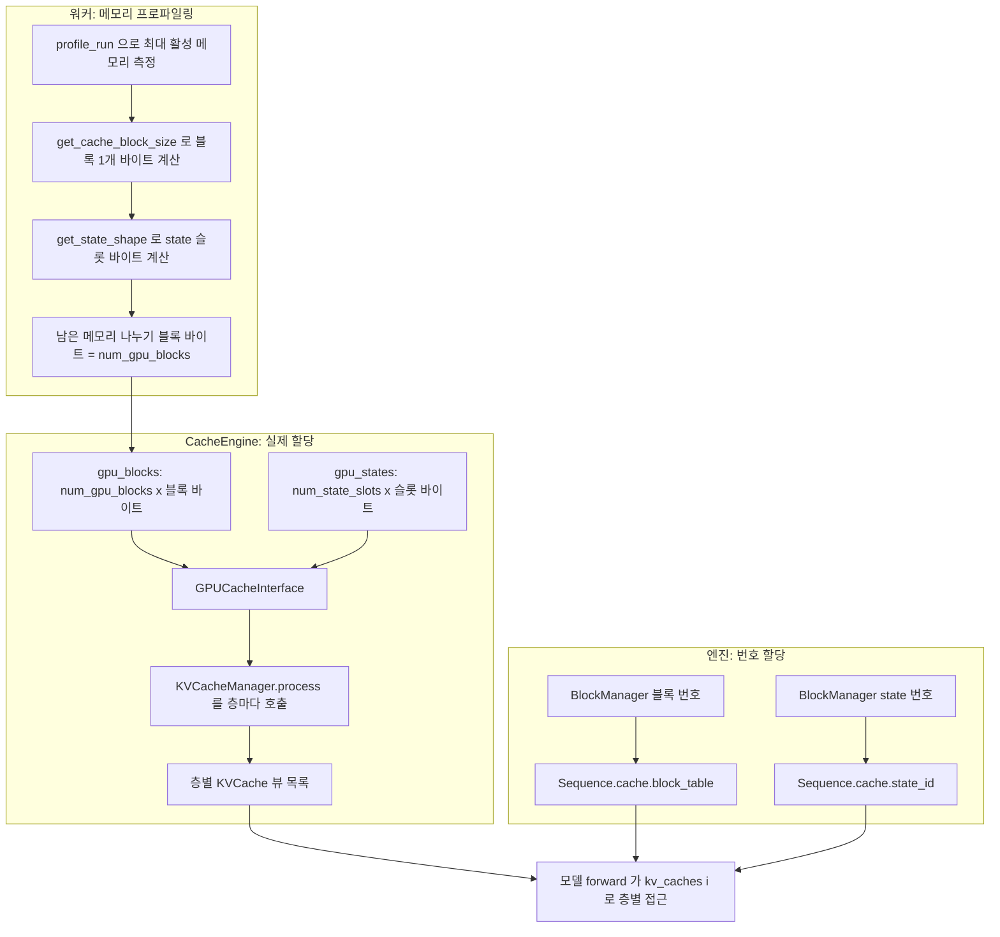

DeepInfer의 KV 캐시는 "블록 캐시"와 "state 캐시" 두 덩어리로 나뉜다. 압축된 main KV와 indexer K는 vLLM처럼 고정 크기 블록에 페이징으로 담고, sliding window KV와 압축 경계의 누적값은 시퀀스마다 슬롯 하나를 전체 할당하는 state 캐시에 담는다. 이 장은 [`deepinfer/worker/cache_engine.py`](https://github.com/deepseek-ai/DeepInfer/blob/a679bb86ce36e883a98a97733492b686e5b9a08e/deepinfer/worker/cache_engine.py)를 중심으로 두 캐시의 크기가 어떻게 정해지고, 한 블록 안에서 층별 바이트가 어떻게 배치되며, 스케줄러가 블록 번호를 어떻게 나눠 주는지 따라간다.

## 두 종류의 캐시

DeepSeek-V4 계열 어텐션은 층마다 세 종류의 KV를 쓴다(어텐션 자체는 6장에서 다룬다). 압축 KV(`ca`), indexer K(`ica`), sliding window KV(`swa`)다. 앞의 둘은 문맥 길이에 비례해 늘어나므로 블록 단위로 페이징하고, SWA는 창 크기만큼만 있으면 되므로 시퀀스당 고정 크기 ring buffer로 둔다. 압축 비율이 2인 층은 아직 압축되지 않은 토큰의 중간값을 들고 있어야 하는데, 이것도 시퀀스당 고정 크기라 state 쪽에 들어간다.

| 구분 | 담는 것 | 단위 | 크기를 정하는 것 | 할당자 |
|---|---|---|---|---|
| 블록 캐시 (`gpu_blocks`) | 층별 압축 main KV(`ca_cache`), indexer K(`ica_cache`) | 블록 1개 = 압축 전 128토큰 | 프로파일링 뒤 남은 메모리 | `BlockManager(num_gpu_blocks)` |
| state 캐시 (`gpu_states`) | 층별 SWA ring(`swa_cache`), 압축 누적값(`ca_state`, `ica_state`) | 슬롯 1개 = 시퀀스 1개 | `max_num_seqs × 1.2 + 1` | `BlockManager(num_state_seqs)` |

두 할당자는 같은 C++ 클래스를 쓴다. [`llm_engine.py`](https://github.com/deepseek-ai/DeepInfer/blob/a679bb86ce36e883a98a97733492b686e5b9a08e/deepinfer/engine/llm_engine.py#L265-L266)에서 블록용과 state용을 하나씩 만든다.

```python
self.block_manager = BlockManager(cache_config.num_gpu_blocks)
self.state_manager = BlockManager(cache_config.num_state_seqs) if cache_config.bytes_of_state_per_seqs > 0 else None
```

state 바이트가 0인 모델(SWA도 압축 state도 없는 모델)에서는 state 할당자를 만들지 않는다. vLLM의 KV 캐시 매니저가 블록 하나만 관리하는 것과 달리(미검증), DeepInfer는 시퀀스마다 "블록 테이블 + state id" 두 자원을 함께 잡아야 스케줄링이 된다.



## 정리

- KV 캐시는 블록 캐시(압축 main KV, indexer K)와 state 캐시(SWA ring, 압축 누적값) 둘로 나뉘고, 엔진은 같은 C++ `BlockManager`를 두 벌 만들어 블록 번호와 state 번호를 따로 나눠 준다
- 블록 1개는 압축 전 128토큰이며, 한 블록 행 안에 모든 층의 `ica`, `ca` 구간이 32바이트 정렬로 이어 붙는다. 압축 비율 2인 층은 같은 블록에 64개 압축 토큰만 담는다
- main · SWA KV는 토큰당 528B(FP8 512개 + UE8M0 scale 16개), FP4 main KV는 288B, FP4 indexer K는 68B이고 포맷 정의는 `cache_common.py` 한 곳에 있다
- SWA ring과 압축 state ring은 추측 디코딩 되돌림 여유(`DEEPINFER_MAX_BACKTRACKING_TOKENS`, 최소 6)만큼 더 크게 잡는다. V4.1 배포 문서 기준 SWA ring은 134토큰이다
- 공개본의 prefix 재사용은 `fork_seq`의 참조 카운트 공유와 마지막 블록 copy-on-write뿐이다. 해시 기반 prefix 매칭과 외부 KV 저장소는 공개되지 않았고, state를 저장 형식으로 바꾸는 함수만 남아 있다
- 어텐션 커널은 블록 테이블 대신 물리 슬롯 인덱스 배열을 받으므로, `get_kv_index.py`, `convert_kv_index` 같은 인덱스 변환 커널이 매 스텝 앞단에서 돈다
