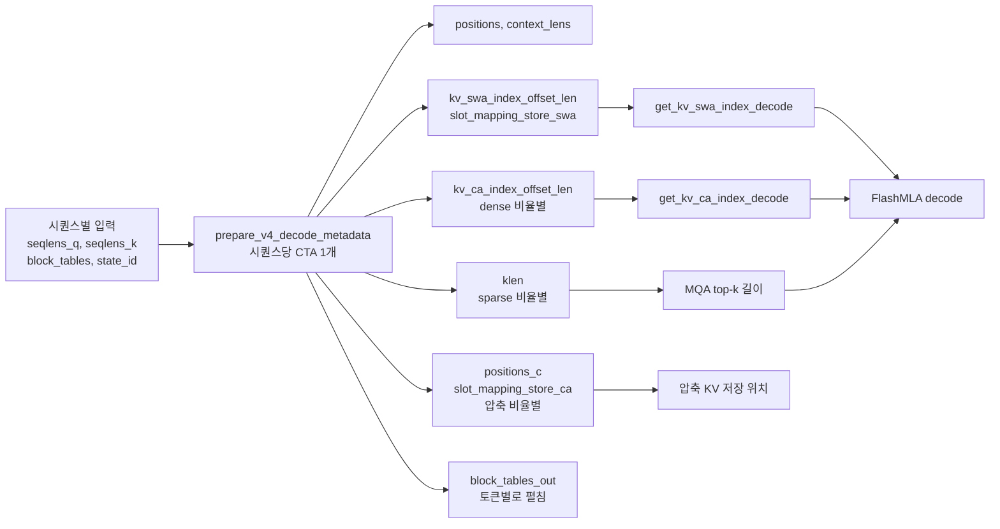

decode 에서 두 캐시를 직접 조회하는 커널과 메타데이터 준비를 본다.

## decode 어텐션: 두 캐시 직접 조회

decode는 KV를 모으지 않고 FlashMLA가 페이징 캐시를 직접 읽는다. SWA 캐시와 압축 캐시를 `key_cache`, `key_cache_extra` 두 개로 넘기고, 각각의 물리 슬롯 인덱스를 함께 준다.

### 코드 분석: _decode_attention

```python
if self.use_swa:
    attn_kv_args = dict(
        key_cache=kv_cache.swa_cache,
        indices_in_kvcache=kv_swa_index,
        key_cache_extra=kv_cache.ca_cache,
        indices_in_kvcache_extra=kv_ca_index,
        index_length_extra=dense_index_len,
    )
else:
    attn_kv_args = dict(
        key_cache=kv_cache.ca_cache,
        indices_in_kvcache=kv_ca_index,
        index_length=dense_index_len,
    )
...
context, _ = decode_mla_mqa_sparse(
    q_b,
    head_dim_v=self.qk_head_dim,
    sched_meta=input_metadata.flash_mla_sched_meta_dict[self.sched_meta_key],
    softmax_scale=self.softmax_scale,
    attn_sink=self.attn_sink_params,
    batch_invariant=envs.DEEPINFER_BATCH_INVARIANT,
    fused_norm_rope_cast_kwargs=fused_kwargs,
    **attn_kv_args,
)
```

[원본 640~669행](https://github.com/deepseek-ai/DeepInfer/blob/a679bb86ce36e883a98a97733492b686e5b9a08e/deepinfer/model_executor/models/v4_modules/attn.py#L640-L669)이다. 받는 쪽 [`decode_mla_mqa_sparse`](https://github.com/deepseek-ai/DeepInfer/blob/a679bb86ce36e883a98a97733492b686e5b9a08e/deepinfer/model_executor/layers/attention_backend.py#L77-L146)는 `flash_mla_with_kvcache`에 `block_table=None`, `cache_seqlens=None`, `causal=False`, `is_fp8_kvcache=True`를 넘긴다. 주석은 FlashMLA가 앞의 두 인자를 받기만 하고 무시한다고 적는다. 블록 테이블 해석은 이미 인덱스 변환 커널이 끝냈기 때문이다.

- `sched_meta_key`는 `"{ratio}_{packed}_{swa}_{index_topk}"`이다([241행](https://github.com/deepseek-ai/DeepInfer/blob/a679bb86ce36e883a98a97733492b686e5b9a08e/deepinfer/model_executor/models/v4_modules/attn.py#L241)). 같은 모양의 층은 FlashMLA tile 스케줄 메타데이터(`FlashMLASchedMeta`)를 공유한다. 메타데이터 dict는 `defaultdict(FlashMLASchedMeta)`라 첫 층에서 채워지고 다음 층이 재사용하는 구조로 보인다(추정)
- `batch_invariant`는 `DEEPINFER_BATCH_INVARIANT`를 그대로 넘긴다. README가 결정적 샘플링 설정으로 안내하는 값이다(9장)

## decode 메타데이터: 단일 커널의 인덱스 오프셋 일괄 계산

decode 어텐션이 쓰는 위치 · 슬롯 정보는 스텝마다 GPU에서 한 번에 만든다. zero-overhead scheduling(ZOS) 경로는 [`prepare_tensor_input_zos.py`](https://github.com/deepseek-ai/DeepInfer/blob/a679bb86ce36e883a98a97733492b686e5b9a08e/deepinfer/model_executor/input_metadata/prepare_tensor_input_zos.py#L336-L367)에서 TileLang 커널 [`prepare_v4_decode_metadata`](https://github.com/deepseek-ai/DeepInfer/blob/a679bb86ce36e883a98a97733492b686e5b9a08e/deepinfer/model_executor/layers/tilelang_ops/prepare_v4_decode_metadata.py#L10-L96)를 부르고, ZOS가 아니면 C++ `prepare_decode_v4`가 같은 일을 한다(4장). 커널은 시퀀스당 CTA 하나로 돌고, 압축 비율별 출력을 비율 수만큼 쌓아 한 번에 채운다.



### 코드 분석: prepare_v4_decode_metadata_ref

참조 구현에서 SWA와 압축 저장 슬롯을 계산하는 부분을 본다.

```python
# kv_swa_index_offset_len
swa_len = torch.clamp(pos + 1, max=window_size)  # min(pos+1, window_size)
window_start_pos = pos - swa_len + 1
swa_off = state_id_per_token * swa_block_size + window_start_pos % swa_block_size
kv_swa_index_offset_len[:total_q, 0] = swa_off
kv_swa_index_offset_len[:total_q, 1] = swa_len

# slot_mapping_store_swa
slot_mapping_store_swa[:total_q] = state_id_per_token * swa_block_size + pos % swa_block_size
...
for ci, ratio in enumerate(ca_ratios):
    cbs = block_size // ratio
    cn_idx = pos // ratio  # [total_q]
    is_boundary = ((pos + 1) % ratio) == 0  # [total_q] bool
    positions_c[ci, :total_q] = torch.where(is_boundary, cn_idx * ratio, torch.zeros_like(pos))
    ...
    slot_mapping_store_ca[ci, :total_q] = torch.where(is_boundary, slot_val, torch.full_like(slot_val, -1))
```

[원본 209~245행](https://github.com/deepseek-ai/DeepInfer/blob/a679bb86ce36e883a98a97733492b686e5b9a08e/deepinfer/model_executor/layers/tilelang_ops/prepare_v4_decode_metadata.py#L209-L245)에서 블록 테이블 gather 부분을 줄였다.

- SWA는 블록 테이블을 쓰지 않는다. 블록 번호가 곧 state id이고, 블록 안 위치는 `pos % swa_block_size`인 ring이다. 5장의 state 슬롯 뷰와 맞물리는 지점이다
- 압축 KV는 블록 끝 토큰(`(pos + 1) % ratio == 0`)만 저장 슬롯을 받고 나머지는 `-1`이다. 압축 커널이 블록 끝에서만 값을 내는 것과 짝을 이룬다. `positions_c`는 압축 블록의 시작 위치로, 압축 KV의 RoPE 위치가 된다
- dense 비율의 `kv_ca_index_offset_len` 오프셋은 `q_off * max_num_blocks * (block_size // ratio)`다. int32를 넘을 수 있어 [진입부에서 미리 검사한다](https://github.com/deepseek-ai/DeepInfer/blob/a679bb86ce36e883a98a97733492b686e5b9a08e/deepinfer/model_executor/layers/tilelang_ops/prepare_v4_decode_metadata.py#L55-L60)
- placeholder 시퀀스(CUDA graph padding)의 `query_indices`는 `998244353`이라는 큰 값으로 채운다. indexer 커널이 이 행을 건너뛰게 하는 표식으로 보인다(추정)

> **주의**: 함수 이름에 "V4"가 붙어 있지만 코드 주석과 docstring은 대상 모델을 "V4.1"로 부른다(`V41_FORMAT`, "HF V4.1 index attention" 등). 공개된 DeepSeek-V4 원본 모델과의 구조 차이는 저장소에서 확인할 수 없다.
