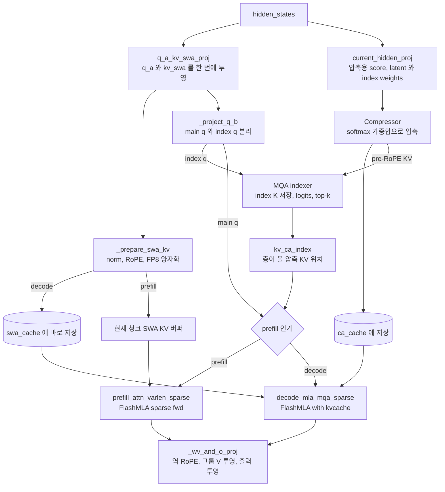

DeepSeek-V4 계열 어텐션은 한 층 안에서 세 종류의 KV를 함께 참조한다. 최근 토큰은 sliding window(SWA)로 원래 해상도 그대로 보고, 먼 과거는 1:1 또는 2:1로 압축한 KV로 보며, 압축 KV가 많아지면 indexer가 고른 top-k만 본다. 이 장은 [`v4_modules/attn.py`](https://github.com/deepseek-ai/DeepInfer/blob/a679bb86ce36e883a98a97733492b686e5b9a08e/deepinfer/model_executor/models/v4_modules/attn.py)의 `V4Attention.forward`를 축으로, 압축기 `Compressor`, indexer `MQA`, decode 메타데이터 커널, FlashMLA 호출 지점까지 한 스텝의 데이터 흐름을 따라간다. KV가 메모리에 어떻게 놓이는지는 5장에서 다뤘다.

## 층 구성과 세 종류의 KV

모델 최상위는 [`models/deepseek.py`](https://github.com/deepseek-ai/DeepInfer/blob/a679bb86ce36e883a98a97733492b686e5b9a08e/deepinfer/model_executor/models/deepseek.py)의 `DeepseekForCausalLM`이다. [생성자](https://github.com/deepseek-ai/DeepInfer/blob/a679bb86ce36e883a98a97733492b686e5b9a08e/deepinfer/model_executor/models/deepseek.py#L251-L306)는 HF 파라미터 묶음에서 main 층(`num_hidden_layers`개), 출력 head, lm head, 그리고 그 뒤의 MTP 층을 차례로 분리한다. main 층은 `DeepseekModel`이 `DeepseekDecoderLayer`로 감싸고, 각 층의 어텐션이 `V4Attention`이다.

층마다 config가 다르다. `attn_module_list`의 각 항목이 `kv_compress_ratio`, `index_topk`, `use_swa`, `sink_mode`를 따로 갖는다. 어떤 조합이 가능한지는 [`V4AttentionBase.__init__`](https://github.com/deepseek-ai/DeepInfer/blob/a679bb86ce36e883a98a97733492b686e5b9a08e/deepinfer/model_executor/models/v4_modules/attn.py#L65-L102)의 assert가 정한다.

| 층 유형 | `kv_compress_ratio` | `index_topk` | `use_swa` | 보는 KV |
|---|---|---|---|---|
| SWA 전용 | 0 | 0 | True | 최근 `window_size` 토큰 |
| SWA + dense 압축 | 1 또는 2 | 0 | True | SWA + 압축 KV 전체 |
| SWA + sparse 압축 | 1 또는 2 | > 0 | True (필수) | SWA + indexer 가 고른 압축 KV top-k |
| packed 전용 | 1 또는 2 | 0 | False | 압축 KV 전체 (YOCO consumer 층 등) |

- `has_packed_kv`는 `n_packed_heads > 0`인지로 판정한다. 압축 KV를 가진 층이라는 뜻이다
- `is_sparse`면 `use_swa`가 반드시 참이어야 하고, `use_swa=False`면 반드시 압축 KV가 있어야 한다
- 압축 비율은 [`Compressor`](https://github.com/deepseek-ai/DeepInfer/blob/a679bb86ce36e883a98a97733492b686e5b9a08e/deepinfer/model_executor/models/v4_modules/compress.py#L73-L78)에서 1과 2만 허용한다. 4나 128, overlap 압축, APE는 "no longer supported" 오류를 낸다

KV는 head가 하나다. 5장의 캐시 엔진은 `num_key_value_heads == 1`을 assert하고, 토큰 하나의 KV가 `head_dim`(= `kv_lora_rank + qk_rope_head_dim`) 원소 한 줄이다. 이 한 줄이 K와 V를 겸한다. 그래서 어텐션 출력의 마지막 RoPE 차원은 되돌려야 하고, [`_wv_and_o_proj`](https://github.com/deepseek-ai/DeepInfer/blob/a679bb86ce36e883a98a97733492b686e5b9a08e/deepinfer/model_executor/models/v4_modules/attn.py#L191-L225)는 출력의 `[-qk_rope_head_dim:]` 구간에 `conjugate=True` RoPE를 건 뒤 그룹별 V 투영(`fp8_einsum "bhr,hdr->bhd"`)과 출력 투영을 한다. vLLM의 MLA 백엔드가 latent KV 하나를 K/V로 함께 쓰는 것과 같은 계열이다(미검증).

## V4Attention.forward 개요



### 코드 분석: forward 의 앞부분

투영을 시작하기 전에 CP all-gather를 걸어 두고 Q 투영과 겹치는 부분을 본다.

```python
input_metadata.compute_attn_info(self.max_model_len, self.window_size, block_size)
use_cp = input_metadata.is_prompt and PG.context_parallel_group().size() > 1
shared_hidden_bf16 = self._resolve_shared_hidden(hidden_states_bf16, shared_hidden_bf16)
projected_kv, index_weights = self._project_current_hidden_inputs(hidden_states_bf16)
...
with userbuffer.cp_session(enabled=use_cp):
    wait_projected_kv = _make_cp_gather_getter(projected_kv, use_cp) if not yoco_full_kv_stored else None

    q_a, kv_swa = self._project_q_and_swa(
        hidden_states,
        shared_hidden_bf16,
    )
    ...
    q_b, index_q_b = self._project_q_b(q_a, input_metadata.positions)
    del q_a

    kv_ca_index = self._compute_kv_ca_index(
        wait_projected_kv, index_weights, index_q_b, kv_cache, input_metadata, cross_layer_runtime,
    )
```

[원본 752~810행](https://github.com/deepseek-ai/DeepInfer/blob/a679bb86ce36e883a98a97733492b686e5b9a08e/deepinfer/model_executor/models/v4_modules/attn.py#L752-L810)에서 YOCO 분기와 일부 인자를 줄였다.

- `compute_attn_info`는 층마다 불리지만, 인덱스 텐서가 이미 있으면 다시 만들지 않는다. 첫 층에서 한 번 계산한 결과를 모든 층이 공유한다(5장)
- 압축용 투영(`projected_kv`)은 `_make_cp_gather_getter`로 all-gather를 먼저 띄우고, 결과는 `wait_projected_kv()`를 부를 때 기다린다. 그 사이 Q 투영이 돈다. context parallel(CP)은 10장에서 다룬다
- `_project_current_hidden_inputs`는 압축기 입력(`kv`)과 indexer 헤드 가중치(`index_weights`)를 [한 GEMM으로 묶어](https://github.com/deepseek-ai/DeepInfer/blob/a679bb86ce36e883a98a97733492b686e5b9a08e/deepinfer/model_executor/models/v4_modules/attn.py#L328-L373) 계산하고 나눈다. 압축 비율 2이면 fp32 출력이다. 압축 커널이 fp32 score와 latent를 받기 때문이다

투영 묶음은 생성자에서 정해진다. [`_init_q_projections`](https://github.com/deepseek-ai/DeepInfer/blob/a679bb86ce36e883a98a97733492b686e5b9a08e/deepinfer/model_executor/models/v4_modules/attn.py#L278-L306)는 `Wq.A`와 `Wkv.A`를 이어 붙여 `q_a_kv_swa_proj` 하나로 만들고, `Wq.B`와 indexer의 `q_B`도 이어 붙여 `q_b_proj` 하나로 만든다. 입력이 같은 투영은 모두 합쳐 GEMM 수를 줄이는 방식이다.

| 투영 | 입력 | 출력 | 합친 원본 가중치 |
|---|---|---|---|
| `q_a_kv_swa_proj` | hidden | `q_lora_rank` + `head_dim` | `Wq.A`, `Wkv.A` |
| `q_b_proj` | `q_a` (norm 후) | `num_heads × head_dim` + `index_n_head × index_head_dim` | `Wq.B`, `index_attn.q_B` |
| `current_hidden_proj` | hidden (bf16) | 압축 gate · latent + indexer 헤드 가중치 | `PackedWkv.Gate`, `PackedWkv.A`, `index_attn.weights_proj` |
| `wv_weight` + `out_proj` | 어텐션 출력 | hidden | `Wv` (그룹 `o_groups`개), `out_proj` |

## 정리

- V4 어텐션 층은 SWA, 압축 KV(비율 1 또는 2), indexer top-k 세 요소의 조합이며, 층마다 config로 조합이 다르다. KV는 head 하나짜리 latent로 K와 V를 겸한다
- 압축은 `ratio`개 토큰을 채널별 softmax(score) 가중합으로 합치고, 덜 찬 블록의 중간값은 state ring(`ca_state`)에 두었다가 다음 청크 · 스텝에서 이어 쓴다
- indexer `MQA`는 FP4 Q · K로 `relu(q·k)·weights` 점수를 내고 DeepSelect `topk`로 위치를 고른 뒤, `convert_kv_index`로 페이징 캐시의 물리 슬롯으로 바꿔 FlashMLA에 넘긴다
- prefill은 캐시에서 KV를 BF16 버퍼로 모아 `flash_mla_sparse_fwd`를, decode는 SWA 캐시와 압축 캐시를 `flash_mla_with_kvcache`에 두 개로 넘겨 직접 읽게 한다. 블록 테이블은 커널에 넘기지 않는다
- 투영은 입력이 같은 것끼리 GEMM 하나로 합치고, norm · RoPE · 양자화 · 캐시 쓰기는 `fused_norm_rope_hadamard_cast_store_kvcache` 커널 하나로 처리한다
- decode 위치 · 슬롯 정보는 `prepare_v4_decode_metadata` 커널 하나가 압축 비율별로 쌓아 채우고, 층들은 `compute_attn_info`에서 만든 인덱스를 공유한다
