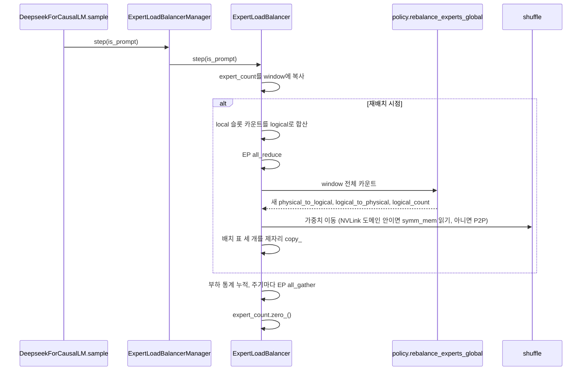

expert 부하 통계로 expert 배치를 바꾸는 EPLB 와 설정값을 본다.

## EPLB: 부하 기반 expert 재배치

라우팅은 입력에 따라 특정 expert에 몰린다. EP에서는 가장 많이 받은 rank가 끝나야 combine이 끝나므로, rank 사이 부하 차이가 곧 지연이다. EPLB는 최근 N 스텝의 expert별 토큰 수를 모아 두었다가 M 스텝마다 복제 대상과 rank 배치를 다시 계산하고, 가중치를 옮긴다.



### 런타임 상태

`ExpertLoadBalancer`가 들고 있는 텐서는 모두 GPU에 있고, gate와 dispatch 커널이 직접 읽고 쓴다([`eplb/__init__.py#L48-L53`](https://github.com/deepseek-ai/DeepInfer/blob/a679bb86ce36e883a98a97733492b686e5b9a08e/deepinfer/model_executor/eplb/__init__.py#L48-L53)).

| 텐서 | 모양 | 쓰는 곳 |
|---|---|---|
| `expert_count` | `[layers, local_physical]` | dispatch, mega MoE 커널이 누적. 스텝마다 0으로 초기화 |
| `physical_to_logical_map` | `[layers, physical]` | 가중치 이동 계획 |
| `logical_to_physical_map` | `[layers, logical, redundant + 1]` | gate 커널이 physical 슬롯을 고를 때. 빈칸은 -1 |
| `logical_count` | `[layers, logical]` | logical expert별 복제본 수 |
| `_expert_count_window` | `[window, layers, local_physical]` | 최근 window 스텝의 카운트 고리 버퍼 |

재배치할 때 이 표들을 새 텐서로 바꾸지 않고 `copy_`로 덮어쓴다. CUDA graph에 캡처된 커널이 같은 주소를 계속 읽어야 하기 때문이다(4장의 CUDA graph 참고).

모델은 모양이 같은 MoE 레이어끼리 balancer 하나를 공유한다. [`DeepseekForCausalLM._init_eplb`](https://github.com/deepseek-ai/DeepInfer/blob/a679bb86ce36e883a98a97733492b686e5b9a08e/deepinfer/model_executor/models/deepseek.py#L324-L365)가 (logical 수, physical 수, EP 그룹, 가중치 모양과 dtype)을 키로 레이어를 묶는다. 본체 레이어와 MTP 레이어의 MoE 설정이 다르면 balancer가 둘 생긴다. `ExpertLoadBalancerManager.layer(i)`가 전역 레이어 번호를 (balancer, 그 안의 번호)로 바꿔 준다.

### 코드 분석: 재배치 시점

무엇을 보는지: 매 스텝 불리는 재배치 판정. [`eplb/__init__.py#L146-L165`](https://github.com/deepseek-ai/DeepInfer/blob/a679bb86ce36e883a98a97733492b686e5b9a08e/deepinfer/model_executor/eplb/__init__.py#L146-L165)

```python
def _update_rearrangement(self, is_prompt: bool) -> None:
    if self._rearrangement_interval == 0:
        return
    if is_prompt and self._skip_rearrangement_on_prefill:
        return

    window_index = self._expert_count_window_index
    self._expert_count_window[window_index].copy_(self.expert_count)
    self._expert_count_window_index = (window_index + 1) % self._expert_count_window.size(0)

    if is_prompt and self._schedule_rearrangement_after_prefill:
        self._rearrangement_step = self._rearrangement_interval - 1
        return

    self._rearrangement_step += 1
    if self._rearrangement_step < self._rearrangement_interval:
        return
    self._rearrangement_step = 0
    self._rearrange_experts()
```

`step`은 [`DeepseekForCausalLM.sample`](https://github.com/deepseek-ai/DeepInfer/blob/a679bb86ce36e883a98a97733492b686e5b9a08e/deepinfer/model_executor/models/deepseek.py#L402-L409)이 샘플링 직후 부른다. EP 크기가 1이면 아무것도 하지 않는다.

- 재배치 주기 `DEEPINFER_EXPERT_REARRANGEMENT_STEP_INTERVAL`의 기본값은 0이고, 0이면 EPLB 재배치는 꺼진다. 통계만 모은다
- 첫 재배치는 주기의 1/4이 지난 시점에 한다. 생성자가 `_rearrangement_step`을 `interval - max(1, interval // 4)`에서 시작하게 둔다([`#L121-L123`](https://github.com/deepseek-ai/DeepInfer/blob/a679bb86ce36e883a98a97733492b686e5b9a08e/deepinfer/model_executor/eplb/__init__.py#L121-L123)). 처음 배치는 부하를 모르고 정한 것이라 빨리 고치려는 설계다
- NORMAL 엔진(prefill과 decode를 한 엔진에서 섞는 모드, 10장)에서는 기본적으로 prefill 스텝을 통계에서 뺀다. `DEEPINFER_REARRANGE_AFTER_PREFILL_IN_NORMAL_ENGINE=1`이면 반대로 prefill을 통계에 넣고, prefill 직후 다음 decode 스텝에서 바로 재배치한다
- window 크기는 1 이상, 주기 이하여야 한다. 생성자가 검사한다([`#L102-L111`](https://github.com/deepseek-ai/DeepInfer/blob/a679bb86ce36e883a98a97733492b686e5b9a08e/deepinfer/model_executor/eplb/__init__.py#L102-L111))

### 코드 분석: 재배치 본체

무엇을 보는지: local 슬롯 단위 카운트를 logical 단위로 바꿔 전 rank에서 합치고, 정책을 불러 가중치를 옮기는 부분. [`eplb/__init__.py#L234-L278`](https://github.com/deepseek-ai/DeepInfer/blob/a679bb86ce36e883a98a97733492b686e5b9a08e/deepinfer/model_executor/eplb/__init__.py#L234-L278)

```python
logical_expert_token_counts.scatter_add_(
    -1,
    local_physical_to_logical_map.to(torch.int64).expand_as(self._expert_count_window),
    self._expert_count_window,
)
dist.all_reduce(logical_expert_token_counts, group=ep_group)

next_physical_to_logical_map, next_logical_to_physical_map, next_logical_count = rebalance_experts_global(
    logical_expert_token_counts,
    num_physical_experts,
    num_local_physical_experts,
)
if self._intranode_shuffle:
    expert_model_parallel_shuffle_inplace_intranode(
        self._ipc_weight_buffers, self.physical_to_logical_map,
        self._expert_weights, next_physical_to_logical_map, ep_group,
    )
else:
    expert_model_parallel_shuffle_inplace(
        self.physical_to_logical_map, self._expert_weights,
        next_physical_to_logical_map, ep_group,
    )
self.physical_to_logical_map.copy_(next_physical_to_logical_map)
```

카운트는 window 축을 그대로 둔 채 정책에 넘긴다. 정책이 스텝별 최대 부하를 보기 때문이다. 모든 rank가 같은 합산 카운트로 같은 정책을 돌리므로 새 배치 표는 통신 없이 모든 rank에서 같다.

함수 전체가 `@allow_cuda_sync()` 아래에 있다. forward 중 CPU-GPU 동기화를 막는 가드(`DEEPINFER_DISABLE_SYNC_GUARD`로 끔)가 있는데, 재배치는 `.tolist()`와 all_reduce를 쓰므로 명시적으로 허용한다. rank 0은 재배치 시간과 균형 지표를 로그로 남긴다([`_log_rearrangement_metrics`](https://github.com/deepseek-ai/DeepInfer/blob/a679bb86ce36e883a98a97733492b686e5b9a08e/deepinfer/model_executor/eplb/__init__.py#L290-L343)).

### 정책 1단계: 복제 대상 expert 선정

[`rebalance_experts_global`](https://github.com/deepseek-ai/DeepInfer/blob/a679bb86ce36e883a98a97733492b686e5b9a08e/deepinfer/model_executor/eplb/policy.py#L73-L140)은 여분 슬롯을 하나씩 채우는 탐욕 알고리즘이다. 스텝 $s$, logical expert $j$의 토큰 수를 $T_{s,j}$, 현재 복제본 수를 $c_j$라 하면 복제본 하나가 받는 부하는 $T_{s,j}/c_j$다. 매 라운드 각 후보 $j$에 대해 "$j$에 복제본을 하나 더 주면 스텝별 최대 복제본 부하의 합이 얼마가 되는가"를 계산하고, 그 값이 가장 작은 $j$를 고른다.

$$
j^\star = \arg\min_j \sum_s \max\Big(\max_{i \ne j} \frac{T_{s,i}}{c_i},\ \frac{T_{s,j}}{c_j + 1}\Big)
$$

코드는 이 식을 텐서 연산으로 계산한다. 현재 최댓값 자리만 "복제본 추가 후" 값으로 바꾸고 다시 최댓값을 구하면, 최댓값이 아닌 $j$에 복제본을 줄 때는 최댓값이 그대로라는 점을 이용한다([`policy.py#L105-L123`](https://github.com/deepseek-ai/DeepInfer/blob/a679bb86ce36e883a98a97733492b686e5b9a08e/deepinfer/model_executor/eplb/policy.py#L105-L123)). 동점을 피하려고 카운트에 `arange * 1e-4`를 더한다.

### 정책 2단계: 복제본의 rank 배치

rank 하나에 슬롯이 둘 이상이면 [`_batch_greedy_indices`](https://github.com/deepseek-ai/DeepInfer/blob/a679bb86ce36e883a98a97733492b686e5b9a08e/deepinfer/model_executor/eplb/policy.py#L12-L70)가 슬롯을 rank에 나눈다. 레이어마다 독립으로 다음 값을 줄이는 것이 목표다. $R_r$은 rank $r$에 놓인 복제본 집합, $w_{s,e}$는 스텝 $s$에서 복제본 $e$의 부하다.

$$
\sum_s \max_r \sum_{e \in R_r} w_{s,e}
$$

복제본을 총부하 내림차순으로 하나씩 꺼내, 빈자리가 남은 rank마다 "여기 놓았을 때 위 값"을 계산해 가장 작은 rank에 놓는다. 총합 부하만 맞추는 방식과 다른 점은 스텝별 최댓값을 본다는 것이다. 두 expert가 총합은 같아도 같은 스텝에 몰리면 같은 rank에 두지 않는다. 층 축은 배치 차원으로 한꺼번에 처리하므로 Python 루프는 physical 슬롯 수만큼만 돈다.

### 가중치 이동

[`shuffle.py`](https://github.com/deepseek-ai/DeepInfer/blob/a679bb86ce36e883a98a97733492b686e5b9a08e/deepinfer/model_executor/eplb/shuffle.py#L1-L218)에는 구현이 두 개 있다.

| 구현 | 조건 | 방식 |
|---|---|---|
| `expert_model_parallel_shuffle_inplace_intranode` | EP 그룹이 NVLink 도메인 안이고 GPU | 레이어 하나 크기의 `symm_mem` 미러를 만들고, 각 rank가 상대 미러에서 필요한 슬롯을 직접 복사 |
| `expert_model_parallel_shuffle_inplace` | 그 밖 (NPU 포함) | NCCL/HCCL `batch_isend_irecv`. `DEEPINFER_REARRANGE_P2P_GROUPS`(기본 1)개 버킷으로 나눠 보냄 |

두 구현 모두 같은 계획 함수를 쓴다. `_plan_intra_copies`가 rank 안에서 해결되는 이동을 먼저 고르고, `_remote_routes`가 expert마다 보내는 rank와 받는 rank를 정하며, `_paired_sender`가 받는 쪽을 보내는 쪽에 고르게 나눈다. 양쪽이 같은 함수로 짝을 정하므로 P2P 송수신이 어긋나지 않는다.

intranode 구현은 레이어마다 barrier를 두 번 친다([`shuffle.py#L192-L195`](https://github.com/deepseek-ai/DeepInfer/blob/a679bb86ce36e883a98a97733492b686e5b9a08e/deepinfer/model_executor/eplb/shuffle.py#L192-L195)). 첫 barrier는 모든 rank가 이전 레이어 미러를 다 읽었는지, 둘째는 이번 레이어 미러가 다 채워졌는지 확인한다. 미러를 한 레이어 크기로 두고 재사용하므로 추가 메모리는 레이어 하나 분량이다. 미러를 처음 만들 때 `torch.cuda.empty_cache()`를 먼저 부르는 것도 OOM을 피하려는 장치다([`_initialize_shuffle`](https://github.com/deepseek-ai/DeepInfer/blob/a679bb86ce36e883a98a97733492b686e5b9a08e/deepinfer/model_executor/eplb/__init__.py#L195-L220)). 패키지 초기화가 `TORCH_SYMM_MEM_ALLOW_OVERLAPPING_DEVICES=1`을 미리 설정하는 이유도 이 미러다([`deepinfer/__init__.py#L41-L42`](https://github.com/deepseek-ai/DeepInfer/blob/a679bb86ce36e883a98a97733492b686e5b9a08e/deepinfer/__init__.py#L41-L42)).

### 부하 지표

재배치와 별개로 `DEEPINFER_MOE_LB_STAT_INTERVAL`(기본 128) 스텝마다 rank별 수신 토큰 수를 EP all_gather로 모은다([`_update_load_balance_stats`](https://github.com/deepseek-ai/DeepInfer/blob/a679bb86ce36e883a98a97733492b686e5b9a08e/deepinfer/model_executor/eplb/__init__.py#L167-L193)). 결과는 (rank 평균 합, rank 최대 합)을 CPU로 비동기 복사해 두었다가 샘플러 출력의 후처리에서 `moe_load_balance_ratio`로 꺼낸다. 통계 로거의 [`_moe_lb_ratio`](https://github.com/deepseek-ai/DeepInfer/blob/a679bb86ce36e883a98a97733492b686e5b9a08e/deepinfer/engine/stats_logger.py#L238-L241)가 최대 합을 평균 합으로 나눠 `moe_lb`로 출력한다. 데이터가 없으면 1.0이다. 배포 문서가 말하는 `moe_lb`(가장 느린 rank / 평균)가 이 값이다.

## EPLB 설정

| 환경변수 | 기본값 | 의미 |
|---|---|---|
| `DEEPINFER_OVERRIDE_NUM_EXTRA_EXPERTS` | 0 | 여분 expert 수 하한. `ep_size` 배수가 되도록 올림 |
| `DEEPINFER_EXPERT_COUNT_WINDOW_SIZE` | 100 | 정책에 넘기는 최근 스텝 수 |
| `DEEPINFER_EXPERT_REARRANGEMENT_STEP_INTERVAL` | 0 | 재배치 주기. 0이면 재배치 안 함 |
| `DEEPINFER_REARRANGE_AFTER_PREFILL_IN_NORMAL_ENGINE` | 꺼짐 | NORMAL 엔진에서 prefill 직후 재배치 |
| `DEEPINFER_MOE_LB_STAT_INTERVAL` | 128 | 부하 지표 집계 주기 |
| `DEEPINFER_REARRANGE_P2P_GROUPS` | 1 | P2P 이동 버킷 수 |
| `DEEPINFER_SHOW_EPLB_DETAIL` | 꺼짐 | 레이어별 expert 부하 표를 로그로 출력 |
| `DEEPINFER_FORCE_IMBALANCE_RATIO` | 0 | 프로파일용. 첫 rank에 부하를 의도적으로 집중 |
| `DEEPINFER_USERBUFFER_COMM_SMS` | 0 | 통신용 SM 수. 0이면 자동 |

기본값은 [`environ.py#L114-L128`](https://github.com/deepseek-ai/DeepInfer/blob/a679bb86ce36e883a98a97733492b686e5b9a08e/deepinfer/environ.py#L114-L128)에 있다. 예제 스크립트는 EPLB를 켤 때 window 3, 주기 30을 쓴다([`examples/_config.py#L80-L83`](https://github.com/deepseek-ai/DeepInfer/blob/a679bb86ce36e883a98a97733492b686e5b9a08e/examples/_config.py#L80-L83)). 짧은 테스트에서 재배치가 실제로 일어나게 하려는 값이다.

운영 설정은 배포 문서에 있다. 아래는 [`doc/inference_deployment_qa.md#L121-L131`](https://github.com/deepseek-ai/DeepInfer/blob/a679bb86ce36e883a98a97733492b686e5b9a08e/doc/inference_deployment_qa.md#L121-L131)을 그대로 옮긴 값이며, 이 책에서 측정한 값이 아니다.

| 단계 | GPU당 여분 expert (시작값) | 통계 window | 재배치 주기 | 문서가 밝힌 `moe_lb` |
|---|---|---|---|---|
| prefill | 4 | 100 스텝 | 1,000 스텝 | 1.074 (EP4DP4), 1.045 (EP2DP2) |
| decode | 1 | 1,000 스텝 | 10,000 스텝 | 1.090 |

문서는 decode EP64에서 올림 후 GPU당 expert가 shared expert를 빼고 7개가 된다고 적는다. 위 표의 "GPU당 여분"은 GPU 하나당 값이므로, 코드의 `DEEPINFER_OVERRIDE_NUM_EXTRA_EXPERTS`(전체 여분 수 하한)에 넣을 때는 EP 크기를 곱해야 한다(추정. 문서가 환경변수 값으로 적지 않았다).

### 부하 불균형 강제 설정

`DEEPINFER_FORCE_IMBALANCE_RATIO`를 1 이상으로 주면 gate를 무시하고 무작위 선택을 하되, 첫 rank가 다른 rank 평균의 $r$배를 받게 만든다. local expert 점수를 $U(0, f)$, 나머지를 $U(0, 1)$에서 뽑고 top-k를 고른다. $f$는 [`_map_unbalanced_ratio_to_factor`](https://github.com/deepseek-ai/DeepInfer/blob/a679bb86ce36e883a98a97733492b686e5b9a08e/deepinfer/model_executor/models/v4_modules/mlp.py#L347-L357)가 평균장 근사로 정한다. EP 크기 $E$, top-k $k$, local 슬롯 수 $n_\ell$, 전체 슬롯 수 $N$일 때

$$
x = \frac{r}{r + E - 1},\qquad t = 1 - \frac{(1-x)\,k}{N - n_\ell},\qquad f = \frac{t}{1 - x k / n_\ell}
$$

$x$는 첫 rank가 받아야 할 선택 비율, $t$는 top-k 경계 점수다. 분모가 0 이하가 되면(달성 불가능한 비율) $f = 100$으로 포화시킨다. 불균형 정도에 따른 MoE 시간 변화를 재는 용도로 보인다(추정).
