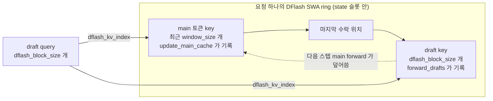

draft 토큰을 만들고 그 확률을 GPU 에 보관하는 코드를 본다.

## draft 생성: run_drafts

수락 판정이 끝나면 sampler가 [`DFlash.decode_forward`](https://github.com/deepseek-ai/DeepInfer/blob/a679bb86ce36e883a98a97733492b686e5b9a08e/deepinfer/model_executor/models/mtp/dflash.py#L378-L387)를 부른다. CUDA graph가 잡혀 있으면 replay하고, 아니면 [`run_drafts`](https://github.com/deepseek-ai/DeepInfer/blob/a679bb86ce36e883a98a97733492b686e5b9a08e/deepinfer/model_executor/models/mtp/dflash.py#L347-L376)를 그대로 실행한다. `run_drafts`는 세 단계다.

1. `build_dflash_input`: 요청마다 마지막 수락 위치 뒤 `dflash_block_size`개 자리의 위치, 저장 슬롯, 참조 슬롯을 만든다
2. `forward_drafts`: 직전 확정 토큰 하나와 noise 토큰들을 임베딩해 DFlash 층을 한 번 통과시킨다
3. `sample_drafts`: 위치별 logits에서 draft 토큰을 뽑고, confidence를 계산하고, pool에 저장한다

### 코드 분석: draft 입력 생성

forward 입력이 무엇인지 본다.

```python
def _embed_draft_init_tokens(self, golden_tokens: torch.Tensor) -> torch.Tensor:
    req_cnt = golden_tokens.shape[0]
    draft_init_tokens = torch.full(
        (req_cnt, self.dflash_block_size),
        fill_value=self.noise_token_id,
        dtype=torch.int,
        device=golden_tokens.device,
    )
    draft_init_tokens[:, 0] = golden_tokens
    return self.embed_tokens(draft_init_tokens.flatten())
```

[원본 230~239행](https://github.com/deepseek-ai/DeepInfer/blob/a679bb86ce36e883a98a97733492b686e5b9a08e/deepinfer/model_executor/models/mtp/dflash.py#L230-L239)이다. 요청마다 `[이번 스텝 확정 토큰, noise, noise, ...]` 길이 `dflash_block_size`인 블록을 만든다. 모든 자리가 한 forward에서 동시에 계산되므로, k번째 draft를 만들 때 k-1번째 draft 토큰을 입력으로 쓰지 않는다. 블록 단위로 한 번에 채우는 방식은 block diffusion 계열 drafter와 같은 발상으로 보인다(미검증. 코드에 논문 인용이 없다). 순서 의존성은 뒤의 markov head가 logits 단계에서 일부 보충한다.

`golden_tokens`는 이번 스텝 sampler가 확정한 토큰이다. 수락된 draft 뒤에 새로 뽑은 토큰, 곧 다음 스텝 입력의 첫 토큰이 된다.

### 코드 분석: 참조 KV 위치

draft 토큰마다 어느 key를 볼지 정하는 참조 구현을 본다.

```python
state_offset = (slot_mapping_swa - positions % swa_block_size).index_select(dim=0, index=idx)
accepted_pos = positions.index_select(dim=0, index=idx) + last_valid_offset

offsets = torch.arange(dflash_block_size, device=device, dtype=torch.int32)
draft_positions = accepted_pos.unsqueeze(1) + 1 + offsets.unsqueeze(0)
newx_slot_mapping = torch.where(is_valid[:, None], draft_positions % swa_block_size + state_offset[:, None], -1)
...
kv_len = window_size + dflash_block_size
padded_kv_len = (kv_len + 63) // 64 * 64
arange_kv = torch.arange(padded_kv_len, device=device, dtype=torch.int32).unsqueeze(0)
start_pos = (accepted_pos - (window_size - 1)).unsqueeze(1)
kv_index_per_req = torch.where(
    is_valid[:, None] & (arange_kv < kv_len),
    (start_pos + arange_kv).clamp(min=-1),
    torch.full_like(arange_kv, -1),
)
```

[`get_kv_index.py`의 `get_fused_dflash_get_input_ref`](https://github.com/deepseek-ai/DeepInfer/blob/a679bb86ce36e883a98a97733492b686e5b9a08e/deepinfer/model_executor/layers/tilelang_ops/get_kv_index.py#L166-L191)에서 일부를 옮겼다. 실제로는 같은 의미의 fused 커널 [`get_fused_dflash_get_input`](https://github.com/deepseek-ai/DeepInfer/blob/a679bb86ce36e883a98a97733492b686e5b9a08e/deepinfer/model_executor/layers/tilelang_ops/get_kv_index.py#L209-L274)을 [`build_dflash_input`](https://github.com/deepseek-ai/DeepInfer/blob/a679bb86ce36e883a98a97733492b686e5b9a08e/deepinfer/model_executor/input_metadata/dflash.py#L36-L84)이 부른다.

- 마지막 수락 위치는 `positions[ftp] + last_valid_offset`이다. `ftp`는 요청의 첫 행 번호, `last_valid_offset`은 수락된 draft 수다
- draft 위치는 그 다음 `dflash_block_size`칸이고, 저장 슬롯은 같은 state의 SWA ring에서 `pos % swa_block_size` 자리다
- draft 하나가 보는 key는 `[accepted_pos - window_size + 1, accepted_pos + dflash_block_size]` 구간, 길이 `window_size + dflash_block_size`를 64 배수로 올린 폭이다. 앞쪽 `window_size`칸은 main 토큰 key, 뒤쪽은 같은 블록의 draft key다. 같은 요청의 draft 행은 모두 같은 인덱스 줄을 공유하므로, 블록 안에서는 서로를 양방향으로 본다
- `ftp < 0`인 요청은 CUDA graph padding이다. 위치 0, 슬롯 `-1`로 채운다



### 코드 분석: DFlashAttention.forward_drafts

```python
q_a, kv_a = self.q_a_kv_proj(draft_hiddens).split([self.q_lora_rank, self.qk_head_dim], dim=-1)
q = self.q_b_proj(self.q_a_norm(q_a))
q = q.unflatten(-1, (self.num_heads, self.qk_head_dim))
q = self._q_b_norm_rope(q, draft_positions)

# Draft keys live for one decode step and are overwritten by the next step.
fused_norm_rope_hadamard_cast_store_kvcache(
    kv_a, ...,
    out_args=KVCacheOutArgs(kv_cache.swa_cache, input_metadata.dflash_newx_slot_mapping_store),
)
...
context, _ = decode_mla_mqa_sparse(
    q, kv_cache.swa_cache, self.qk_head_dim,
    input_metadata.dflash_kv_index,
    input_metadata.flash_mla_sched_meta_dict["DFlash"],
    softmax_scale=self.softmax_scale, attn_sink=self.attn_sink_params, ...
)
return self._wv_and_o_proj(context, draft_positions)
```

[`v4_modules/attn.py` 969~1008행](https://github.com/deepseek-ai/DeepInfer/blob/a679bb86ce36e883a98a97733492b686e5b9a08e/deepinfer/model_executor/models/v4_modules/attn.py#L969-L1008)에서 norm · RoPE 인자를 줄였다. DFlash 어텐션은 main 모델의 V4 어텐션과 같은 기반 클래스(`V4AttentionBase`)를 쓰고 같은 FlashMLA decode 커널을 부른다(6장). 다른 점은 압축 KV와 indexer가 없고, 인덱스를 위의 `dflash_kv_index`로 직접 준다는 것이다.

### 코드 분석: sample_drafts

위치별로 draft를 뽑는 루프를 본다.

```python
for step_i in range(self.max_MTP_value):
    logits = logits_next[step_i :: self.max_MTP_value]
    if self.enable_markov:
        w1 = self.markov_w1(draft_token_ids)
        logits = self.markov_w2(w1, out_acc=logits)
    else:
        w1 = None
    if confidence_rates is not None:
        self.confidence_head(
            hidden_states_before_norm[step_i :: self.max_MTP_value],
            w1, out=confidence_rates[:, step_i], step_i=step_i,
        )
    _, token_index_next, draft_token_ids, _, _, _ = process_sampling(
        logits,
        SamplingKernelInputs(
            sampling_input.kernel_inputs.logits, sampling_input.kernel_inputs.seq_seeds, sample_positions_table[step_i]
        ),
        self.force_topk,
        logprobs_out=next_n_token_logprobs[:, step_i],
        tag="mtp",
    )
    ...
    next_n_token_ids_list.append(draft_token_ids)
```

[원본 308~334행](https://github.com/deepseek-ai/DeepInfer/blob/a679bb86ce36e883a98a97733492b686e5b9a08e/deepinfer/model_executor/models/mtp/dflash.py#L308-L334)이다.

- logits는 블록 전체에서 한 번에 계산하고(`get_logits`), 위치별로 `step_i :: max_MTP_value` 간격으로 잘라 쓴다
- markov head는 직전 위치에서 뽑힌 draft 토큰(`draft_token_ids`, 첫 위치는 golden 토큰)을 저랭크 임베딩으로 바꿔 logits에 더한다. forward가 병렬이라 생기는 순서 정보 손실을 sampling 단계에서 보충하는 장치다
- 샘플링은 요청의 sampling 파라미터(온도, top-p 등)를 그대로 쓰고, 난수 namespace만 `tag="mtp"`로 분리한다. 샘플 위치(`sample_positions_table`)는 main 샘플 위치에 `step_i + 1 + last_valid_offset`을 더한 값이라 같은 시드에서 재현 가능하다
- 위치별 logprob 전체(`[req, nextn, vocab 또는 force_topk]`)를 남긴다. 다음 스텝 수락 판정에 draft 분포가 필요하기 때문이다

결과는 [`MTPInfoPool.store`](https://github.com/deepseek-ai/DeepInfer/blob/a679bb86ce36e883a98a97733492b686e5b9a08e/deepinfer/model_executor/layers/mtp_info_pool.py#L54-L78)로 GPU pool에 들어간다.

## MTPInfoPool: draft 확률의 GPU 상주

[`MTPInfoPool`](https://github.com/deepseek-ai/DeepInfer/blob/a679bb86ce36e883a98a97733492b686e5b9a08e/deepinfer/model_executor/layers/mtp_info_pool.py#L14-L52)은 요청 슬롯마다 `nextn`행을 갖는 고정 버퍼다. 어휘 전체 크기의 logprob를 CPU로 옮기지 않으려고 둔다.

| 버퍼 | 모양 | 용도 |
|---|---|---|
| `token_ids` | `[(max_num_seqs + 1) × nextn]` int32 | draft 토큰 번호 |
| `logprobs` | `[행 수, force_topk 또는 vocab]` fp32 | draft 분포. 수락 판정에 사용 |
| `logprobs_index` | 같은 모양 int32 | `force_topk` 일 때 어휘 번호 |
| `confidence` | `[행 수]` fp32 | confidence head 출력 |

docstring이 메모리 크기를 직접 적는다. logprob만 `pool_rows × (force_topk 또는 vocab_size) × 4`바이트이고 force-top-k면 같은 양을 인덱스로 한 번 더 쓴다. 0번 슬롯은 padding용으로, 생성자가 logprob를 `-inf`로 채우고 padding 토큰 자리만 0으로 둔다.

슬롯 번호는 C++ 스케줄러가 요청이 실행 대기열에 들어갈 때 [`allocate_mtp_info_slot`](https://github.com/deepseek-ai/DeepInfer/blob/a679bb86ce36e883a98a97733492b686e5b9a08e/csrc/engine/scheduler.hpp#L792-L810)으로 하나 주고 끝날 때 돌려받는다. 매 스텝 읽기 슬롯은 [`take_draft_info_slot`](https://github.com/deepseek-ai/DeepInfer/blob/a679bb86ce36e883a98a97733492b686e5b9a08e/csrc/engine/sequence.hpp#L149-L153)이 정한다. 아직 넘기지 않은 draft가 있으면 자기 슬롯, 없으면 0번이다. 쓰기는 항상 자기 슬롯이다. 같은 슬롯을 읽고 바로 덮어쓰지만, [Sampler docstring](https://github.com/deepseek-ai/DeepInfer/blob/a679bb86ce36e883a98a97733492b686e5b9a08e/deepinfer/model_executor/layers/sampler.py#L85)은 둘이 같은 CUDA stream에 있어 순서가 보장된다고 적는다.
