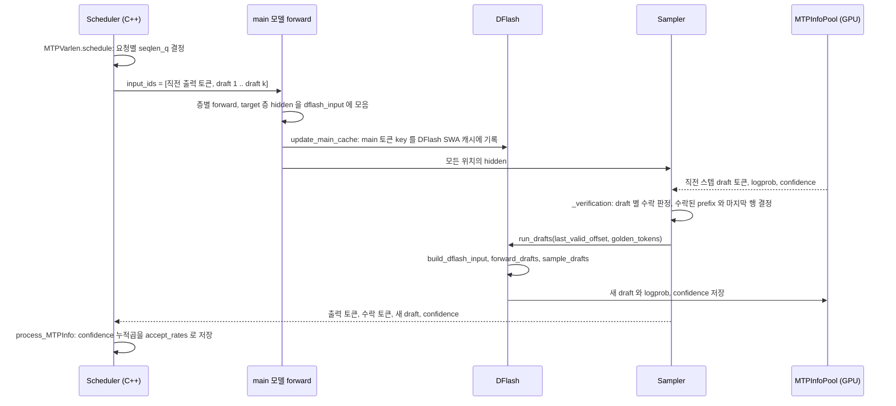

DeepInfer의 추측 디코딩은 코드에서 "MTP"라고 부르지만, 공개본이 지원하는 draft head는 DFlash 하나뿐이다. DFlash는 main 모델 몇 개 층의 hidden을 받아, 직전에 확정된 토큰 뒤의 draft 여러 개를 forward 한 번에 병렬로 만든다. 다음 스텝에 main 모델이 draft를 함께 넣어 검증하고, 스케줄러는 draft마다 붙은 수락 확률 예측값(confidence)으로 이번 스텝에 몇 개를 검증할지 정한다. 이 장은 [`models/mtp/dflash.py`](https://github.com/deepseek-ai/DeepInfer/blob/a679bb86ce36e883a98a97733492b686e5b9a08e/deepinfer/model_executor/models/mtp/dflash.py)를 중심으로 draft 생성, KV 관리, 검증과 수락, 검증 길이 스케줄링까지 한 바퀴를 따라간다. 수락 판정의 확률 계산 자체는 샘플링 커널 안에 있어 9장에서 다룬다.

## 용어와 설정

README는 이 기능을 "DSpark and confidence-scheduled verification"이라고 소개한다([README.md 24행](https://github.com/deepseek-ai/DeepInfer/blob/a679bb86ce36e883a98a97733492b686e5b9a08e/README.md#L24)). 코드 안에서는 클래스 이름이 `DFlash`이고 config 키는 `dflash_cfg.dspark_*`이며, 환경 변수와 엔진 쪽은 `MTP`, `nextn`이라는 이름을 쓴다. 세 이름이 같은 대상을 가리킨다.

| 이름 | 위치 | 뜻 |
|---|---|---|
| `DEEPINFER_USE_NEXTN_DECODE` | [`environ.py`](https://github.com/deepseek-ai/DeepInfer/blob/a679bb86ce36e883a98a97733492b686e5b9a08e/deepinfer/environ.py#L136-L137) | 요청당 draft 최대 개수. 기본 5, 0이면 추측 디코딩 끔 |
| `DEEPINFER_ENABLE_MTP_VARLEN` | [`environ.py`](https://github.com/deepseek-ai/DeepInfer/blob/a679bb86ce36e883a98a97733492b686e5b9a08e/deepinfer/environ.py#L138) | confidence 기반 검증 길이 스케줄링. 기본 꺼짐 |
| `DEEPINFER_MAX_BACKTRACKING_TOKENS` | [`environ.py`](https://github.com/deepseek-ai/DeepInfer/blob/a679bb86ce36e883a98a97733492b686e5b9a08e/deepinfer/environ.py#L139) | 거절 시 되돌릴 여유. `nextn + 1` 이상으로 강제 |
| `DEEPINFER_DFLASH_CONFIDENCE_HEAD_TEMPERATURE` | [`environ.py`](https://github.com/deepseek-ai/DeepInfer/blob/a679bb86ce36e883a98a97733492b686e5b9a08e/deepinfer/environ.py#L141-L150) | confidence head 의 온도. 쉼표로 draft 위치별 지정 가능 |
| `dflash_cfg.dspark_target_layer_ids` | 모델 config | hidden 을 추출해 DFlash 에 넘길 main 층 번호 |
| `dflash_cfg.dspark_noise_token_id` | 모델 config | 아직 모르는 draft 자리에 넣는 자리표시 토큰 |
| `num_nextn_predict_layers` | 모델 config | DFlash 층 수. 체크포인트의 MTP 모듈 수와 같아야 함 |

draft 개수와 DFlash 층 수는 별개다. [`DeepseekForCausalLM`](https://github.com/deepseek-ai/DeepInfer/blob/a679bb86ce36e883a98a97733492b686e5b9a08e/deepinfer/model_executor/models/deepseek.py#L298-L306)의 주석이 "MTP 층의 layer 개수와 예측 개수는 분리돼 있다"고 적는다. DFlash 층 몇 개를 forward 한 번 돌리면 `dflash_block_size = DEEPINFER_USE_NEXTN_DECODE`개 위치의 hidden이 한꺼번에 나온다.

## 한 decode 스텝의 흐름

이 그림에서 볼 점은 셋이다. 첫째, draft 생성은 sampler 안에서 수락 판정 직후에 일어난다. 별도 엔진 스텝이 없다. 둘째, DFlash가 쓰는 main 토큰 key는 main 모델 forward 안에서 미리 기록되므로, decode 때 main 모델 CUDA graph에 함께 담긴다. 셋째, draft 확률은 GPU의 `MTPInfoPool`에만 있고 CPU로는 토큰 번호와 confidence만 간다.

## 정리

- 공개본의 MTP는 DFlash head 하나로, 직전 확정 토큰과 noise 토큰으로 이루어진 블록을 한 번 forward해 `DEEPINFER_USE_NEXTN_DECODE`(기본 5)개 draft를 병렬로 만든다. 순서 정보는 markov head가 logits 단계에서 보충한다
- DFlash가 참조하는 main 토큰 key는 지정된 target 층의 hidden을 투영해 main 모델 forward 안에서 SWA ring에 기록하고, draft key는 같은 ring의 수락 위치 뒤에 쓴다. ring과 창 크기는 main 모델과 같다
- draft 분포는 GPU의 `MTPInfoPool`에 요청 슬롯별로 남고, 다음 스텝 sampler가 같은 stream에서 읽어 수락 판정에 쓴다. CPU로는 토큰 번호와 confidence만 간다
- 검증은 `[직전 출력, draft...]`를 main 모델이 한 번에 forward하고, `get_accept_result`가 연속 수락 prefix와 마지막 행을 정해 `last_valid_offset`을 다음 draft 생성에 넘긴다
- confidence head의 위치별 확률은 `process_MTPInfo`에서 누적곱 $a_j$가 되고, `MTPVarlen`은 graph 크기별 시간 곡선과 실측 보정으로 기대 처리량이 가장 큰 총 검증 토큰 수를 고른다(`DEEPINFER_ENABLE_MTP_VARLEN=1`)
- 거절 대비 여유는 KV 캐시 쪽 `DEEPINFER_MAX_BACKTRACKING_TOKENS`(최소 `nextn + 1`)와 블록 선할당으로 확보하며, 수락 확률 계산 세부는 9장으로 넘긴다
