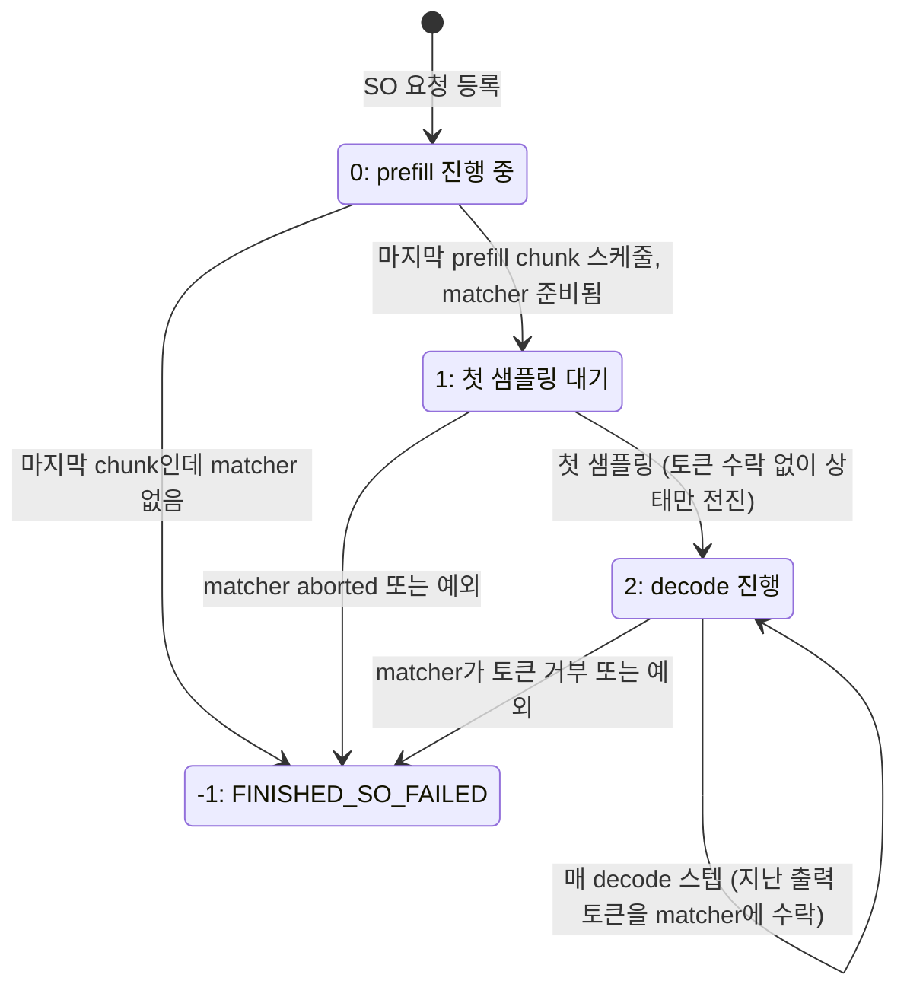
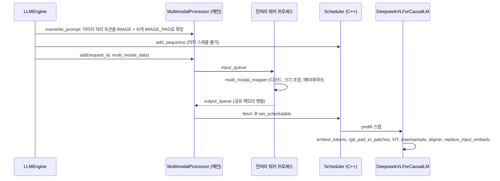

regex, JSON schema, EBNF 제약 출력과 vision encoder 연결을 본다.

## 구조화 출력

구조화 출력(structured output, 코드에서는 SO)은 출력이 JSON 스키마 · 정규식 · EBNF 문법을 따르도록 매 스텝 허용 토큰 집합을 bitmask로 만들어 logits에 씌우는 기능이다. 문법 처리는 xgrammar에 맡기고, DeepInfer는 컴파일을 비동기로 돌리는 부분, MTP draft 단계까지 mask를 만드는 부분, 실패를 요청 하나로 가두는 부분을 직접 구현했다.

| 클래스 · 함수 | 파일 | 역할 |
|---|---|---|
| `XGrammarCompiler` | `structure_output/compiler.py` | xgrammar `GrammarCompiler` 래퍼. schema_type별 컴파일, 캐시 상한 |
| `XGrammarMatcher` | `structure_output/matcher.py` | 요청별 문법 상태. 토큰 수락, mask 채우기, rollback, trigger · bound 처리 |
| `XGrammarMatcherFuture` | `structure_output/matcher.py` | 컴파일 중인 matcher를 감싼 future. 타임아웃이면 aborted matcher를 돌려준다 |
| `SOMatcherBuilder` | `structure_output/so_matcher_builder.py` | 스레드 풀에서 컴파일하고 `pump()`로 완료된 요청을 스케줄러에 넣는다 |
| `allocate_vocab_mask`, `XGrammarUtils` | `structure_output/mask.py` | xgrammar 지연 import, bitmask 적용 진입점 |
| `apply_token_bitmask_by_step_inplace` | `tilelang_ops/structure_output.py` | int32 bitmask로 logits를 -inf 처리하는 TileLang 커널 |

### 요청 등록과 비동기 컴파일

무엇을 보는지: `so_args`가 붙은 요청이 언제 스케줄러에 들어가는지.

[deepinfer/engine/llm_engine.py L618-L630](https://github.com/deepseek-ai/DeepInfer/blob/a679bb86ce36e883a98a97733492b686e5b9a08e/deepinfer/engine/llm_engine.py#L618-L630)

```python
        if enqueue:

            def _enqueue(s: Sequence) -> None:
                if s.so_matcher is not None and s.so_matcher.is_aborted():
                    s.status = SequenceStatus.FINISHED_SO_FAILED
                self.scheduler.add_sequence(s)
                if self.multi_modal_processor is not None:
                    self.multi_modal_processor.add(request_id, multi_modal_data)

            if so_pending:
                self.so_matcher_builder.submit(seq, sampling_params.so_args, _enqueue)
            else:
                _enqueue(seq)
```

SO 요청은 문법 컴파일이 끝날 때까지 스케줄러에 들어가지 않는다(`enqueue=False`로 호출자가 직접 스케줄을 관리할 때만 동기로 컴파일한다, [L606-L613](https://github.com/deepseek-ai/DeepInfer/blob/a679bb86ce36e883a98a97733492b686e5b9a08e/deepinfer/engine/llm_engine.py#L606-L613)). 컴파일은 `SOMatcherBuilder`의 스레드 풀에서 돌고, 엔진은 매 스텝 `pre_sampler_sync`에서 `pump()`를 불러 끝난 요청만 꺼내 `_enqueue`한다([llm_engine.py L841-L842](https://github.com/deepseek-ai/DeepInfer/blob/a679bb86ce36e883a98a97733492b686e5b9a08e/deepinfer/engine/llm_engine.py#L841-L842)). 컴파일이 느린 스키마 하나가 다른 요청의 스케줄을 막지 않는다.

무엇을 보는지: 스레드 안에서 실제로 하는 일.

[deepinfer/structure_output/so_matcher_builder.py L78-L95](https://github.com/deepseek-ai/DeepInfer/blob/a679bb86ce36e883a98a97733492b686e5b9a08e/deepinfer/structure_output/so_matcher_builder.py#L78-L95)

```python
        def _build() -> XGrammarMatcher:
            ctx = self._compiler.dispatch_and_compile(so_args["schema_type"], schema)
            matcher = XGrammarMatcher.from_compiled(
                ctx,
                self._vocab_size,
                self._eos_id,
                trigger_tokens,
                bound_token_id=bound_token_id,
            )
            for i, token in enumerate(replay_tokens):
                if not matcher.accept_token(int(token)):
                    raise RuntimeError(
                        f"SO replay failed: token {token} (idx {i}/{len(replay_tokens)}) rejected during matcher state restore"
                    )
            return matcher

        task: Future = self._pool.submit(_build)
        return XGrammarMatcherFuture(task=task)
```

- `dispatch_and_compile`은 `schema_type`이 `"json"`이면 `compile_json_schema(strict_mode=True)`, `"regex"`면 `compile_regex`, `"ebnf"`면 `compile_grammar`를 부른다([compiler.py L54-L71](https://github.com/deepseek-ai/DeepInfer/blob/a679bb86ce36e883a98a97733492b686e5b9a08e/deepinfer/structure_output/compiler.py#L54-L71))
- `replay_tokens`는 이미 생성된 토큰으로 matcher 상태를 복원하는 경로다
- 스레드 풀 워커는 `get_idle_cpus`가 고른 CPU 코어에 묶인다. 코어 수는 `DEEPINFER_SO_BUILDER_CPUS`(기본 4)이고, GPU당 물리 코어 수보다 크면 시작 시 오류를 낸다([utils.py L154-L161](https://github.com/deepseek-ai/DeepInfer/blob/a679bb86ce36e883a98a97733492b686e5b9a08e/deepinfer/utils.py#L154-L161))

| 환경변수 | 기본값 | 의미 |
|---|---|---|
| `DEEPINFER_XGRAMMAR_TIMEOUT` | 20 | 컴파일 대기 상한(초). 넘으면 aborted matcher |
| `DEEPINFER_XGRAMMAR_DISABLE_CACHE` | 꺼짐 | xgrammar 컴파일 캐시 끄기 |
| `DEEPINFER_XGRAMMAR_CACHE_LIMIT_BYTES` | 10 GiB | 캐시 상한. 0 이하면 무제한이라 경고 |
| `DEEPINFER_SO_BUILDER_CPUS` | 4 | 컴파일 스레드를 묶을 코어 수 |
| `DEEPINFER_XGRAMMAR_DEBUG` | 꺼짐 | xgrammar debug 출력 |

값은 [environ.py L174-L178](https://github.com/deepseek-ai/DeepInfer/blob/a679bb86ce36e883a98a97733492b686e5b9a08e/deepinfer/environ.py#L174-L178)에 있다. 캐시 상한에 대해 compiler.py는 상한이 없으면 서로 다른 스키마가 쌓여 OOM이 날 수 있다며 CVE-2025-32381을 인용해 경고한다([compiler.py L23-L29](https://github.com/deepseek-ai/DeepInfer/blob/a679bb86ce36e883a98a97733492b686e5b9a08e/deepinfer/structure_output/compiler.py#L23-L29)).

### so_status 상태 전이

요청의 SO 상태는 C++ `Sequence`의 `structured_output.status` 정수 하나로 관리되고, Python의 `seq_metadata.so_status`로 노출된다.



- 0→1 전이는 엔진 `step()`에서 prefill 스케줄 직후 일어난다([llm_engine.py L910-L928](https://github.com/deepseek-ai/DeepInfer/blob/a679bb86ce36e883a98a97733492b686e5b9a08e/deepinfer/engine/llm_engine.py#L910-L928))
- 1→2와 실패 처리는 샘플러의 `_get_so_mask`가 하고, 결과 목록은 `SamplerOutput.so_status`로 C++ 스케줄러의 `process_outputs`에 되돌아간다([scheduler.hpp L928-L929](https://github.com/deepseek-ai/DeepInfer/blob/a679bb86ce36e883a98a97733492b686e5b9a08e/csrc/engine/scheduler.hpp#L928-L929))

> **주의**: SO 요청은 preemption 후 재계산을 지원하지 않는다. 스케줄러는 `so_status != 0`인 요청이 preempt되면 다시 계산하지 않고 `FINISHED_PREEMPTED`로 끝낸다([scheduler.hpp L766-L780](https://github.com/deepseek-ai/DeepInfer/blob/a679bb86ce36e883a98a97733492b686e5b9a08e/csrc/engine/scheduler.hpp#L766-L780)). KV 캐시가 부족한 부하에서 SO 요청이 중간에 끊길 수 있다는 뜻이다.

### draft 단계의 mask 생성 방법

MTP가 켜져 있으면 decode 한 스텝에서 요청당 최대 `nextn + 1`개 행을 동시에 검증한다. 각 행에 맞는 mask를 만들려면 matcher를 draft 토큰만큼 앞으로 굴렸다가 되돌려야 한다.

무엇을 보는지: step 0 mask, draft step별 mask, rollback.

[deepinfer/model_executor/layers/sampler.py L352-L376](https://github.com/deepseek-ai/DeepInfer/blob/a679bb86ce36e883a98a97733492b686e5b9a08e/deepinfer/model_executor/layers/sampler.py#L352-L376)

```python
                if so_status[idx] == 2:
                    for token in seq_metadata.last_accepted_token + [seq_metadata.last_output_token]:
                        if not matcher.accept_token(token):
                            raise RuntimeError(f"matcher rejected step token {token}, upstream invariant broken")
                elif so_status[idx] == 1:
                    so_status[idx] = 2
                else:
                    raise RuntimeError(f"unexpected so_status {so_status[idx]}")

                if matcher.constrained():
                    mask_filled = matcher.fill_vocab_mask(self.bitmasks_cpu[0], idx)
                    assert mask_filled, "填充 so mask 失败"
                    so_indices_cpu[0].append(idx)

                num_accepted_steps = 0
                for k, draft_token in enumerate(seq_metadata.last_next_n_token):
                    if matcher.accept_token(draft_token):
                        if matcher.constrained():
                            mask_filled = matcher.fill_vocab_mask(self.bitmasks_cpu[k + 1], idx)
                            assert mask_filled, f"填充第 {k + 1} 步 draft so mask 失败"
                            so_indices_cpu[k + 1].append(idx)
                        num_accepted_steps += 1
                    else:
                        break
                matcher.rollback(num_accepted_steps)
```

1. 지난 스텝에서 확정된 토큰(수락된 draft + 마지막 출력)을 matcher에 먹인다. 이 토큰들은 이미 mask를 통과한 것이라 거부되면 불변식이 깨진 것으로 보고 예외를 낸다
2. 현재 상태에서 step 0 mask를 `bitmasks_cpu[0]`의 `idx` 행에 채운다
3. 이번 스텝에 검증할 draft 토큰을 하나씩 임시로 수락하면서 step `k+1` mask를 채운다. 문법상 불가능한 draft를 만나면 거기서 멈춘다. 그 뒤 행들은 mask가 없는데, 그 draft는 이미 문법 밖이라 target 분포에서 확률이 0이 되어 거절된다(코드 흐름상 추론)
4. 임시로 수락한 만큼 `rollback`한다. 실제 확정은 다음 스텝 1번에서 한다

matcher가 되돌릴 수 있는 최대 토큰 수는 `MAX_ROLLBACK_TOKENS = DEEPINFER_USE_NEXTN_DECODE + 2`다([matcher.py L20](https://github.com/deepseek-ai/DeepInfer/blob/a679bb86ce36e883a98a97733492b686e5b9a08e/deepinfer/structure_output/matcher.py#L20)). 이 과정에서 예외가 나면 해당 요청만 `so_status=-1`로 죽이고 엔진은 계속 돈다. 주석은 CP rank 0 샘플링 경로에서 예외를 올리면 모든 요청이 같이 죽고 NCCL barrier가 타임아웃난다는 이유를 든다([L377-L386](https://github.com/deepseek-ai/DeepInfer/blob/a679bb86ce36e883a98a97733492b686e5b9a08e/deepinfer/model_executor/layers/sampler.py#L377-L386)).

bitmask는 pinned CPU 메모리에 `max_MTP_value + 1`개를 미리 잡아 두고, 배치가 커질 때만 다시 할당한다([L324-L327](https://github.com/deepseek-ai/DeepInfer/blob/a679bb86ce36e883a98a97733492b686e5b9a08e/deepinfer/model_executor/layers/sampler.py#L324-L327)). GPU로는 별도 stream에서 non-blocking으로 보낸다.

복사는 [L391-L408](https://github.com/deepseek-ai/DeepInfer/blob/a679bb86ce36e883a98a97733492b686e5b9a08e/deepinfer/model_executor/layers/sampler.py#L391-L408)에서 기본 stream에 이벤트를 찍고, 별도 `so_copy_stream`이 그 이벤트를 기다린 뒤 bitmask와 인덱스를 GPU로 보내고 완료 이벤트(`so_mask_ready`)를 남긴다. 복사된 텐서에는 `record_stream(consumer_stream)`을 걸어, 기본 stream이 쓰는 동안 캐싱 할당자가 메모리를 재사용하지 않게 한다.

### trigger와 bound: 자유 생성 뒤에 문법을 거는 방법

`so_args`에는 `schema_type`, `schema` 외에 `trigger_token_ids`와 `bound_token_id`를 줄 수 있다([sampling_params.py L39-L43](https://github.com/deepseek-ai/DeepInfer/blob/a679bb86ce36e883a98a97733492b686e5b9a08e/deepinfer/sampling_params.py#L39-L43)). reasoning 모델이 생각을 자유롭게 쓴 다음 특정 토큰열 뒤부터 JSON을 내게 하는 식의 용도로 보인다(용도는 추정).

| 키 | 타입 | 동작 |
|---|---|---|
| `trigger_token_ids` | list[int] | 이 토큰열이 출력에 완전히 나타나기 전까지는 제약 없음. 나타난 뒤부터 문법 적용 |
| `bound_token_id` | int (0 이상) | 이 토큰이 나오면 그 뒤로는 자유 토큰을 막고 trigger 토큰열을 한 토큰씩 강제한 뒤 문법으로 들어간다. 비어 있지 않은 `trigger_token_ids`가 필요 |

토큰 수락 로직은 [matcher.py L134-L179](https://github.com/deepseek-ai/DeepInfer/blob/a679bb86ce36e883a98a97733492b686e5b9a08e/deepinfer/structure_output/matcher.py#L134-L179)에 있다. trigger가 아직 끝나지 않았으면 xgrammar를 부르지 않고 trigger 진행도만 갱신한 뒤 항상 수락한다.

- bound 전에는 KMP failure 함수로 "지금까지 trigger 접두사가 얼마나 맞았는지"를 갱신한다. 생성 중간에 trigger 일부가 나왔다 끊겨도 처음부터 다시 맞추지 않아도 된다
- bound 후에는 다음에 와야 할 trigger 토큰 하나만 허용한다. `fill_vocab_mask`도 이 경우 그 토큰 하나만 켠 mask를 만든다([L181-L187](https://github.com/deepseek-ai/DeepInfer/blob/a679bb86ce36e883a98a97733492b686e5b9a08e/deepinfer/structure_output/matcher.py#L181-L187))
- rollback을 위해 trigger 진행 이력을 최대 `MAX_ROLLBACK_TOKENS`개까지 보관한다
- EOS를 수락한 뒤에는 전체 허용 mask(`mask_after_eos`)를 쓴다. MTP가 EOS 뒤 draft를 검증하는 동안 mask가 실패하지 않게 하는 장치로 보인다(추정)

`constrained()`가 거짓인 동안(trigger가 아직 안 나옴)에는 bitmask를 채우지 않고 해당 요청 행을 `so_indices`에 넣지 않는다. 그래서 trigger 전 구간은 일반 요청과 같은 비용으로 돈다.

### bitmask 적용 커널

bitmask는 `[요청 수, ceil(vocab/32)]` 모양의 int32 텐서로, 워드 하나에 토큰 32개의 허용 여부를 비트로 담는다. 참조 구현 [structure_output.py L40-L61](https://github.com/deepseek-ai/DeepInfer/blob/a679bb86ce36e883a98a97733492b686e5b9a08e/deepinfer/model_executor/layers/tilelang_ops/structure_output.py#L40-L61)은 각 선택 요청에 대해 `(bitmask[r, col // 32] >> (col % 32)) & 1`이 0인 열을 -inf로 채운다.

참조 구현은 Python 루프지만, 실제 커널(`apply_token_bitmask_by_step_inplace_tl`)은 선택된 요청 행을 병렬로 처리한다. decode에서는 `ftp`(요청별 첫 행 위치)와 `step`으로 "요청 r의 k번째 draft 행"을 찾아간다. 요청의 행 수가 step보다 적으면(variable-length MTP로 draft를 덜 검증하는 경우) 건너뛴다. mask는 `fused_sample` 전에 logits에 적용되므로, 샘플링뿐 아니라 draft 수락 판정에 쓰는 target 분포 $q$에도 문법이 반영된다.

### 예제 검증

`examples/_structured_output.py`는 세 가지 문법을 일부러 엉뚱한 프롬프트와 짝지어, 프롬프트가 아니라 문법이 출력을 지배하는지 확인한다.

[examples/_structured_output.py L23-L41](https://github.com/deepseek-ai/DeepInfer/blob/a679bb86ce36e883a98a97733492b686e5b9a08e/examples/_structured_output.py#L23-L41)의 세 경우는 다음과 같다.

| schema_type | schema | 짝지은 프롬프트의 요구 |
|---|---|---|
| `regex` | `[A-Z]{2}-[0-9]{3}` | 긴 이야기를 이어 써라 |
| `json` | `color`(red/green/blue), `count`(1/2/3) 두 필드만 허용하는 객체 | JSON이나 코드를 쓰지 마라 |
| `ebnf` | `root ::= "answer=" ("yes" \| "no") ";level=" [1-3]` | 긴 시를 써라 |

세 요청 모두 `temperature=0`, `max_tokens=128`이고, 출력은 정규식 · JSON 스키마 · EBNF를 정확히 만족해야 하고 마지막 토큰은 EOS여야 한다([L42-L63](https://github.com/deepseek-ai/DeepInfer/blob/a679bb86ce36e883a98a97733492b686e5b9a08e/examples/_structured_output.py#L42-L63)). `python examples/offline_inference.py --check_structured_output`으로 실행하며, CI 테스트 `test_offline_inference`가 이 옵션을 켜고 돈다(12장).

## 입력 확장: vision encoder 연결 방식

샘플링이 출력 끝이라면 이미지는 입력 끝에서 붙는다. DeepInfer의 공개본은 ViT를 LLM과 같은 프로세스에 올려 prefill 안에서 이미지를 인코딩한다(README가 언급하는 VE 분리 배포는 공개본에 없다, 1장). 흐름은 CPU 전처리와 GPU 인코딩 두 단계로 나뉜다.



### 프롬프트 확장

무엇을 보는지: 이미지 하나가 몇 개의 토큰 자리를 차지하는지 미리 정하는 부분.

[deepinfer/ve/multimodal_processor.py L140-L152](https://github.com/deepseek-ai/DeepInfer/blob/a679bb86ce36e883a98a97733492b686e5b9a08e/deepinfer/ve/multimodal_processor.py#L140-L152)

```python
            image_input = ImageInput(
                width=image_sizes[image_index][0],
                height=image_sizes[image_index][1],
                binary=image_bytes[image_index] if image_bytes else None,
            )
            num_image_tokens = self.mm_processor.image_processor.estimate_num_tokens(image_input)
            image_tokens = np.full(num_image_tokens, self.mm_image_pad_token, dtype=np.int32)
            image_tokens[:1] = self.mm_image_token
            image_spans.append((num_expanded_tokens, num_image_tokens))
            pieces.append(image_tokens)
            segments.append(image_input)
            num_expanded_tokens += num_image_tokens
            cursor = position + 1
```

- 이미지 토큰 수는 사용자가 준 `image_sizes`(너비, 높이)만으로 계산한다. 그래서 이미지를 디코드하기 전에 프롬프트 길이가 정해지고, 스케줄러가 KV 블록을 바로 잡을 수 있다
- 확장된 토큰 id는 `vocab_size + offset` 범위의 특수 id다. `IMAGE_PAD=1`, `IMAGE=2` 등으로 정의되고([multimodal_tokens.py L17-L28](https://github.com/deepseek-ai/DeepInfer/blob/a679bb86ce36e883a98a97733492b686e5b9a08e/deepinfer/multimodal_tokens.py#L17-L28)), 첫 토큰이 `IMAGE`여야 chunked prefill이 이미지 경계를 알 수 있다는 주석이 있다([L89-L91](https://github.com/deepseek-ai/DeepInfer/blob/a679bb86ce36e883a98a97733492b686e5b9a08e/deepinfer/ve/multimodal_processor.py#L89-L91))
- prefix 캐시가 이미지 전체를 덮으면 해당 이미지의 바이트를 IPC 전에 지운다(`_compute_and_strip_cached_images`, [L219-L246](https://github.com/deepseek-ai/DeepInfer/blob/a679bb86ce36e883a98a97733492b686e5b9a08e/deepinfer/ve/multimodal_processor.py#L219-L246)). 이미지 중간에 캐시 경계가 걸리면 캐시되지 않은 것으로 본다

전처리 설정은 HF `config.json`의 `vision_config`에서 읽는다. `model_type`이 `deepseek_v41`이 아니면 거부하고, 정규화 상수 mean · std 0.5는 config에 키가 없어 코드에 고정돼 있다([hugging_face/processor.py L19-L43](https://github.com/deepseek-ai/DeepInfer/blob/a679bb86ce36e883a98a97733492b686e5b9a08e/deepinfer/hugging_face/processor.py#L19-L43)). tokenizer의 이미지 토큰 id와 config의 `image_token_id`가 다르면 assert로 멈춘다([multimodal_processor.py L83-L86](https://github.com/deepseek-ai/DeepInfer/blob/a679bb86ce36e883a98a97733492b686e5b9a08e/deepinfer/ve/multimodal_processor.py#L83-L86)).

워커 결과는 `DEEPINFER_USE_MULTIMODAL_POOL`을 켜면 pinned 공유 메모리 풀(rank당 기본 8GB)로 넘기고, 출력 큐가 `DEEPINFER_MULTI_MODAL_BUFFER_SIZE`(기본 512)에 차면 워커가 멈춰 backpressure가 걸린다. `DEEPINFER_MULTI_MODAL_WORKER_TIMEOUT`(기본 1800초) 동안 진전이 없으면 프로세스를 abort한다([environ.py L214-L217](https://github.com/deepseek-ai/DeepInfer/blob/a679bb86ce36e883a98a97733492b686e5b9a08e/deepinfer/environ.py#L214-L217)).

### GPU 쪽 인코딩과 임베딩 치환

`DeepseekVLForCausalLM.get_input_embeddings`([deepseek_vl.py L194-L224](https://github.com/deepseek-ai/DeepInfer/blob/a679bb86ce36e883a98a97733492b686e5b9a08e/deepinfer/model_executor/models/deepseek_vl.py#L194-L224))는 먼저 `embed_tokens`로 텍스트 임베딩을 만든다. `vocab_size` 이상인 특수 이미지 토큰 id는 gather 커널이 0으로 채운다. 배치에 이미지가 있으면(`images_raw`가 있으면) 그 결과를 `vision_language_tuner`에 넘겨 이미지 자리를 덮어쓴다.

`VisionLanguageInstructTuner.forward`([vl_aligner.py L96-L141](https://github.com/deepseek-ai/DeepInfer/blob/a679bb86ce36e883a98a97733492b686e5b9a08e/deepinfer/model_executor/models/vision_encoder/vl_aligner.py#L96-L141))는 다음 순서로 돈다.

| 단계 | 함수 | 하는 일 |
|---|---|---|
| 1 | `rgb_pad_to_patches` | 워커가 넘긴 RGB 바이트를 가운데 정렬 pad + 정규화해 patch로 만든다 (TileLang 커널) |
| 2 | `visual_encoder` (ViT) | patch 14, 임베딩 1024, 깊이 32, 헤드 16 ([vit.py L27-L31](https://github.com/deepseek-ai/DeepInfer/blob/a679bb86ce36e883a98a97733492b686e5b9a08e/deepinfer/model_executor/models/vision_encoder/vit.py#L27-L31)) |
| 3 | `batch_downsample` | `downsample_ratio`만큼 인접 patch를 채널 방향으로 이어 붙여 토큰 수를 줄인다 |
| 4 | `aligner.layers` (`MlpProjector`) | `downsample_mlp_gelu` MLP로 LLM hidden 크기에 맞춘다 ([mlp_projector.py L10-L23](https://github.com/deepseek-ai/DeepInfer/blob/a679bb86ce36e883a98a97733492b686e5b9a08e/deepinfer/model_executor/models/vision_encoder/mlp_projector.py#L10-L23)) |
| 5 | `replace_input_embeds` | `mm_token_type`이 IMAGE인 자리는 이미지 임베딩으로, image_start · end · newline 자리는 학습된 파라미터로 덮어쓴다 |

이미지 인코딩은 `forward`에서 `is_prompt`이고 hidden state가 아직 없을 때만 일어난다([L232-L234](https://github.com/deepseek-ai/DeepInfer/blob/a679bb86ce36e883a98a97733492b686e5b9a08e/deepinfer/model_executor/models/deepseek_vl.py#L232-L234)). decode는 KV 캐시에 이미 이미지 정보가 들어 있으므로 텍스트 모델과 같다. 이미지 정규화 상수를 기본값 없이 config에서 받도록 한 이유를 주석이 밝힌다. 기본값이 있으면 ViT가 정규화되지 않은 [0,1] 픽셀을 받아도 오류 없이 돌기 때문이다([vl_aligner.py L22-L27](https://github.com/deepseek-ai/DeepInfer/blob/a679bb86ce36e883a98a97733492b686e5b9a08e/deepinfer/model_executor/models/vision_encoder/vl_aligner.py#L22-L27)). 인코더 처리량을 따로 재는 `ve_sweep.py`는 12장에서 다룬다.
