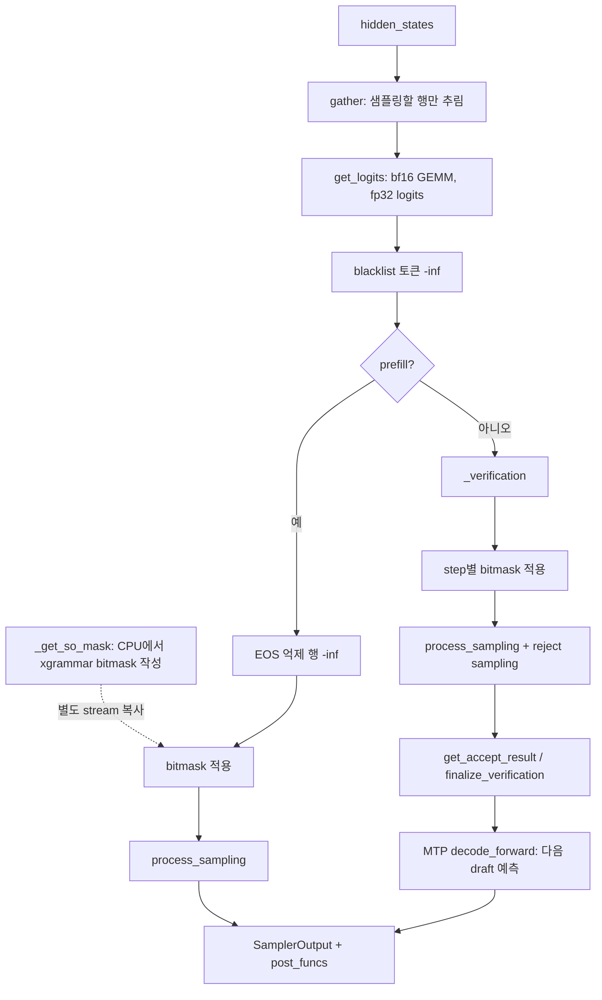

모델이 hidden state를 내놓은 뒤 토큰 하나를 고르기까지의 과정은 `Sampler` 한 클래스가 맡는다. DeepInfer의 샘플러는 temperature · top-p · top-k · log-softmax · 샘플링 · MTP rejection sampling을 TileLang 커널 하나(`fused_sample`)로 묶고, 난수를 해시로 만들어 배치 구성과 무관하게 같은 결과를 내며, 구조화 출력(xgrammar bitmask)을 draft 토큰 단계까지 적용한다. 이 장에서는 이 경로를 코드 순서대로 따라가고, 끝에서 이미지 입력이 프롬프트 쪽에서 어떻게 붙는지 짧게 본다.

## 샘플러의 위치

샘플러는 모델 forward 직후, 워커의 한 스텝 안에서 호출된다(워커와 모델 러너의 흐름은 4장에서 다룬다). 입력은 hidden state와 임베딩 행렬, 그리고 C++ 쪽에서 미리 만들어 둔 `SamplerInputs`다. 출력은 `SamplerOutput`이고, GPU→CPU 복사가 끝난 뒤에 실행할 `post_funcs`를 함께 들고 나간다.

prefill과 decode는 같은 커널을 쓰지만 decode에서는 한 요청이 여러 행(draft 검증 행 + 마지막 fresh 행)을 차지한다는 점이 다르다. MTP를 끄면(`DEEPINFER_USE_NEXTN_DECODE=0`) decode도 요청당 한 행이 된다.

## 정리

- `Sampler.forward`는 SO mask를 CPU에서 준비하고 별도 stream으로 복사하는 동안 logits GEMM을 돌려 두 작업을 겹친다. CP follower rank는 샘플링 없이 집합 통신과 MTP draft forward만 맞춘다
- temperature · top-p · top-k · log-softmax · 샘플링 · rejection sampling이 TileLang 커널 `fused_sample` 하나에 들어 있고, 같은 파일의 PyTorch 참조 구현이 동작 명세 역할을 한다. 백엔드(cuda/asc) 선택은 `ops.py` 한 곳에서만 한다
- 난수는 `(seq_seed, 위치, case)`의 SplitMix64 해시로 만들어 배치 구성과 무관하게 같은 결과가 나온다. greedy도 temperature 1e-5인 일반 경로를 탄다
- MTP 검증은 표준 speculative sampling에 `DRAFT_PROB_PENALTY=5e-5`를 더한 변형이다. 잔차가 0이 되는 경우를 막는 대가로 생기는 분포 오차의 상하한이 코드 주석에 유도돼 있다
- 구조화 출력은 xgrammar 컴파일을 스레드 풀에서 비동기로 돌리고, draft 토큰마다 matcher를 앞으로 굴렸다 되돌리며 step별 mask를 만든다. 실패는 요청 하나로 가두지만, SO 요청은 preemption 후 재계산이 안 된다
- 이미지는 사용자가 준 크기로 토큰 수를 먼저 정해 프롬프트를 확장하고, CPU 워커 프로세스에서 전처리한 뒤 prefill 안에서 ViT → downsample → MLP aligner를 거쳐 임베딩 자리를 덮어쓴다
