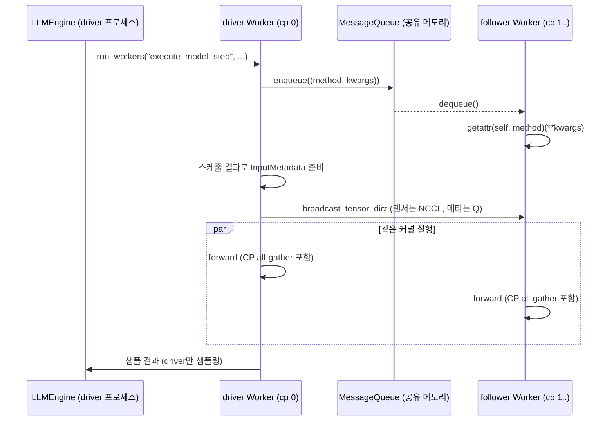

CP 그룹 내부 통신, DP rank 합의, 워커 초기화 순서를 본다.

## CP 그룹 내부 통신: driver와 follower

CP 워커들은 같은 엔진의 일부라 같은 스텝을 함께 돌아야 한다. 스케줄러와 입력 준비는 driver(cp_rank 0)만 하고, follower는 driver가 보내는 것을 받아 같은 커널을 실행한다. 통로는 두 가지다.

| 보내는 것 | 통로 | 함수 |
|---|---|---|
| 메서드 이름과 인자 (Python 객체) | 공유 메모리 고리 버퍼 + ZeroMQ | `cp_broadcast_object` → `MessageQueue` |
| 입력 메타데이터 dict | 텐서는 NCCL broadcast, 나머지는 위 메시지 큐 | `broadcast_tensor_dict` |
| prefill 중간 텐서 | DeepEP `BucketBuffer` all-gather | `CPManager.all_gather` |



### 코드 분석: follower 루프

무엇을 보는지: follower가 생성자 끝에서 들어가는 루프와 driver 쪽 송신. [`base.py#L129-L133`](https://github.com/deepseek-ai/DeepInfer/blob/a679bb86ce36e883a98a97733492b686e5b9a08e/deepinfer/worker/base.py#L129-L133), [`base.py#L290-L302`](https://github.com/deepseek-ai/DeepInfer/blob/a679bb86ce36e883a98a97733492b686e5b9a08e/deepinfer/worker/base.py#L290-L302)

```python
def start_slave_worker_loop(self) -> None:
    set_pdeathsig(signal.SIGKILL)
    while True:
        method, kwargs = cp_broadcast_object(None)
        getattr(self, method)(**kwargs)

def run_workers(self, method: str, driver_kwargs: dict[str, Any] | None = None, **kwargs: Any) -> Any:
    with cpu_timer.record("broadcast_method", enable=False):
        assert self.is_driver_worker
        cp_group = PG.cpu_cp_group
        if cp_group and cp_group.size() > 1:
            cp_broadcast_object((method, kwargs))
    return getattr(self, method)(**(driver_kwargs or {}), **kwargs)
```

vLLM 초기 버전의 `_run_workers`와 같은 RPC 방식이다(미검증). 차이는 `driver_kwargs`로, 스케줄러 출력처럼 driver만 가진 큰 객체는 follower에 보내지 않는다. follower는 `prctl(PR_SET_PDEATHSIG, SIGKILL)`을 걸어 부모 엔진이 죽으면 같이 죽는다([`set_pdeathsig`](https://github.com/deepseek-ai/DeepInfer/blob/a679bb86ce36e883a98a97733492b686e5b9a08e/deepinfer/worker/base.py#L42-L46)).

### 코드 분석: 공유 메모리 고리 버퍼

`MessageQueue`는 vLLM의 `shm_broadcast.py`에서 가져온 코드다(파일 머리의 "Derived from vLLM"). 쓰는 쪽 하나, 읽는 쪽 여럿인 고리 버퍼이고, 칸마다 `[written_flag, reader0_flag, ...]` 메타데이터 바이트를 둔다.

무엇을 보는지: 쓰기 쪽이 칸을 확보하고 플래그를 바꾸는 순서. [`shm_broadcast.py#L321-L357`](https://github.com/deepseek-ai/DeepInfer/blob/a679bb86ce36e883a98a97733492b686e5b9a08e/deepinfer/distributed/shm_broadcast.py#L321-L357)

```python
while True:
    with self.buffer.get_metadata(self.current_idx) as metadata_buffer:
        read_count = sum(metadata_buffer[1:])
        written_flag = metadata_buffer[0]
        if written_flag and read_count != self.buffer.n_reader:
            n_warning = self._spin_wait(start_time, n_warning, timeout)
            continue
        metadata_buffer[0] = 0
        with self.buffer.get_data(self.current_idx) as buf:
            yield buf
        for i in range(1, self.buffer.n_reader + 1):
            metadata_buffer[i] = 0
        metadata_buffer[0] = 1
        self.current_idx = (self.current_idx + 1) % self.buffer.max_chunks
        break
```

(주석을 뺐다.)

읽기 플래그를 먼저 0으로 되돌리고 그 다음 쓰기 플래그를 1로 올린다. 순서가 반대면 읽는 쪽이 "이미 읽음" 상태를 잠깐 볼 수 있다는 설명이 클래스 docstring에 있다([`#L41-L91`](https://github.com/deepseek-ai/DeepInfer/blob/a679bb86ce36e883a98a97733492b686e5b9a08e/deepinfer/distributed/shm_broadcast.py#L41-L91)). 직렬화한 객체가 칸 크기보다 크면 칸 첫 바이트에 overflow 표시만 남기고 본문은 로컬 ZeroMQ 소켓으로 보낸다([`enqueue`](https://github.com/deepseek-ai/DeepInfer/blob/a679bb86ce36e883a98a97733492b686e5b9a08e/deepinfer/distributed/shm_broadcast.py#L389-L404)).

CP 그룹용 큐는 칸 크기 1 MiB(`1 << 20`), 칸 10개로 만든다([`parallel_state.py#L122-L124`](https://github.com/deepseek-ai/DeepInfer/blob/a679bb86ce36e883a98a97733492b686e5b9a08e/deepinfer/model_executor/parallel_utils/parallel_state.py#L122-L124)). `create_from_process_group`은 "그룹이 노드를 넘지 않는다"고 가정하고 모든 reader를 로컬로 둔다([`#L442-L444`](https://github.com/deepseek-ai/DeepInfer/blob/a679bb86ce36e883a98a97733492b686e5b9a08e/deepinfer/distributed/shm_broadcast.py#L442-L444)). 따라서 CP 그룹은 한 노드 안에 있어야 한다. 대기 중에는 `os.sched_yield()`로 바쁜 대기를 하며, `DEEPINFER_RINGBUFFER_WARNING_INTERVAL`(기본 60초)마다 debug 로그를 남긴다.

### 코드 분석: 텐서와 메타데이터 분리 전송

무엇을 보는지: dict 안의 CUDA 텐서는 모양과 dtype만 먼저 보내고, 본문은 NCCL broadcast로 보내는 부분. [`communication_op.py#L51-L82`](https://github.com/deepseek-ai/DeepInfer/blob/a679bb86ce36e883a98a97733492b686e5b9a08e/deepinfer/model_executor/parallel_utils/communication_op.py#L51-L82)

```python
tensors = []
if cp_group.rank() == src:
    metadata_list = []
    for key, value in tensor_dict.items():
        if isinstance(value, torch.Tensor):
            assert value.is_cuda, ...
            metadata_list.append((key, TensorMetadata(value.dtype, value.size())))
            tensors.append(value)
        else:
            metadata_list.append((key, value))
    cp_broadcast_object(metadata_list)
else:
    tensor_dict = {}
    for key, value in cp_broadcast_object(None):
        if isinstance(value, TensorMetadata):
            tensor_dict[key] = torch.empty(value.size, dtype=value.dtype, device="cuda")
            tensors.append(tensor_dict[key])
        else:
            tensor_dict[key] = value
cp_broadcast_multi_tensor(tensors, src)
```

모델 러너는 CP 크기가 1보다 크면 이 함수로 `InputMetadata`를 펼친 dict를 보낸다([`model_runner.py#L200-L212`](https://github.com/deepseek-ai/DeepInfer/blob/a679bb86ce36e883a98a97733492b686e5b9a08e/deepinfer/worker/model_runner.py#L200-L212)). CUDA graph로 도는 decode 스텝이면 텐서는 빼고 크기 정보만 보낸다. follower는 같은 크기의 graph를 골라 자기 쪽에 캡처된 입력 버퍼를 쓴다([`_prepare_input_follower`](https://github.com/deepseek-ai/DeepInfer/blob/a679bb86ce36e883a98a97733492b686e5b9a08e/deepinfer/worker/model_runner.py#L216-L230)).

### CP all-gather 버퍼

CP prefill은 토큰을 rank에 나눠 계산하다가 attention 직전에 KV 등을 모아야 한다. 이 all-gather는 NCCL이 아니라 DeepEP의 `BucketBuffer`로 한다. [`CPManager`](https://github.com/deepseek-ai/DeepInfer/blob/a679bb86ce36e883a98a97733492b686e5b9a08e/deepinfer/model_executor/parallel_utils/cp.py#L9-L54)는 세션 단위로 버퍼를 빌려 주고, `all_gather`가 돌려주는 대기 함수를 부르면 rank 조각을 토큰 축으로 이어 붙인 뷰를 준다. 모은 텐서는 버퍼 저장소의 별칭이라 다음 세션에서 덮어써진다.

버퍼 크기는 [`allocate_cp`](https://github.com/deepseek-ai/DeepInfer/blob/a679bb86ce36e883a98a97733492b686e5b9a08e/deepinfer/model_executor/parallel_utils/userbuffer.py#L97-L117)가 정한다.

$$
\text{bytes} = \text{max\_num\_tokens} \times \text{max\_ag\_bytes\_per\_token} \times \text{cp} + 8 \times \text{rdma\_alignment}
$$

(마지막에 할당 정렬 단위로 올림한다.) `max_ag_bytes_per_token`은 샘플링용 hidden state(hidden × 2바이트)와 각 attention 레이어가 요구하는 값 중 최댓값이다([`deepseek.py#L412-L436`](https://github.com/deepseek-ai/DeepInfer/blob/a679bb86ce36e883a98a97733492b686e5b9a08e/deepinfer/model_executor/models/deepseek.py#L412-L436)). CP 안에서 토큰을 어떻게 나누고 attention에서 무엇을 모으는지는 6장에서 다룬다.

## DP rank 사이의 합의

DP rank들은 서로 다른 요청을 처리하지만 MoE 레이어에서 같은 EP 그룹으로 묶인다. 한 rank가 prefill을 하는데 다른 rank가 decode를 하면 DeepEP dispatch의 토큰 상한과 CUDA graph 사용 여부가 어긋난다. 그래서 NORMAL 엔진은 매 스텝 "이번 스텝을 prefill로 할지"를 DP 그룹 안에서 투표로 맞춘다.

무엇을 보는지: C++ 스케줄러가 ALL 점과 ANY 점에서 all_reduce MIN으로 투표하는 부분. [`csrc/engine/scheduler.hpp#L308-L319`](https://github.com/deepseek-ai/DeepInfer/blob/a679bb86ce36e883a98a97733492b686e5b9a08e/csrc/engine/scheduler.hpp#L308-L319)

```cpp
bool is_any_point = (decode_step != 0) && (decode_step % prefill_any_attempt_interval == 0);
bool is_all_point = (decode_step % prefill_attempt_interval == 0);
if (!is_any_point && !is_all_point) {
    return _schedule_decode(acquire);
}
bool want = (get_gpu_cache_usage() <= GPU_CACHE_PREFILL_WATERMARK) && _has_prefill_waiting();
bool do_prefill;
if (is_any_point) {
    do_prefill = (_dp_allreduce(want ? 0 : 1, c10d::ReduceOp::MIN) == 0);
} else {
    do_prefill = (_dp_allreduce(want ? 1 : 0, c10d::ReduceOp::MIN) == 1);
}
```

ALL 점(기본 70 decode 스텝마다)은 모든 rank가 prefill할 것이 있을 때만, ANY 점(기본 100 스텝마다)은 한 rank라도 있으면 다 함께 prefill한다([`environ.py#L181-L185`](https://github.com/deepseek-ai/DeepInfer/blob/a679bb86ce36e883a98a97733492b686e5b9a08e/deepinfer/environ.py#L181-L185)). 할 일이 없는 rank는 빈 prompt 스텝을 함께 돈다. 투표 뒤의 두 번째 확인 투표와 decode 스케줄링 세부는 3장에서 다룬다.

엔진 루프의 종료 판정도 DP 그룹 all_reduce MAX로 맞춘다([`has_unfinished_requests`](https://github.com/deepseek-ai/DeepInfer/blob/a679bb86ce36e883a98a97733492b686e5b9a08e/deepinfer/engine/llm_engine.py#L665-L679)). 한 rank라도 요청이 남아 있으면 모두 계속 돈다. 비동기 스케줄링(ZOS)이 켜져 있으면 이 투표들은 GPU 스트림을 막지 않도록 gloo로 만든 CPU DP 그룹을 쓴다([`_create_scheduler`](https://github.com/deepseek-ai/DeepInfer/blob/a679bb86ce36e883a98a97733492b686e5b9a08e/deepinfer/engine/llm_engine.py#L307-L327)).

## 워커 초기화 순서와 하드웨어 바인딩

[`WorkerBase.__init__`](https://github.com/deepseek-ai/DeepInfer/blob/a679bb86ce36e883a98a97733492b686e5b9a08e/deepinfer/worker/base.py#L58-L123)의 순서는 다음과 같다.

| 순서 | 메서드 | 하는 일 |
|---|---|---|
| 1 | `_init_torch` | bf16/fp16 축약 연산 금지, expandable segments, 스레드 수 8 |
| 2 | `init_model` | 워커 환경변수 설정, NUMA 바인딩, `torch.cuda.set_device`, 커널 라이브러리 설정, CPU 바인딩, rank별 시드 |
| 3 | `init_dist` | gloo 기본 그룹, `init_parallel_groups` |
| 4 | (follower만) `gc.freeze` 후 `start_slave_worker_loop` | 이후 단계는 driver가 RPC로 지시 |

그 다음 단계(`load_model`, `profile_num_available_blocks`, `init_cache_engine`, `warm_up_model`)는 엔진이 `_run_workers`로 부른다. `profile_num_available_blocks`는 rank별로 남은 메모리에서 KV 블록 수를 계산한 뒤 world 그룹 all_reduce SUM으로 평균을 내고 짝수로 내린다([`base.py#L264-L267`](https://github.com/deepseek-ai/DeepInfer/blob/a679bb86ce36e883a98a97733492b686e5b9a08e/deepinfer/worker/base.py#L264-L267)). vLLM이 최솟값을 쓰는 것과 다르다(미검증). 같은 하드웨어에서 차이가 작다는 전제로 보인다(추정).

NUMA 바인딩은 `deep_cluster` 패키지가 맡는다. 이 패키지는 torch나 CUDA를 import하지 않고 procfs, sysfs, 장치 파일만 읽는다.

| 함수 | 위치 | 동작 |
|---|---|---|
| `accelerator_kind` | [`hardware/device.py#L17-L23`](https://github.com/deepseek-ai/DeepInfer/blob/a679bb86ce36e883a98a97733492b686e5b9a08e/deep_cluster/hardware/device.py#L17-L23) | Ascend, NVIDIA, CPU 순으로 탐지 |
| `device_numa_node` | [`hardware/nvidia.py#L55-L79`](https://github.com/deepseek-ai/DeepInfer/blob/a679bb86ce36e883a98a97733492b686e5b9a08e/deep_cluster/hardware/nvidia.py#L55-L79) | `/proc/driver/nvidia/gpus`의 PCI 주소로 `/sys/bus/pci/devices/<bus>/numa_node` 조회 |
| `which_numa` | [`topology/bind.py#L42-L71`](https://github.com/deepseek-ai/DeepInfer/blob/a679bb86ce36e883a98a97733492b686e5b9a08e/deep_cluster/topology/bind.py#L42-L71) | 보이는 장치 번호를 물리 번호로 바꿔 NUMA 노드 반환. IB NIC(`mlx5_N`)도 지원 |
| `bind_numa` | [`topology/bind.py#L79-L93`](https://github.com/deepseek-ai/DeepInfer/blob/a679bb86ce36e883a98a97733492b686e5b9a08e/deep_cluster/topology/bind.py#L79-L93) | libnuma로 CPU 친화도와 메모리 정책(`MPOL_BIND`)을 그 노드로 고정 |
| `bind_cpu` | [`deepinfer/utils.py#L143-L151`](https://github.com/deepseek-ai/DeepInfer/blob/a679bb86ce36e883a98a97733492b686e5b9a08e/deepinfer/utils.py#L143-L151) | 물리 코어를 GPU 수로 나눠 GPU마다 연속 구간 배정 |

NUMA 바인딩이 실패하면 예외를 삼키고 경고만 남긴다. 경고 문구는 메모리 배치가 first-touch로 떨어져 H2D 복사가 느려질 수 있다고 적는다([`_bind_numa`](https://github.com/deepseek-ai/DeepInfer/blob/a679bb86ce36e883a98a97733492b686e5b9a08e/deepinfer/worker/base.py#L347-L357)). Ascend 쪽 NUMA 탐지는 11장에서 다룬다.

종료 순서도 분산 때문에 정해져 있다. [`stop`](https://github.com/deepseek-ai/DeepInfer/blob/a679bb86ce36e883a98a97733492b686e5b9a08e/deepinfer/worker/base.py#L135-L151)은 barrier 사이에 통신 버퍼를 닫고, CUDA graph를 먼저 지운 다음 프로세스 그룹을 파괴한다. graph 안에서 쓴 NCCL이 의존성을 잡고 있으면 그룹 파괴가 멈추기 때문이다(코드 주석이 PyTorch 이슈 115388을 가리킨다).
