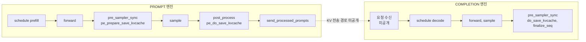

prefill/decode 엔진 종류, 배포 문서의 운영 구성, 통신 메모리 관측을 본다.

## prefill/decode 분리: 엔진 종류

DeepInfer의 엔진은 세 종류다([`engine_type.py`](https://github.com/deepseek-ai/DeepInfer/blob/a679bb86ce36e883a98a97733492b686e5b9a08e/deepinfer/engine/engine_type.py#L4-L17)). C++ 스케줄러의 enum과 값을 맞춰야 한다고 docstring이 적는다.

| 종류 | 스케줄러 동작 | 쓰임 |
|---|---|---|
| `NORMAL` | prefill과 decode를 섞고 DP 투표로 스텝 종류 결정 | 단일 엔진 서비스, 오프라인 추론 |
| `PROMPT` | prefill만. 요청이 없어도 빈 prefill 결과 반환 | PD 분리의 prefill 엔진 (문서의 PE) |
| `COMPLETION` | decode만 | PD 분리의 decode 엔진 (문서의 CE) |

엔진 종류에 따라 바뀌는 코드 지점을 모으면 다음과 같다.

| 지점 | PROMPT | COMPLETION | 근거 |
|---|---|---|---|
| CUDA graph | 사용 안 함 | 사용 | [`model_runner.py#L73`](https://github.com/deepseek-ai/DeepInfer/blob/a679bb86ce36e883a98a97733492b686e5b9a08e/deepinfer/worker/model_runner.py#L73) |
| MoE 통신 버퍼 토큰 상한 | prefill 상한 | decode 상한 | [`mlp.py#L175`](https://github.com/deepseek-ai/DeepInfer/blob/a679bb86ce36e883a98a97733492b686e5b9a08e/deepinfer/model_executor/models/v4_modules/mlp.py#L175) |
| CP | 허용 | 금지 (assert) | [`llm_engine.py#L248-L249`](https://github.com/deepseek-ai/DeepInfer/blob/a679bb86ce36e883a98a97733492b686e5b9a08e/deepinfer/engine/llm_engine.py#L248-L249) |
| 비동기 스케줄링 기본값 | 꺼짐 | 켜짐 | [`engine_type.py#L15-L17`](https://github.com/deepseek-ai/DeepInfer/blob/a679bb86ce36e883a98a97733492b686e5b9a08e/deepinfer/engine/engine_type.py#L15-L17) |
| 멀티모달 처리 | 켜짐 | 꺼짐 | [`arg_utils.py#L56-L60`](https://github.com/deepseek-ai/DeepInfer/blob/a679bb86ce36e883a98a97733492b686e5b9a08e/deepinfer/engine/arg_utils.py#L56-L60) |
| MTP 드래프트 모듈 | prefill 전용 동작 | 정상 동작 | [`dflash.py#L112`](https://github.com/deepseek-ai/DeepInfer/blob/a679bb86ce36e883a98a97733492b686e5b9a08e/deepinfer/model_executor/models/mtp/dflash.py#L112) |
| Python GC 주기 | 기본 | 10배 | [`base.py#L104-L106`](https://github.com/deepseek-ai/DeepInfer/blob/a679bb86ce36e883a98a97733492b686e5b9a08e/deepinfer/worker/base.py#L104-L106) |
| COMPLETION 엔진의 선점 | | `stop_preempted_request` 필수 | [`scheduler.hpp#L100-L102`](https://github.com/deepseek-ai/DeepInfer/blob/a679bb86ce36e883a98a97733492b686e5b9a08e/csrc/engine/scheduler.hpp#L100-L102) |

COMPLETION 엔진이 선점된 요청을 반드시 멈추게 하는 이유는, decode 엔진은 prefill을 할 수 없어 KV를 잃은 요청을 스스로 다시 계산할 수 없기 때문으로 보인다(추정).

### PD 훅

엔진 사이에서 KV를 넘기는 코드는 공개되지 않았지만, 넘기는 시점은 `LLMEngine`의 빈 메서드로 정해져 있다. 소스 주석이 이 구간을 "여기부터 가상 함수"라고 표시한다([`llm_engine.py#L800-L858`](https://github.com/deepseek-ai/DeepInfer/blob/a679bb86ce36e883a98a97733492b686e5b9a08e/deepinfer/engine/llm_engine.py#L800-L858)).

| 훅 | 부르는 곳 | 기본 동작 | 주석이 말하는 용도 |
|---|---|---|---|
| `init_pd_split` | `_init_cache` 끝, 엔진이 NORMAL이 아닐 때 | 없음 | PD 분리용 자료구조 초기화 |
| `pe_prepare_save_kvcache` | `pre_sampler_sync`, prefill 스텝 | 없음 | PE가 KV 저장 준비 |
| `pe_do_save_kvcache` | `post_process`, prefill 스텝 | 없음 | PE가 KV 저장 |
| `do_save_kvcache` | `pre_sampler_sync`, decode 스텝 | 없음 | KV 저장 |
| `send_processed_prompts` | `post_process`, PROMPT 엔진 | 없음 | 처리한 prompt를 COMPLETION 엔진으로 보내고 스케줄러에서 제거 |
| `should_copy_state` | decode 스텝, `copy_state` 버퍼가 있을 때 ([`#L930-L936`](https://github.com/deepseek-ai/DeepInfer/blob/a679bb86ce36e883a98a97733492b686e5b9a08e/deepinfer/engine/llm_engine.py#L930-L936)) | `False` | 요청의 GPU state를 복사 버퍼로 떠 둘지 판정. 주석은 "KV 캐시 디스크 저장 관련"이라고 적는다 |
| `finalize_seq` | `pre_sampler_sync`, NORMAL/COMPLETION | `scheduler.free_seq` | 끝난 요청 정리 |

그림의 점선과 "미공개" 상자는 훅만 있고 구현이 없는 부분이다. `send_processed_prompts` 이후 KV가 어떤 경로로 decode 엔진에 도착하는지, 요청 메타데이터는 무엇으로 넘기는지는 이 저장소로 알 수 없다. 배포 문서는 SWA KV와 블록 KV가 같은 P→D 전송 경로를 쓴다고만 적는다([`inference_deployment_qa.md#L225-L227`](https://github.com/deepseek-ai/DeepInfer/blob/a679bb86ce36e883a98a97733492b686e5b9a08e/doc/inference_deployment_qa.md#L225-L227)).

> **주의**: 공개 저장소의 예제와 테스트는 모두 NORMAL 엔진으로 돈다. PROMPT, COMPLETION 엔진을 이 저장소만으로 함께 띄워 요청을 넘기는 방법은 없다.

## 배포 문서가 밝힌 운영 구성

아래 표는 모두 [`doc/inference_deployment_qa.md`](https://github.com/deepseek-ai/DeepInfer/blob/a679bb86ce36e883a98a97733492b686e5b9a08e/doc/inference_deployment_qa.md)에서 인용한 운영 설정이다. 이 책에서 재현하거나 측정한 값이 아니다.

| 항목 | 문서 서술 | 위치 |
|---|---|---|
| 전체 구조 | VE/Prefill/Decode 분리 + 전용 KV 저장 노드 | [L41-L43](https://github.com/deepseek-ai/DeepInfer/blob/a679bb86ce36e883a98a97733492b686e5b9a08e/doc/inference_deployment_qa.md#L41-L43) |
| Prefill 병렬 | EP2~8 / DP2~8. HBM이 허용하는 가장 작은 크기 | [L47](https://github.com/deepseek-ai/DeepInfer/blob/a679bb86ce36e883a98a97733492b686e5b9a08e/doc/inference_deployment_qa.md#L47) |
| Decode 병렬 | EP64~128 / DP64~128 (Wide-EP). 가용 GPU가 허용하는 가장 큰 크기 | [L49](https://github.com/deepseek-ai/DeepInfer/blob/a679bb86ce36e883a98a97733492b686e5b9a08e/doc/inference_deployment_qa.md#L49) |
| VE | 인스턴스당 GPU 1장, 저가 GPU 권장 | [L51](https://github.com/deepseek-ai/DeepInfer/blob/a679bb86ce36e883a98a97733492b686e5b9a08e/doc/inference_deployment_qa.md#L51) |
| TP, CP | 현재 사용 안 함 | [L53](https://github.com/deepseek-ai/DeepInfer/blob/a679bb86ce36e883a98a97733492b686e5b9a08e/doc/inference_deployment_qa.md#L53) |
| Engram | 별도 ENP 그룹. prefill ENP8, decode는 DP/EP 크기와 같게 | [L83](https://github.com/deepseek-ai/DeepInfer/blob/a679bb86ce36e883a98a97733492b686e5b9a08e/doc/inference_deployment_qa.md#L83) |
| 최소 효율 단위 | 1P+1D로 배포 가능. P와 D의 GPU 비는 대략 1:1이라 prefill 64장 + decode 64장 | [L91](https://github.com/deepseek-ai/DeepInfer/blob/a679bb86ce36e883a98a97733492b686e5b9a08e/doc/inference_deployment_qa.md#L91) |
| 데이터센터 간 PD | 기술적으로 가능. GPU 8장당 약 400 Gbps 대역 | [L97](https://github.com/deepseek-ai/DeepInfer/blob/a679bb86ce36e883a98a97733492b686e5b9a08e/doc/inference_deployment_qa.md#L97) |
| EP 장애 | 남은 정상 GPU 수로 EP 크기를 다시 정해 재시작 | [L265](https://github.com/deepseek-ai/DeepInfer/blob/a679bb86ce36e883a98a97733492b686e5b9a08e/doc/inference_deployment_qa.md#L265) |
| decode 축소 | 종료 통지 후 1분 유예, 남은 요청과 KV를 다른 CE로 한 번에 넘김 | [L253](https://github.com/deepseek-ai/DeepInfer/blob/a679bb86ce36e883a98a97733492b686e5b9a08e/doc/inference_deployment_qa.md#L253) |

문서는 prefill을 작게 나누는 이유를 "prefill은 expert당 배치가 이미 충분히 크다. DP/EP를 작게 두면 부하 균형이 좋아지고 NVLink 트래픽이 준다"고 설명한다. decode를 넓게 나누는 이유는 expert 쪽 스텝당 메모리 트래픽이 크게 줄기 때문이라고 한다. CP를 쓰지 않는 이유로는 측정상 DP보다 끝에서 끝까지 최대 5% 느리고 EP 부하 균형을 오히려 나쁘게 만든다는 점을 든다([L65-L69](https://github.com/deepseek-ai/DeepInfer/blob/a679bb86ce36e883a98a97733492b686e5b9a08e/doc/inference_deployment_qa.md#L65-L69)). 코드에는 CP가 구현되어 있지만 운영에서는 끈 셈이다.

로드밸런서 네 종(Prefill, Decode, VE, EP)은 EP 것(7장의 EPLB)만 코드가 있다. 나머지 셋의 동작은 문서 [L133-L161](https://github.com/deepseek-ai/DeepInfer/blob/a679bb86ce36e883a98a97733492b686e5b9a08e/doc/inference_deployment_qa.md#L133-L161)에 서술만 있다.

| 로드밸런서 | 문서가 밝힌 방식 |
|---|---|
| Prefill | 문맥 길이로 4단계 버킷. 엔진이 남은 계산 할당량에 따라 요청을 당겨 감(pull). GPU 안에서는 이차 비용 모델로 chunk 크기를 풀어 정함 |
| Decode | 모든 decode GPU에 균일하게 보냄(push). 요청 수와 KV 총길이 두 축을 함께 맞춤 |
| VE | 기계 단위로 무작위 선택 후, 처리 중인 패치 수가 가장 적은 GPU로 |

prefill 엔진이 요청을 당기는 이유는 현재 스텝의 남은 시간을 엔진만 알기 때문이고, decode는 전역 평균을 봐야 하므로 중앙에서 보낸다고 문서가 설명한다([L157-L161](https://github.com/deepseek-ai/DeepInfer/blob/a679bb86ce36e883a98a97733492b686e5b9a08e/doc/inference_deployment_qa.md#L157-L161)). vLLM의 PD 분리가 KV connector 계층(`KVConnectorBase`)으로 전송을 추상화하는 것과 비교하면, DeepInfer 공개본은 엔진 메서드 훅 수준에서 멈춘다(vLLM 쪽은 미검증).

## 통신 메모리 관측

NCCL 통신기는 graph 캡처와 그룹 수에 따라 GPU 메모리를 적지 않게 잡는다. [`NCCLMemoryStatsLogger`](https://github.com/deepseek-ai/DeepInfer/blob/a679bb86ce36e883a98a97733492b686e5b9a08e/deepinfer/model_executor/parallel_utils/nccl_memory.py#L13-L100)는 10 스텝 이후 `DEEPINFER_NCCL_MEMORY_SAMPLE_INTERVAL_STEPS`(기본 1,000) 스텝마다 초기화된 NCCL 통신기의 `memory_stats()["total"]`을 모아, 값이 바뀌었을 때만 `[nccl_memory]` 로그를 남긴다. 그룹 이름 옆에 `PG` 속성 이름(`dp|cp` 같은 별칭)을 붙여 어느 그룹이 메모리를 쓰는지 보여 준다.
