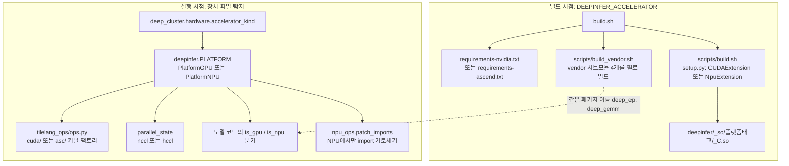

DeepInfer는 한 코드 트리로 NVIDIA SM100 GPU와 Huawei Ascend 950 NPU를 함께 지원한다([`README.md#L33-L36`](https://github.com/deepseek-ai/DeepInfer/blob/a679bb86ce36e883a98a97733492b686e5b9a08e/README.md#L33-L36)). 갈림길은 세 곳에 모여 있다. 빌드할 때 어느 커널 라이브러리를 설치하는가, 실행할 때 어느 `Platform` 객체를 만드는가, TileLang 커널을 어느 하위 폴더에서 가져오는가. 이 장은 이 세 갈림길과, 그래도 모델 코드 안에 남은 분기들을 정리한다.

## 이원화의 전체 구조

모델 코드가 `import deep_ep`, `import deep_gemm`을 플랫폼과 관계없이 그대로 쓸 수 있는 이유가 그림 아래쪽 점선이다. NVIDIA용과 Ascend용 서브모듈이 같은 Python 패키지 이름으로 설치된다.

## 정리

- 빌드는 `DEEPINFER_ACCELERATOR` 하나로 갈린다. requirements 파일, vendor 서브모듈 4개의 빌드 대상, `setup.py`의 확장 종류(`CUDAExtension`/`NpuExtension`)가 이 값을 따른다. 산출물은 `deepinfer/_so/<가속기>-<arch>/`에 따로 놓여 한 트리에 공존한다
- DeepEP와 DeepGEMM은 Ascend용 저장소를 따로 두지만 같은 패키지 이름(`deep_ep`, `deep_gemm`)으로 설치되어 모델 코드의 import와 호출이 하나로 유지된다
- 실행 시 `deep_cluster`가 장치 파일만 보고 가속기를 정하고, `deepinfer.PLATFORM`이 처음 접근할 때 `PlatformGPU`나 `PlatformNPU`를 만든다. NPU 쪽은 `transfer_to_npu`로 `torch.cuda` 호출을 NPU로 돌린다
- TileLang 커널은 `tilelang_ops/cuda`(43개 팩토리)와 `tilelang_ops/asc`(42개)에 두 벌 있고 `ops.py`가 고른다. Ascend 구현은 UB 복사와 SIMD 명령을 직접 적어 1.5배 길다
- Ascend에 아직 없는 vendor 함수(top-k 일부, ViT attention)는 `npu_ops.patch_imports`가 `builtins.__import__`를 바꿔 대체한다
- mega MoE의 일부 정밀도, mega gate, `symm_mem` EPLB 이동, batch invariant, PDL, graph 타이머는 NVIDIA 전용이다. 코드의 기준선은 NVIDIA이고 Ascend는 `is_npu` 제약과 `TODO(NPU)`로 따라오는 구조다
