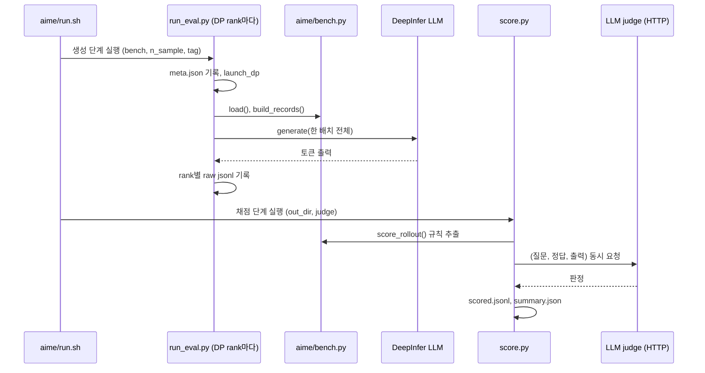

생성과 채점을 나눈 평가 도구를 본다.

## eval: 생성과 채점을 나눈 두 단계

`eval/README.md`는 구조를 이렇게 요약한다. 생성 단계는 모든 요청을 엔진에 한 배치로 넣고 원본 출력을 디스크에 쓰며, 채점 단계는 그 출력을 읽어 지표를 만든다. 그래서 judge를 바꿔 다시 채점해도 재생성이 필요 없다([eval/README.md L6-L9](https://github.com/deepseek-ai/DeepInfer/blob/a679bb86ce36e883a98a97733492b686e5b9a08e/eval/README.md#L6-L9)).



| 파일 | 역할 |
|---|---|
| `eval/run_eval.py` | 생성 진입점. 인자 처리, 환경 설정, DP rank별 샤딩, `llm.generate` 호출 |
| `eval/score.py` | 채점 진입점. rank별 출력 병합, judge 호출, coverage 확인, 요약 |
| `eval/common/loader.py` | `eval/<bench>/bench.py`를 모듈로 불러온다. 지원 목록은 `("aime", "hle", "gpqa")` |
| `eval/common/passk.py` | 비편향 Pass@k 추정기와 요약 |
| `eval/common/judge.py` | OpenAI 호환 `/chat/completions`로 judge 호출, 판정 파싱, 재시도 |
| `eval/common/encoder.py` | 체크포인트 안의 `encoding/encoding.py`를 불러 채팅 프롬프트를 렌더링 |
| `eval/common/paths.py`, `io.py` | 저장소 루트 탐지, JSONL 입출력 |
| `eval/<bench>/bench.py` | 프롬프트 구성, 답 추출, 규칙 채점 |
| `eval/<bench>/run.sh` | 생성 → 채점 두 단계 실행 스크립트 |

벤치마크마다 `bench.py`가 같은 함수 네 개(`load`, `build_records`, `score_rollout`, 그리고 내부의 답 추출)를 구현하면 `run_eval.py`와 `score.py`가 이름으로 찾아 쓴다. 새 벤치마크를 붙이려면 디렉터리 하나와 `SUPPORTED` 튜플 한 칸이면 된다([loader.py L9-L25](https://github.com/deepseek-ai/DeepInfer/blob/a679bb86ce36e883a98a97733492b686e5b9a08e/eval/common/loader.py#L9-L25)).

### 벤치마크별 기본값

무엇을 보는지: 벤치마크마다 샘플 수와 샘플링 설정.

[eval/run_eval.py L23-L27](https://github.com/deepseek-ai/DeepInfer/blob/a679bb86ce36e883a98a97733492b686e5b9a08e/eval/run_eval.py#L23-L27)

```python
BENCH_DEFAULTS = {
    "aime": {"n_sample": 32, "temperature": 1.0, "top_p": 1.0},
    "hle": {"n_sample": 1, "temperature": 1.0, "top_p": 1.0},
    "gpqa": {"n_sample": 8, "temperature": 1.0, "top_p": 1.0},
}
```

세 벤치마크 모두 temperature 1.0, top-p 1.0, top-k 끔이다. greedy가 아니라 분포에서 뽑은 샘플 여러 개의 평균 정확도로 Pass@1을 낸다. README 표 기준 문항 수는 AIME 2026 30개, HLE 2500개(텍스트 2158, 이미지 342), GPQA Diamond 198개다([eval/README.md L13-L17](https://github.com/deepseek-ai/DeepInfer/blob/a679bb86ce36e883a98a97733492b686e5b9a08e/eval/README.md#L13-L17)).

| 인자 | 기본값 | 의미 |
|---|---|---|
| `--reasoning-effort` | 100 | 1~100 정수 또는 `low` / `high` / `max`. 채팅 인코더에 그대로 전달 |
| `--max-len` | 147456 (`1024 * 144`) | 프롬프트 + 출력 길이 상한. `max_tokens = max_len - prompt_len` |
| `--ep` | 8 | expert parallel 크기 = 작업 전체 GPU 수 |
| `--cp` / `--dp` | 1 / `ep // cp` | context parallel, data parallel |
| `--max-num-seqs` | 384 | 엔진 동시 시퀀스 상한 |
| `--max-num-batched-tokens` | 32768 | 스텝당 토큰 상한 |
| `--decode-blacklist` | `0,2,129262..129264` | 생성 중 막을 토큰. 빈 문자열이면 끔 |
| `--batch-invariant` | 꺼짐 | `DEEPINFER_BATCH_INVARIANT=1`. 배치 구성과 무관한 결과, 느림 |

값은 [run_eval.py L46-L75](https://github.com/deepseek-ai/DeepInfer/blob/a679bb86ce36e883a98a97733492b686e5b9a08e/eval/run_eval.py#L46-L75)에 있다.

### 엔진 설정: 서빙 구성 기반 평가

무엇을 보는지: 평가 생성 시 켜는 엔진 기능.

[eval/run_eval.py L118-L133](https://github.com/deepseek-ai/DeepInfer/blob/a679bb86ce36e883a98a97733492b686e5b9a08e/eval/run_eval.py#L118-L133)

```python
def _setup_env() -> None:
    # MTP / DFlash speculative decoding, set before setup_common_env (which only setdefaults it).
    os.environ["DEEPINFER_USE_NEXTN_DECODE"] = "5"
    os.environ["DEEPINFER_ENABLE_MTP_VARLEN"] = "1"

    from examples._config import setup_common_env

    setup_common_env(model_name=args.model_name, sampler_force_topk=0, set_override_experts=True, enable_eplb=True)
    for item in args.env:
        key, _, value = item.partition("=")
        assert key and "=" in item, f"--env expects KEY=VALUE, got {item!r}"
        os.environ[key] = value
    if args.batch_invariant:
        os.environ["DEEPINFER_BATCH_INVARIANT"] = "1"
    if args.decode_blacklist:
        os.environ["DEEPINFER_DECODE_TOKEN_BLACKLIST"] = args.decode_blacklist
```

- MTP 5개 draft와 variable-length 검증, EPLB를 켠 상태로 생성한다. 평가 점수가 추측 디코딩 · expert 재배치를 포함한 실제 서빙 경로의 점수라는 뜻이다(MTP는 8장, EPLB는 7장)
- `sampler_force_topk=0`으로 vocab 전체에서 샘플링한다. force_topk는 분포를 자르는 근사라서(9장) 평가에서는 끈다
- `--env KEY=VALUE`로 엔진 생성 전에 임의 환경변수를 더 넣을 수 있다. 이 목록도 `meta.json`에 남는다

### 샤딩과 시드

무엇을 보는지: DP rank에 요청을 나누는 방식과 샘플별 시드.

[eval/run_eval.py L169-L174](https://github.com/deepseek-ai/DeepInfer/blob/a679bb86ce36e883a98a97733492b686e5b9a08e/eval/run_eval.py#L169-L174)

```python
    bench = load_bench(args.bench)
    problems = bench.load(args.data_file)
    records = bench.build_records(problems, limit=args.limit)

    # Shard by sample so every rank gets an equal share and no rank inherits a problem's long tail.
    plan = [(problem, sample) for problem in range(len(records)) for sample in range(args.n_sample)][dp_rank::dp_size]
```

- 문항 단위가 아니라 (문항, 샘플) 쌍 단위로 round-robin한다. 한 문항의 샘플 32개가 여러 rank에 흩어지므로, 출력이 유독 긴 문항이 한 rank에 몰려 전체 종료를 늦추는 일이 줄어든다
- 시드는 `(문항 번호 × n_sample + 샘플 번호) mod 2^64`다([L136-L138](https://github.com/deepseek-ai/DeepInfer/blob/a679bb86ce36e883a98a97733492b686e5b9a08e/eval/run_eval.py#L136-L138)). 9장에서 본 해시 난수 때문에 시드가 같으면 출력도 같아서, 샘플마다 시드를 다르게 줘야 한다는 주석이 붙어 있다
- rank 수가 요청 수보다 많아 빈 샤드를 받은 rank는 빈 `raw_rank###.jsonl`을 쓰고 끝낸다([L199-L205](https://github.com/deepseek-ai/DeepInfer/blob/a679bb86ce36e883a98a97733492b686e5b9a08e/eval/run_eval.py#L199-L205))

이미지 문항이 섞여 있으면 프롬프트를 문자열로 넘기고, 데이터셋의 `<image>` 자리를 엔진이 쓰는 이미지 토큰 문자열로 바꾼 뒤 `multi_modal_data`(이미지 바이트와 크기)를 요청마다 복사해 넣는다. 엔진이 `multi_modal_data`를 제자리에서 소비하기 때문이다([L211-L221](https://github.com/deepseek-ai/DeepInfer/blob/a679bb86ce36e883a98a97733492b686e5b9a08e/eval/run_eval.py#L211-L221)). 텍스트만 있으면 토큰 id를 직접 넘긴다. 엔진 쪽 이미지 처리는 9장 끝에서 다뤘다.

### 답 추출: 벤치마크별 규칙

| 벤치마크 | 프롬프트 지시 | 규칙 추출 | 대체 경로 |
|---|---|---|---|
| AIME | `\boxed{}`에 최종 답 | 마지막 `\boxed{...}` | `</think>` 뒤(없으면 끝 400자)의 마지막 0~999 정수 (`tail_number`) |
| GPQA | 마지막 줄을 `ANSWER: $LETTER` 형식으로 | 줄머리 `ANSWER:` 뒤 A~D | `\boxed{X}`, 그다음 `</think>` 뒤(없으면 끝 400자)의 단독 A~D 문자 |
| HLE | 공식 3단 형식 (Explanation, Answer, Confidence) | 마지막 `Answer:` 줄 | 없음 |

무엇을 보는지: AIME 답 추출이 어느 경로로 나왔는지 기록하는 방식.

[eval/aime/bench.py L127-L136](https://github.com/deepseek-ai/DeepInfer/blob/a679bb86ce36e883a98a97733492b686e5b9a08e/eval/aime/bench.py#L127-L136)

```python
    boxed = extract_boxed(text)
    if boxed is not None:
        norm = normalize_answer(boxed)
        if norm:
            return norm, "boxed"
    tail = text.rsplit("</think>", 1)[-1] if "</think>" in text else text[-_TAIL_CHARS:]
    nums = _NUMBER_RE.findall(tail)
    if nums:
        return normalize_answer(nums[-1]), "tail_number"
    return None, "none"
```

추출 경로(`extract_source`)는 rollout마다 남고, `score.py`가 경로별 개수를 요약에 따로 보고한다. 대체 경로는 docstring이 "higher risk"라고 표시한 경로라, 비율이 높으면 점수를 의심해야 한다([L118-L126](https://github.com/deepseek-ai/DeepInfer/blob/a679bb86ce36e883a98a97733492b686e5b9a08e/eval/aime/bench.py#L118-L126)). 끝 400자만 보는 이유는 추론 본문에 숫자가 많아 중간 초안의 값을 잘못 집기 쉽기 때문이다([L113-L115](https://github.com/deepseek-ai/DeepInfer/blob/a679bb86ce36e883a98a97733492b686e5b9a08e/eval/aime/bench.py#L113-L115)).

## score: 채점과 결과 검증

### 두 가지 judge

| 모드 | 방법 | 결정성 |
|---|---|---|
| `llm` (기본) | judge 모델이 추출 답과 정답의 동치 여부를 판정 | judge 모델 샘플링에 좌우 |
| `rule` | 고정 규칙 추출 + 정확 비교 | 완전 결정적 |

기본은 세 벤치마크 모두 `llm`이다([score.py L23-L24](https://github.com/deepseek-ai/DeepInfer/blob/a679bb86ce36e883a98a97733492b686e5b9a08e/eval/score.py#L23-L24)). HLE는 `rule`을 아예 거부한다. 답의 절반 넘게가 자유 서술이라 정확 일치는 같은 뜻의 다른 표현을 틀렸다고 처리해 점수를 체계적으로 낮춘다는 이유다([score.py L45-L51](https://github.com/deepseek-ai/DeepInfer/blob/a679bb86ce36e883a98a97733492b686e5b9a08e/eval/score.py#L45-L51), [README L165-L167](https://github.com/deepseek-ai/DeepInfer/blob/a679bb86ce36e883a98a97733492b686e5b9a08e/eval/README.md#L165-L167)).

judge 입력도 벤치마크마다 다르다. HLE는 공식 프로토콜대로 `</think>` 앞 생각 부분만 버리고 나머지를 자르지 않고 보낸다. AIME · GPQA는 `</think>` 뒤에서 마지막 10문단, 마지막 4000자만 보낸다([score.py L61-L65](https://github.com/deepseek-ai/DeepInfer/blob/a679bb86ce36e883a98a97733492b686e5b9a08e/eval/score.py#L61-L65), [judge.py L167-L170](https://github.com/deepseek-ai/DeepInfer/blob/a679bb86ce36e883a98a97733492b686e5b9a08e/eval/common/judge.py#L167-L170)).

무엇을 보는지: judge 응답에서 판정을 읽는 범위.

[eval/common/judge.py L249-L262](https://github.com/deepseek-ai/DeepInfer/blob/a679bb86ce36e883a98a97733492b686e5b9a08e/eval/common/judge.py#L249-L262)

```python
                choice = response.json()["choices"][0]
                message = choice.get("message") or {}
                # Read only `content`: a thinking model puts its draft in `reasoning_content`,
                # and a phrase such as "correct: no" there must not be taken as the verdict.
                text = (message.get("content") or "").strip()
                if kind == "hle":
                    judge_correct, verdict_unparsed = parse_hle_judge(text) if text else (False, True)
                    return {
                        "judge_correct": judge_correct,
                        "judge_raw": text,
                        "judge_parsed": bool(text),
                        "judge_verdict_unparsed": verdict_unparsed,
                        "judge_finish_reason": choice.get("finish_reason"),
                    }
```

- judge가 thinking 모델이면 초안이 `reasoning_content`에 들어가므로 `content`만 읽는다
- 요청은 `EVAL_JUDGE_ATTEMPTS`(기본 3)번까지 지수 대기로 재시도하고, 타임아웃은 `EVAL_JUDGE_TIMEOUT`(기본 600초), 응답 길이 상한은 65536 토큰이다([judge.py L161-L164](https://github.com/deepseek-ai/DeepInfer/blob/a679bb86ce36e883a98a97733492b686e5b9a08e/eval/common/judge.py#L161-L164)). 끝내 실패한 항목은 오답으로 세되 배치 전체는 멈추지 않는다
- HLE 판정은 `correct: yes/no` 정규식 → `answer: yes/no` → 문장 표현 순으로 세 번 시도하고, 모두 실패하면 `judge_verdict_unparsed`로 표시한다([judge.py L147-L156](https://github.com/deepseek-ai/DeepInfer/blob/a679bb86ce36e883a98a97733492b686e5b9a08e/eval/common/judge.py#L147-L156))

LLM judge를 쓰면 규칙 판정도 같이 계산해 `rule_vs_llm_agreement`(두 방식이 일치한 rollout 비율)를 요약에 넣는다. README는 AIME 2026에서 두 방식이 960개 rollout 모두에서 일치했다고 적는다([eval/README.md L186-L188](https://github.com/deepseek-ai/DeepInfer/blob/a679bb86ce36e883a98a97733492b686e5b9a08e/eval/README.md#L186-L188)). 960은 30문항 × 32샘플이다.

### coverage: 누락 결과 표시

무엇을 보는지: 점수를 내기 전에 rollout 수를 확인하는 부분.

[eval/score.py L127-L144](https://github.com/deepseek-ai/DeepInfer/blob/a679bb86ce36e883a98a97733492b686e5b9a08e/eval/score.py#L127-L144)

```python
    # Coverage: missing rank files, problems or samples must be surfaced, never silently ignored.
    seen = {row["task_id"] for row in results}
    n_sample = int(meta.get("n_sample", max((row["sample_idx"] for row in results), default=0) + 1))
    missing = sorted(set(by_id) - seen)
    expected_rollouts = len(records) * n_sample
    coverage_complete = not missing and len(results) == expected_rollouts
    if not coverage_complete:
        print(
            f"[warn] incomplete coverage: {len(seen)}/{len(records)} tasks, {len(results)}/{expected_rollouts} "
            "rollouts; this is not a complete result",
            flush=True,
        )

    # Truncated rollouts and fallback extraction paths both depress the score, so surface them.
    finish_reasons = dict(Counter(str(row["finish_reason"]) for row in results if row.get("finish_reason")))
    extract_sources = dict(Counter(str(row["extract_source"]) for row in results if row.get("extract_source")))
    truncated = sum(finish_reasons.get(reason, 0) for reason in ("length", "prompt_length_exceeded"))
    invalid = sum(finish_reasons.get(reason, 0) for reason in ("ignored", "aborted", "error", "preempted"))
```

- rank 하나가 죽어 `raw_rank###.jsonl`이 빠지면 `coverage_complete`가 거짓이 된다. README는 이 값이 참일 때만 Pass@1이 유효하다고 적는다([L203-L204](https://github.com/deepseek-ai/DeepInfer/blob/a679bb86ce36e883a98a97733492b686e5b9a08e/eval/README.md#L203-L204))
- 길이 초과로 잘린 rollout(`length`, `prompt_length_exceeded`)과 비정상 종료(`ignored`, `aborted`, `error`, `preempted`)는 모두 오답으로 세지만 개수를 따로 보고한다. 9장에서 본 SO 요청의 preemption 종료도 여기서 `preempted`로 잡힌다
- 같은 `(task_id, sample_idx)`가 여러 rank 파일에 있으면 나중 것이 이긴다([L27-L40](https://github.com/deepseek-ai/DeepInfer/blob/a679bb86ce36e883a98a97733492b686e5b9a08e/eval/score.py#L27-L40))

### Pass@k 추정기

무엇을 보는지: Pass@k 계산식.

[eval/common/passk.py L8-L19](https://github.com/deepseek-ai/DeepInfer/blob/a679bb86ce36e883a98a97733492b686e5b9a08e/eval/common/passk.py#L8-L19)

```python
def estimator(num_samples: int, num_correct: int, k: int) -> float:
    """Unbiased Pass@k estimator: 1 - C(n-c, k) / C(n, k).

    (The Codex/HumanEval estimator.)
      * for k=1 it degenerates to c/n, the mean per-sample accuracy, i.e. the usual avg@n / Pass@1;
      * when n-c < k (too few wrong samples for a k-subset to be all-correct) it returns 1.0.
    """
    assert 0 <= num_correct <= num_samples, f"invalid num_correct={num_correct} num_samples={num_samples}"
    assert 0 <= k <= num_samples, f"invalid k={k} num_samples={num_samples}"
    if num_samples - num_correct < k:
        return 1.0
    return float(1.0 - math.prod(1.0 - k / i for i in range(num_samples - num_correct + 1, num_samples + 1)))
```

문항마다 샘플 $n$개 중 정답 $c$개일 때

$$\text{Pass@}k = 1 - \frac{\binom{n-c}{k}}{\binom{n}{k}} = 1 - \prod_{i=n-c+1}^{n}\left(1 - \frac{k}{i}\right)$$

이고, 문항 평균을 낸다. $k=1$이면 $c/n$이므로 Pass@1은 샘플 평균 정확도다. 코드는 이항계수를 직접 계산하지 않고 곱 형태로 써서 큰 $n$에서도 넘치지 않게 한다. 샘플 수가 k보다 적은 문항은 버리지 않고 $\min(k, n)$으로 근사하는데, 주석은 버리면 남는 "깨끗한" 문항이 대개 쉬운 문항이라 결과가 위로 치우친다는 이유를 든다([L29-L34](https://github.com/deepseek-ai/DeepInfer/blob/a679bb86ce36e883a98a97733492b686e5b9a08e/eval/common/passk.py#L29-L34)). 보고할 k 목록 기본값은 1, 2, 4, ... 2의 거듭제곱에 n_sample을 더한 것이다.

### 산출물과 참고 수치

| 파일 | 내용 |
|---|---|
| `meta.json` | 생성 시 전체 설정 (`mtp: 5`, `mtp_varlen: true` 포함) |
| `raw_rank###.jsonl` | rank별 원본 출력. 시드, 프롬프트 길이, 출력 토큰 수, `finish_reason`, 원문 |
| `scored.jsonl` | rollout별 추출 답, 판정, judge 원문 |
| `summary.json` | Pass@k, `coverage_complete`, `finish_reasons`, `extract_sources`, `rule_vs_llm_agreement`, 이미지 문항이 있으면 `by_modality` |

README가 기본 구성에서 V4.1 모델의 참고값으로 적은 Pass@1은 다음과 같다([eval/README.md L208-L221](https://github.com/deepseek-ai/DeepInfer/blob/a679bb86ce36e883a98a97733492b686e5b9a08e/eval/README.md#L208-L221)).

| 벤치마크 | Pass@1 (README 기재값) |
|---|---:|
| AIME 2026 | 99.9% |
| GPQA Diamond | 93.4% |
| HLE-Full | 42.6% |

> **주의**: README는 이 값을 "indicative rather than exact"라고 하고, 배포 구성이 맞는지 확인하는 sanity check 용도로 둔다. 같은 설정으로 다시 돌려도 생성의 확률성 때문에 조금 달라질 수 있다. 위 값은 이 책에서 재현하지 않았다.
