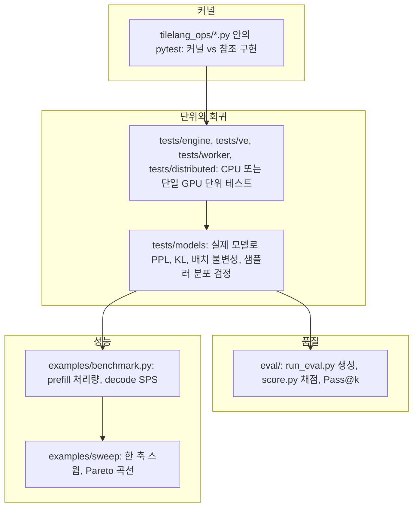

DeepInfer 저장소는 "정확한가"와 "빠른가"를 따로 잰다. 정확성은 `eval/`의 오프라인 벤치마크 평가(AIME 2026, HLE, GPQA Diamond)와 `tests/`의 회귀 테스트가 맡고, 속도는 `examples/benchmark.py`와 `examples/sweep/`이 맡는다. 이 장에서는 각 도구가 무엇을 어떻게 재는지, 그리고 수치를 해석할 때 코드가 어떤 전제를 깔고 있는지를 본다. 결과 수치는 저장소 문서에 적힌 것만 출처와 함께 옮긴다.

## 검증 도구의 층위

| 도구 | 묻는 질문 | 실행 단위 | 판정 방식 |
|---|---|---|---|
| 커널 테스트 | 커널이 참조 구현과 같은 값을 내는가 | 커널 하나 | 수치 비교, 분포 적합도 |
| `tests/` 단위 | 메타데이터 · 스케줄러 · 캐시 연산이 맞는가 | 함수 · 클래스 | assert |
| `tests/models` | 엔진 전체가 이전과 같은 출력을 내는가 | 다중 GPU 프로세스 | PPL 정확 일치, KL 상한, 통계 검정 |
| `eval/` | 모델 + 엔진이 기대 점수를 내는가 | 데이터셋 전체 | LLM judge 또는 규칙 |
| `benchmark.py` | 정상 상태에서 얼마나 빠른가 | 한 구성 | 측정창 평균 |
| `sweep/` | 배치 크기에 따라 처리량과 지연이 어떻게 바뀌는가 | 구성 여러 개 | Pareto 그림 |

## 정리

- 평가는 `run_eval.py`(생성)와 `score.py`(채점)로 나뉘어 judge만 바꿔 다시 채점할 수 있다. 생성은 MTP 5 · variable-length 검증 · EPLB를 켠 서빙 구성으로 돌고, force_topk는 끈다
- 요청은 (문항, 샘플) 쌍 단위로 DP rank에 round-robin하고, 샘플마다 다른 시드를 준다. 해시 난수 때문에 같은 시드는 같은 출력을 낸다
- 채점은 LLM judge가 기본이며 HLE는 규칙 채점을 거부한다. coverage, 잘린 rollout, 대체 추출 경로 비율을 요약에 따로 남겨 점수가 왜곡된 원인을 드러낸다. Pass@k는 Codex 비편향 추정기다
- README 기재 참고값은 AIME 2026 99.9%, GPQA Diamond 93.4%, HLE-Full 42.6%(Pass@1)이며 sanity check 용도로 제시된다
- `benchmark.py`는 prefill과 decode 측정을 떼고 EPLB 통계 flush 구간을 버린다. decode 처리량은 모든 draft 수락을 가정한 값이고, 스윕 그림은 사용자가 준 수락률로 $\tau = 1 + \text{nextn} \cdot a$를 곱해 환산한다
- 회귀 테스트는 PPL 정확 일치, KL 0, 배치 불변성처럼 비트 단위 재현을 요구하고, 샘플러는 randomized PIT + KS 검정으로 분포 자체를 검증한다
